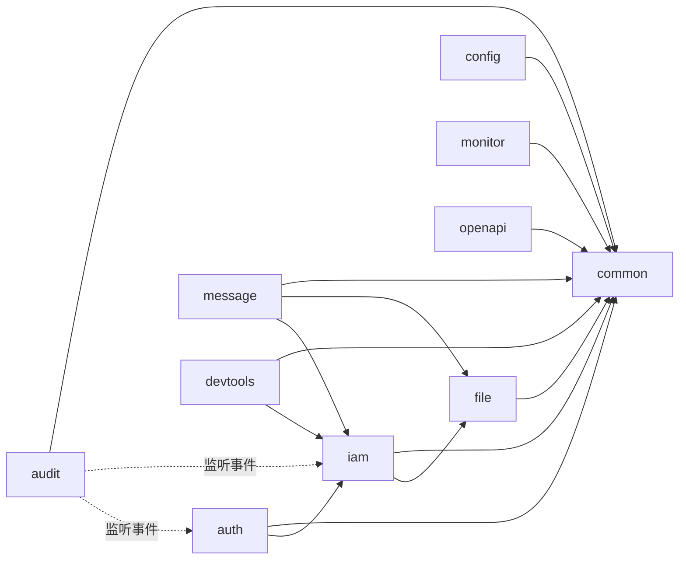

# Springboot Modulith Admin

Springboot Modulith Admin 是一套前后端分离的后台管理系统，产品能力参考 JBolt（组织权限、字典参数、日志审计、消息中心、开发平台），后端以 Spring Boot 4.1 + Spring Modulith 2.1 为底座。首版只支持 MySQL 8。

本文是项目的总纲：第 1 节确定底座基调，第 2～11 节是所有后端代码必须遵守的框架约束，其中标注“自动校验”的条目由测试强制执行，违反即构建失败。

> 方案与决策记录见 [docs/proposals](docs/proposals/README.md)（P01 改名、P02 mvnd 已实施；P03 i18n 已确认），开发计划与逐项验证记录见 [docs/development-progress.md](docs/development-progress.md)。

## 1. 底座基调

| 决策 | 内容 | 理由 |
|---|---|---|
| 系统形态 | 模块化单体：一个 Spring Boot 进程、一个 MySQL 库、一套前端 | 后台系统规模适中，单体部署和事务最简单；模块边界由 Spring Modulith 守住，将来可以按模块拆出服务 |
| 技术基线 | Java 21、Spring Boot 4.1.2、Spring Modulith 2.1.2、Spring Security 7.1、MyBatis-Plus 3.5.18.1、Flyway、MySQL 8.0+（开发用 8.4 LTS）、Jackson 3 | 均为当前稳定版；Modulith 2.1.2 正是基于 Boot 4.1.2 编译 |
| 前端 | Vue 3 + Vite + TypeScript + Element Plus + Pinia，独立工程 `frontend/` | 前后端分离，后端只提供 REST API |
| 模块即包 | 启动类所在包 `com.sma.admin` 的每个直接子包是一个应用模块；模块 id 是单个小写单词 | 模块 id 同时决定表前缀 `<id>_`、URL 前缀 `/api/<id>`、权限 key 前缀 `<id>:`，一处命名，全链路一致 |
| 对外即根包 | 模块根包放对外 API（接口、record DTO、事件），实现全部放在 `internal` | 编译器管不住 public 类型的越界引用，由 Modulith 校验兜底 |
| 协作方式 | 查询走对方模块的 API 接口；有副作用的联动走事件（`@ApplicationModuleListener` + 事件发布登记表） | 降低耦合，副作用失败可重试、可观测 |
| 数据所有权 | 每张表只属于一个模块，只能由该模块读写；表结构全部由 Flyway 管理 | 模块可以独立演进，避免跨模块 SQL |
| 安全 | 默认拒绝：每个接口必须显式声明访问策略，权限 key 由模块声明 | 延续 JBolt“未声明即无权访问”的做法，并在构建期检查 |
| 质量门禁 | `mvn verify` 运行 Modulith 结构校验 + 13 条架构规则 + 单元测试，Maven Enforcer 要求 JDK 21+ | 约束写进代码，不靠口头约定 |
| 构建工具 | 本地默认 `mvnd`（1.0.6，内置 Maven 3.9.16），标准构建 `mvnw`（同为 Maven 3.9.16） | 实测 `compile` 1.7s → 0.3s、`verify` 4.3s → 2.5s；两者同版本，本地仓库元数据一致 |
| 多租户 | 业务表从第一版起带 `tenant_id`，由 MyBatis-Plus 租户插件自动过滤与填充，首版只有默认租户 | 以后开启 SaaS 不需要改表 |
| 数据权限 | 角色配置数据范围（全部、本部门及下级、本部门、仅本人、自定义部门），按 `dept_id` / `created_by` 自动拼接查询条件 | 弥补 JBolt 没有数据权限的空白 |
| 多后台入口 | 用户与权限资源带 `portal` 字段（默认 `admin`），对应 JBolt 的“所属模块” | 一个系统可以有多个后台入口，各自管理用户和菜单 |
| 时间 | 数据库统一存 UTC；接口输出带偏移的 ISO-8601；用户有自己的时区（个人偏好 > 租户默认 > 浏览器），前端按用户时区显示，后端导出等服务端渲染按请求时区转换 | 跨国家用户看到本地时间 |
| 多语言 | 首批 zh-CN（默认）、en-US；用户录入数据首版只翻译菜单、字典、参数名称 | 见 P03 |
| 本版不做 | UReport 报表设计器、微信公众平台、七牛账号、敏感词词库、代码生成平台 | 按需求范围裁剪 |
| 另期实施 | hiprint 打印设计器、AI 数智化中心 | 先完成既有 P0～P4，2026-11-10 用户确认 |

## 2. 工程结构

```text
spring Modulith/
├─ backend/                         Spring Boot 工程（Maven Wrapper）
│  ├─ src/main/java/com/sma/admin/
│  │  ├─ SpringbootModulithAdminApplication.java  @Modulithic(sharedModules = "common")
│  │  ├─ common/                     共享内核
│  │  └─ auth/                       认证与会话（当前只有安全基线）
│  ├─ src/main/resources/
│  │  ├─ application.yml
│  │  └─ db/migration/__root/        公共表结构（事件发布表）
│  └─ src/test/java/com/sma/admin/
│     ├─ ModularityTests.java        Modulith 结构校验 + 生成模块文档
│     └─ architecture/ArchitectureRulesTests.java   项目级架构规则
├─ frontend/                        Vue 3 前端
├─ docs/                            研究资料与设计文档
└─ tools/                           研究脚本与环境安装脚本
```

## 3. 模块规划与依赖

| 模块 id | 名称 | 职责 | 允许依赖（allowedDependencies） | 状态 |
|---|---|---|---|---|
| common | 共享内核 | 统一响应、业务异常、访问控制注解、序列化、全局异常处理 | 无 | 已建 |
| auth | 认证与会话 | 登录、验证码、服务端令牌、在线用户、强制下线、锁屏、安全过滤链 | common、common :: security、common :: persistence、iam、config | P1 完成 |
| iam | 组织与权限 | 用户、部门、岗位、角色、权限资源（菜单/按钮）、角色授权、顶部导航、数据范围、个人资料与头像 | common、common :: security、common :: persistence、file | P1 完成，P3 扩展 |
| config | 系统配置 | 数据字典、全局参数、用户界面偏好 | common、common :: security、common :: persistence | P2 完成 |
| audit | 审计 | 登录日志、操作日志（只消费事件） | common、common :: security、common :: persistence、auth | P2 完成 |
| message | 消息中心 | 系统通知、已读、待办、私信、WebSocket 推送 | common、common :: security、common :: persistence、iam、file | P3 实施 |
| file | 文件 | 文件元数据、本地存储适配、受控下载、引用保护 | common、common :: security、common :: persistence | P3 实施 |
| monitor | 运维监控 | 服务器指标、缓存管理、事件发布管理（失败重试） | common、common :: security | 规划 |
| devtools | 开发工具 | 数据库文档（P3，首版由 monitor 提供） | common、common :: security | 后续按规模独立 |
| openapi | 开放平台 | 应用 AppId/Secret、签名、对外令牌 | common、common :: security | 规划 |



规则：依赖必须是有向无环图；被依赖最多的 `iam` 只能暴露只读查询接口，写操作留在 `iam` 内部；需要“由各模块声明、由某模块汇总”的能力（例如权限资源目录）放在 `common` 的命名接口里定义 SPI，避免所有模块反向依赖 `iam`。

## 4. 模块内部结构

```text
com.sma.admin.<module>
├─ package-info.java          @ApplicationModule(displayName = "...", allowedDependencies = { ... })
├─ XxxQuery / XxxApi          对外接口（只读查询或明确的命令）
├─ XxxDto / XxxView           对外数据（record）
├─ XxxCreatedEvent            对外事件（record）
└─ internal/
   ├─ web/                    @RestController，类名 *Controller
   ├─ service/                业务逻辑、事务边界、对外接口的实现、事件监听
   ├─ persistence/            MyBatis-Plus 实体（@TableName）与 *Mapper
   └─ (其他)                   配置类等，不属于三层的基础设施
```

需要对外多暴露一组类型时，在子包的 `package-info.java` 上加 `@NamedInterface("名称")`，依赖方写成 `"模块 :: 名称"`（如 `common :: security`）。

组件扫描与 Mapper 扫描统一使用 `FullyQualifiedAnnotationBeanNameGenerator`，允许不同模块有同名的内部类；显式 `@Bean` 方法仍应使用唯一名称，不开启 Bean 覆盖。

## 5. 框架约束清单

| 编号 | 约束 | 校验方式 |
|---|---|---|
| R0 | 模块间无循环依赖；不得引用其他模块的非公开类型（internal 及未暴露子包）；只能依赖 allowedDependencies 白名单中的模块和命名接口 | 自动：`ModularityTests.verifiesModularStructure`（Spring Modulith `verify()`） |
| R1 | 每个模块必须有 `package-info.java`，声明 `@ApplicationModule` 的 `displayName` 和显式 `allowedDependencies`；模块 id 必须是单个小写单词 | 自动：`modulesDeclareIdDisplayNameAndExplicitDependencies` |
| R2 | `common` 不得依赖任何业务模块 | 自动：`commonDoesNotDependOnBusinessModules` + R0 白名单为空 |
| R3 | 模块根包（对外 API）不得引用任何 `internal` 类型，实体、Mapper 不得出现在 API 签名中 | 自动：`moduleApiDoesNotExposeInternalTypes` |
| R4 | 模块内分层只能向下依赖：web → service → persistence；web 不得直接用 Mapper | 自动：`layersInsideModulesPointDownwards` |
| R5 | `@RestController` 必须位于 `internal.web`，类名以 `Controller` 结尾，类上 `@RequestMapping` 以 `/api/<模块id>` 开头 | 自动：`controllersLiveInWebLayerUnderModulePath` |
| R6 | 每个请求处理方法必须（在方法或类上）声明 `@RequiresPermission`、`@PermitLoggedIn` 或 `@PermitAnonymous` | 自动：`everyRequestHandlerDeclaresAnAccessPolicy` |
| R7 | 权限 key 格式为 `<模块id>:<资源>[:<动作>]`，且必须以所在模块 id 开头 | 自动：`permissionKeysAreScopedToTheirModule` |
| R8 | 请求处理方法返回 `ApiResponse`（文件下载等例外用 `ResponseEntity`） | 自动：`requestHandlersReturnUnifiedResponses` |
| R9 | Mapper 接口位于 `internal.persistence` 且以 `Mapper` 结尾；`@TableName` 实体位于 `internal.persistence`，表名以 `<模块id>_` 开头 | 自动：`persistenceTypesStayInsideTheirModule` |
| R10 | web 层不得声明 `@Transactional`，事务边界在 service | 自动：`transactionsAreNotOpenedInTheWebLayer` |
| R11 | 名称以 `Event` 结尾的类型必须是 record，且位于模块根包 | 自动：`eventsArePublicRecords` |
| R12 | 不得直接使用 `@TransactionalEventListener`，跨模块监听统一用 `@ApplicationModuleListener` | 自动：`crossModuleListenersUseApplicationModuleListener` |
| R13 | 禁止字段注入（只用构造器注入）、`System.out/err`、`java.util.logging`、Joda-Time、`java.util.Date` 等旧时间类 | 自动：`generalCodingRules` |
| R14 | 构建必须使用 JDK 21+、Maven 3.9+ | 自动：Maven Enforcer |
| C1 | 一个模块只读写自己前缀的表；禁止跨模块 SQL、跨模块 join、跨模块外键；需要别的模块的数据时调用其 API，或在本模块保存快照字段 | 代码评审 |
| C2 | 表结构只能通过 Flyway 变更：公共表放 `db/migration/__root`，模块表放 `db/migration/<模块id>`，版本号在模块内独立递增，禁止修改已发布的脚本 | 代码评审 + Flyway 校验和 |
| C3 | 对外 API 只返回 record DTO，不返回实体；DTO 不携带密码、盐等敏感字段 | 代码评审（R3 拦截引用实体的情况） |
| C4 | 事件只携带标识和必要的快照数据，不携带实体或可变对象；监听器必须幂等（失败会被重新投递） | 代码评审 |
| I1 | `BizException` 只接受 `ErrorCode` 与插值参数 | 编译期构造器签名 |
| I2 | 后端语言包放在 `i18n/<模块id>/`，key 以模块 id 开头 | 自动：`I18nBundlesTests` |
| I3 | zh-CN 与 en-US 的 key、插值占位符集合一致 | 自动：`I18nBundlesTests` |
| I4 | 每个错误码在所有语言中都有文案 | 自动：`I18nBundlesTests` |
| I5 | 前端语言包 key 与占位符一致，模板显示文本及 label/placeholder/title/aria-label/alt 必须翻译（语言自称和时区标识除外） | 自动：`i18n:check`、ESLint `no-raw-text` |
| T1 | 业务时间使用 `Instant`、MySQL `DATETIME(3)` 存 UTC，JDBC 会话固定 UTC；自然日查询先按 IANA 时区转换成半开 UTC 范围 | 自动：`UtcStorageTests`、`TimeRangeTests` |
| P1 | 业务实体继承 `common :: persistence` 的 `TenantEntity`；租户由认证上下文获取，插入强制填充，更新不可更换；超管同样受租户隔离 | 自动：`PersistenceTests` |
| P2 | 插件顺序：防全表更新 → 租户 → 数据权限（P0-7）→ 分页；未知 MyBatis 表不自动豁免租户隔离 | 自动：`PersistenceTests` |
| P3 | 分页最多 200 条，排序列从服务端白名单取得；树输入拒绝环和重复 ID | 自动：`PersistenceTests` |

后台启动/系统任务未携带认证时使用默认租户 `1`、操作者 `0`；HTTP API 由安全链要求登录。租户 ID 不从请求头取值，业务代码不得直接使用未经插件保护的 JDBC 读写业务表。系统级事件表由 Modulith 自身的 JDBC 管理，不经过业务 Mapper。

需数据隔离的 Mapper 声明 `@DataScoped(table = "模块_表名")`，可指定部门列和所有者列（无此列时置空）。认证模块将角色的 ALL / DEPARTMENT_TREE / DEPARTMENT / SELF / CUSTOM 展开成 `DataAccess`（全部、部门 ID 集合、本人），多个角色取并集。插件把授权条件与已有查询条件分组后取交集，同时保护更新、逻辑删除与分页总数；空授权得到零行。系统上下文与超管豁免数据范围，始终保留租户隔离。角色范围展开与权限变更后的会话刷新在 P1 实现。

组织结构写事务先锁定本租户的 `iam_structure_lock` 行，避免并发移动形成环；只能在拥有完整子树的数据范围时移动/删除节点。业务唯一编码通过 `(tenant_id, active_code)` 约束，`active_code` 为未删除记录的生成列，逻辑删除后允许重复创建和删除。

模块通过 `PermissionCatalog` SPI 声明菜单与按钮，使用本模块语言包提供 `nameKey`。启动时 IAM 汇总目录并扫描 `@RequiresPermission` 补齐逻辑权限，只新增缺失项，保留管理员设置。内置权限 key、类型不可更改或删除；自定义菜单名保存在 IAM 自己的翻译表中，按当前语言的自定义翻译 > `nameKey` > 默认名称回退。首版自动同步默认租户及 admin portal，后续租户开通流程复用同一目录。

认证使用 256 位随机 Bearer 令牌，数据库仅存 SHA-256 哈希；普通会话 8 小时、保持登录 7 天，均可配置。验证码两分钟且尝试即消费；单终端登录由账号行锁和事务保证。每个请求重新计算当前账号的有效权限和数据范围。账号凭据版本与会话绑定，改密/账号管理更新会使旧会话立即失效，不能依赖时间戳比较。登录事件在事务中发布以接入 Modulith 审计；首版登录限流在单实例内存中，集群部署时需迁移到共享存储。账号查询不会向其他模块返回密码哈希。

锁屏由服务端会话状态执行，锁定时仅允许 me、解锁、退出；接口返回 423。`sma.auth.auto-lock-after` 默认零（关闭），`password-notice-days` 默认零（关闭提醒）。异步模块监听使用 `TenantScope.within(event.tenantId(), ...)` 恢复可信事件的租户，凭据版本小于事件版本的会话才被清理，避免误删较新的登录。

系统参数由 Config 模块的 `ParameterQuery` 提供类型化查询。数据库配置优先于认证属性默认值；会话时长只影响新签发的会话。缓存带租户和版本，保存提交后刷新；公开接口只返回 `public_readable=true AND secret=false` 的值，管理列表的敏感值返回空，编辑时空值表示保留。参数名称可翻译，参数值保持原始业务数据。

个人偏好由 Config 独立维护，认证通过 `PreferenceQuery` 返回有效设置，保存偏好不改变账号凭据版本。个人时区优先于 IAM 中的账号默认；可选 `system.timeZone` 参数提供租户默认，未设置时由前端使用浏览器时区再回退 UTC。国家不是时区的唯一依据，使用 IANA 时区以正确处理多时区国家和夏令时。

文件二进制使用服务端随机存储键，原文件名只作展示；默认 20 MiB 上限。PNG/JPEG/GIF 必须成功解码且不超过 2500 万像素才可预览，其他文件一律附件下载。所有下载要求登录并校验租户、portal、所有者/管理数据范围或引用模块贡献的 `FileAccessPolicy`；禁止公开直连存储目录。上传回滚清理二进制，逻辑删除保留二进制但立即阻止下载。引用前经 FileQuery 验证所有权并锁住文件记录，删除同样锁记录并检查引用。头像由 IAM 保存文件 ID、贡献读取及引用保护策略；策略只查询本模块 Mapper，避免与文件服务形成依赖循环。个人资料更新不提升凭据版本。

系统通知通过 IAM 的 `AudienceQuery` 展开接收人，并在发布时保存快照；全部指发布者可见数据范围内的有效用户。管理列表按发布者部门/本人数据权限过滤，个人收件箱按接收关系授权。已读时间首次写入后保留，编辑只变更接收人差集；回收站保留阅读与附件引用，恢复不重置阅读状态。正文用 jsoup 安全 HTML 白名单清洗，附件通过 FileAccessPolicy 授权。详细协同约定见 [docs/message-design.md](docs/message-design.md)。

关键操作日志由 Common 的 MVC 拦截器捕获带 `@RequiresPermission` 的写请求；登录即可的关键写操作显式加 `@AuditAction`。只记录操作者、动作、目标 ID、路径、结果码、耗时和设备，不记录请求体、查询参数、认证头或响应内容。事件在独立事务中发布，由 Audit 的 `@ApplicationModuleListener` 幂等写入。文案使用 `<模块>.audit.<资源>.<动作>` 与目标 ID 参数，保存中文快照，查询时按语言重新渲染；目标回跳地址仅由受控路径和 ID 构成。

规则对“还没有出现的代码”放行，一旦出现对应类型就开始约束。R0～R12 以及 R13 中的字段注入、标准输出两项，都用故意违规的代码验证过会报错（验证代码已删除）；R13 其余三项直接使用 ArchUnit 内置规则。

## 6. 模块间协作

查询用对方模块根包里的接口：

```java
// iam 模块根包：对外只读查询
public interface UserQuery {
    Optional<UserView> findById(long userId);
}
public record UserView(long id, String username, String name, Long deptId) { }
```

副作用用事件，发布方只管发布，订阅方用 `@ApplicationModuleListener`（异步、新事务、原事务提交后才执行，并写入事件发布登记表）：

```java
// iam 模块根包
public record UserCreatedEvent(long userId, String username) { }

// iam.internal.service
@Transactional
public long create(CreateUserCommand command) {
    // ... 保存用户
    events.publishEvent(new UserCreatedEvent(id, command.username()));
    return id;
}

// audit.internal.service
@ApplicationModuleListener
void on(UserCreatedEvent event) { /* 写操作日志，必须幂等 */ }
```

需要“要么全部成功要么全部失败”的强一致联动时，改用同步调用对方 API，不要用事件。

## 7. 数据与持久化约定

- 数据库：MySQL 8.0+，`utf8mb4` / `utf8mb4_0900_ai_ci`，InnoDB。首版只写 MySQL 方言，SQL 只出现在 Mapper 中，便于以后扩展其他数据库。
- 表名：`<模块id>_<实体>`，例如 `iam_user`、`config_dictionary`、`audit_login_log`；多对多关联表 `iam_user_role`。框架表（`EVENT_PUBLICATION`、`flyway_schema_history*`）除外。
- 主键：`id BIGINT`，MyBatis-Plus 雪花算法（`id-type: assign_id`）。JSON 中所有 Long 输出为字符串，防止前端精度丢失（已实现：`JacksonConfiguration`）。
- 通用字段：`tenant_id BIGINT`（租户，默认 1）、`created_at DATETIME(3)`、`created_by BIGINT`、`updated_at DATETIME(3)`、`updated_by BIGINT`、`deleted TINYINT(1)`（逻辑删除）。布尔一律 `TINYINT(1)`，不用 JBolt 的 `char(1)`。框架级、全局性的表（如权限资源同步表、事件表）可以不带 `tenant_id`，须在租户插件中显式列为忽略表。
- 时间：`DATETIME(3)` 一律存 UTC，Java 侧用 `Instant`；JDBC 连接固定会话时区为 UTC（`connectionTimeZone=UTC&forceConnectionTimeZoneToSession=true`），与服务器时区无关。
- 数据权限字段：需要数据范围控制的表带 `dept_id`（归属部门）与 `created_by`（归属人），由数据权限插件使用。
- 多对多一律用关联表，不用 JBolt 的逗号分隔字符串；唯一性用唯一索引保证（如 username、权限 key、字典类型+编码）。
- 业务时刻用 `Instant`，自然日用 `LocalDate`；`LocalDateTime` 只用于显式的本地日历计算，不能作为跨时区业务时刻入库（R13 禁止 `java.util.Date`）。

## 8. Web API 约定

- 路径：`/api/<模块id>/<资源复数>`，例如 `GET /api/iam/users`、`POST /api/iam/users`、`PUT /api/iam/users/{id}`、`DELETE /api/iam/users/{id}`；动作型操作用子资源，例如 `PUT /api/iam/users/{id}/enabled`、`PUT /api/iam/users/{id}/password`。
- 响应体：`ApiResponse { code, message, data }`，`code = 0` 表示成功。业务失败（`BizException`）返回 HTTP 200 + 非 0 code；参数校验失败 400；未登录 401；无权限 403；未知异常 500，不向前端暴露堆栈。
- 下拉选项、树、分页、启停、排序这类 JBolt 高频交互，统一做成标准接口形态（在实现第一个业务模块时放入 `common`）。

## 9. 安全与权限约定

- 过滤链：除健康检查外的所有请求都要求登录（无状态，不使用 Session、Basic、表单登录），未登录返回 401。
- 方法级授权使用 `common :: security` 中的三个注解（已实现，`AccessAnnotationsTests` 验证其行为）：
  - `@RequiresPermission("iam:user:create")`：需要指定权限，对应 JBolt `@CheckPermission`；
  - `@PermitLoggedIn`：登录即可，对应 JBolt `@UnCheck`；
  - `@PermitAnonymous`：无需登录，对应 JBolt `@Clear`，URL 还需在 auth 模块的公开路径中放行。
- 权限 key 在登录时作为用户的 authority 加载。超级管理员沿用 JBolt 语义：拥有“超管默认”标记的权限，再叠加所属角色的权限（不是无条件全权）。
- 权限资源（菜单、按钮）由各模块在代码中声明，启动时同步到数据库，注解里的 key 和数据库里的 key 出自同一处。
- 登录状态用服务端保存的不透明令牌，支持在线用户、强制下线、单终端登录、锁屏。

## 10. 事件约定

- 事件是模块根包里的 record，名称以 `Event` 结尾（R11），用过去式描述已发生的事实，例如 `UserCreatedEvent`、`RolePermissionsChangedEvent`。
- 在 service 的事务方法内通过 `ApplicationEventPublisher` 发布；订阅用 `@ApplicationModuleListener`（R12）。
- 事件发布登记表 `EVENT_PUBLICATION` 由 Flyway 创建（`db/migration/__root/V1__event_publication.sql`），框架自动建表已关闭。
- `application.yml` 已配置：完成后保留记录（`completion-mode: update`）、重启不自动重发（多实例安全）、发布/处理/重提交超过 10 分钟视为失败（每分钟检查）。失败事件由 monitor 模块提供页面重试。

## 11. 测试与质量门禁

| 层次 | 内容 |
|---|---|
| 结构 | `ModularityTests`：`ApplicationModules.verify()` + 生成 C4/UML 模块图与模块 Canvas 到 `backend/target/spring-modulith-docs` |
| 架构规则 | `ArchitectureRulesTests`：R1～R13 |
| 单元测试 | 例如 `AccessAnnotationsTests`、`JacksonConfigurationTests` |
| 模块集成测试 | 每个业务模块用 `@ApplicationModuleTest` 单独启动本模块，跨模块依赖用 `@MockitoBean`，异步事件用 `Scenario` API；数据库使用独立测试库（Docker 就绪后改用 Testcontainers） |
| 构建 | `mvnw verify` 依次执行 Enforcer、编译、全部测试、打包，任何一步失败即构建失败 |

## 12. 新增一个模块的步骤

1. 在 `com.sma.admin` 下新建包 `<id>`（单个小写单词），写 `package-info.java`：`displayName` + `allowedDependencies`。
2. 对外类型放根包：查询接口、record DTO、事件；实现放 `internal.service`。
3. 表结构写在 `src/main/resources/db/migration/<id>/V1__init.sql`，表名以 `<id>_` 开头。
4. 实体和 Mapper 放 `internal.persistence`；控制器放 `internal.web`，路径 `/api/<id>/...`，每个方法声明访问注解，权限 key 以 `<id>:` 开头。
5. 编写 `@ApplicationModuleTest`，运行 `mvnw verify`。
6. 如被其他模块依赖，更新本文第 3 节的依赖表和对方的 `allowedDependencies`。

## 13. 开发环境与常用命令

环境安装与当前状态见 [docs/dev-environment.md](docs/dev-environment.md)。用户级 `JAVA_HOME` 默认指向 JDK 8（运行 JBolt 用），后端需要 JDK 21：

```powershell
# 后端：本地默认 mvnd（守护进程固定使用 JDK 21，见 ~/.m2/mvnd.properties）
cd backend
mvnd verify                   # Enforcer + 全部测试 + 打包
mvnd spring-boot:run          # 启动，连接 127.0.0.1:3306/springboot_modulith_admin
mvnd --stop                   # 停止守护进程

# 标准构建（CI、首次构建、排查问题），需要 JDK 21
$env:JAVA_HOME = $env:JAVA21_HOME
.\mvnw.cmd verify

# 前端（Node 版本由 .nvmdrc 锁定）
cd frontend
npm install
npm run dev                   # http://127.0.0.1:5173，/api 代理到 8080
```

## 14. 文档索引

| 文档 | 内容 |
|---|---|
| [docs/jbolt-product-design.md](docs/jbolt-product-design.md) | JBolt 产品设计与功能地图（完整版） |
| [docs/development-progress.md](docs/development-progress.md) | 开发计划（P0～P4）与每个功能的验证记录 |
| [docs/proposals/](docs/proposals/README.md) | 方案与决策记录 |
| [docs/jbolt-research/](docs/jbolt-research/README.md) | JBolt 研究资料：底层能力、数据字典、接口清单、运行观察 |
| [docs/jbolt-capability-migration-plan.md](docs/jbolt-capability-migration-plan.md) | 从 JBolt 迁移产品能力的执行方案 |
| [docs/dev-environment.md](docs/dev-environment.md) | 开发环境安装、临时数据库、JBolt 参考环境 |

