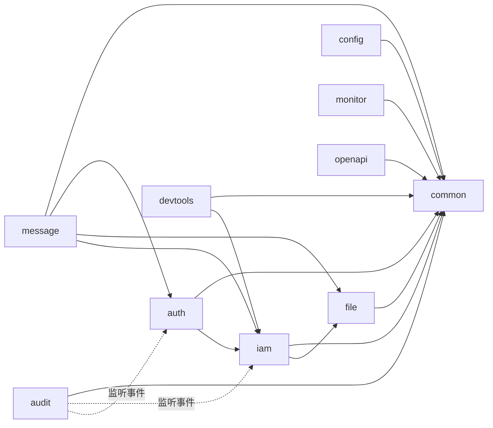

# Springboot Modulith Admin

安全专项已按用户授权开始，密码策略保持当前 P07。已本地验证 `/api` 写来源/简单表单门禁、URL 语法校验与 Mapper SQL 插值门禁、新版安全富文本与页面 CSP 观察策略；开发代理、生产域名和静态响应头配置见[运行说明](docs/security-defense-operations.md)。前后端防重复操作、攻击监控和诱捕告警尚按[专项进度](docs/security-defense-progress.md)逐项实施，不代表当前运行服务已升级。

请求治理已完成Config、IAM、消息与个人随手栏接口本地验收：写操作需要Idempotency-Key，同键重放只返回本人最小回执，快速换键还受默认500ms冷却限制。两套前端已补协议头；全站提交状态管理、UNKNOWN恢复与其他模块接入仍按专项计划推进，不能将此阶段当作全站防重复完成。

新版前端C1/C2已本地验收：显式原键、同步预留、3秒慢响应、元数据恢复及身份隔离；FilterBar输入防抖/中文组合输入、通用资源编辑/删除和上传原任务查询已接入。业务输入不写入恢复记录，UNKNOWN不自动重传。其余页面和跨标签交互按[前端安全进度](docs/security-frontend-progress.md)C3～C4继续推进，不能声明所有按钮已治理。随手栏入口移到顶部工具栏以避免遮住表格操作。

C3a已补配置维护、偏好/显示设置、个人资料、用户密码重置及角色授权/删除：同对象共享提交范围，未决表单保留内容并可查询，密码策略不变。消息、批量操作和模块原生任务仍按后续子项验收。

公告收件人纯读详情已提供`GET /api/message/notices/inbox/{id}`，只校验当前收件资格而不修改已读状态，供写操作回执确认后的安全重读。新版消息入口与批量目标保护已完成C3b本地验收；连点只发送原意图，未知正文冻结且仅查原键，已读确认后授权重读。工作台标签/便签也已补原键恢复且保留版本/创建键；品牌草稿与目录查LOCAL原回执，发布/域名检查查原生编号且支持刷新恢复；缓存任务已补刷新后的原预览/原键恢复与独立取消，排队/部分未知不当完成；规则模板发布和迁移批次已提供原键只读查询并通过43项后端验收；规则前端已补原键恢复、共享资产门禁及精确数值快照；插件、上传恢复与跨标签治理仍按C3c～C4推进。

规则、运行监控及开放应用管理已按LOCAL/QUERY/NATIVE分类验收；独立事务和原生任务保留自己的回执，运行时效果不伪装成同库原子操作。协议、并发预算和重试边界见上述运行说明；本地整合通过不等于已部署或已验证生产多节点。

认证、Socket票据及宿主插件入口已接入原生协议治理；原密码、OTP和机器签名规则保留。控制台查询与分片写入分别限流，正常独立会话/分片不共用冷却目标。文件上传已通过持久任务防重复及故障恢复专项：原键查询 `/api/file/uploads/lookup`，仅ACCEPTED可显式恢复，UNKNOWN不自动重传；确认回滚才清理二进制。协议和磁盘/部署验证边界见安全运行说明，其余并行模块继续按专项进度接入。

Springboot Modulith Admin 是一套前后端分离的后台管理系统，产品能力参考 JBolt（组织权限、字典参数、日志审计、消息中心、开发平台），后端以 Spring Boot 4.1 + Spring Modulith 2.1 为底座。首版只支持 MySQL 8。

租户/域名、品牌草稿、邮件账号/模板及应用身份后台配置已接入请求治理；平台目录继续校验部署指定的运维身份，品牌发布/回退与邮件取消保留原生回执。只写凭据参与输入指纹但不会返回或作为正文写入账本。后端接口接入B1～B6已按分轮快照本地验收，编译映射门禁拒绝未审查的新入口；当前[接口清单](docs/security-endpoint-inventory.md)及[客户端回执契约](docs/security-request-client-contract.md)供接入使用。前端统一交互正在实施，持续并行变化与生产部署边界见专项进度。

本文是项目的总纲：第 1 节确定底座基调，第 2～11 节说明后端框架约束，其中标注“自动校验”的条目由测试强制执行。开发代理从 [AGENTS.md](AGENTS.md) 开始，按任务读取专项规则。

> 方案与决策记录见 [docs/proposals](docs/proposals/README.md)（P01 改名、P02 mvnd 已实施；P03 i18n 已确认），开发计划与逐项验证记录见 [docs/development-progress.md](docs/development-progress.md)。较大需求按 [AGENTS.md 的逐项验收规则](AGENTS.md#较大需求先定方案逐项验收)推进。

P0～P4 的范围内代码与自动验证已完成；最终功能对照与待人工验收项见 [docs/acceptance.md](docs/acceptance.md)，部署与主密钥持久化见 [docs/deployment.md](docs/deployment.md)。P4-4 仍保留登录后浏览器人工巡检，不将自动测试等同于人工验收。

## 基座维护与二次开发

P08 正在建设统一缓存治理与多实例访问连续性：[方案与边界](docs/proposals/P08-cache-governance-and-cluster.md)、[逐项实施与验证](docs/cache-governance-progress.md)。公开缓存契约位于 `backend/src/main/java/com/sma/admin/common/cache/`；新增能力以进度证据为准，不能据方案宣称当前服务已支持 Redis 或集群。

P08 已支持 Local/Redis/None 配置切换，部署覆盖见[缓存运行说明](docs/cache-governance-operations.md)。Redis 需显式部署 namespace 和正数 maxmemory；现有缓存管理接口保留。完整应用多实例门禁尚未通过，`deployment-mode=multi` 仍拒绝启动。

已接入参数、字典选项、原始个人偏好及IAM部门/岗位/用户/菜单/导航展示，并自动显示在现有缓存目录；支持全局默认策略和区域覆盖，不能突破注册上限。基础数据已通过三种 provider 的隔离、回滚和真实命中专项，授权仍查权威数据；整体标准回归与分组治理页面按进度实施。

治理目录后端已提供 `/api/monitor/caches/directory` 和区域详情，支持分组/场景等交集筛选、策略来源与统计范围；旧清理入口也执行区域管理权限。S4a专项48项通过；持久策略、异步任务及四页签界面仍在后续阶段，未替换当前运行服务。

S4b已完成公开治理接口：暂停/恢复、运行策略、独立统计重置、版本冲突和同事务审计；目录展示当前进程已确认的有效策略。三后端运行层及HTTP拒绝路径通过分阶段专项；接口权限、用法和升级边界见[缓存运行说明](docs/cache-governance-operations.md)。批量任务、四页签和集群验收仍按专项进度推进，禁止直接操作内部表。

S4c1/c2已验证持久预览、幂等任务与HTTP接口（`/api/monitor/caches/tasks`）；后台执行前重查IAM授权，采用租约围栏、逐项原子结果，支持部分失败和取消。用法与分轮验证证据见缓存运行说明和专项进度。QUEUED不表示缓存已清理，APPLIED只代表逻辑提交；预热和统一四页签尚待后续，产物未部署。

S4c3a已验证部署节点清单、自动心跳和逐节点持久确认：确认与逻辑操作同事务发布，应用状态后复验进程租约及数据/控制版本。GET `/api/monitor/caches/nodes` 展示当前租约，任务 `/{id}/confirmation` 区分历史确认与当前在线；未知范围不补造证据，物理回收保持未测量。整合62/62及新增后台闭环1/1通过；尚非独立双JVM/LB验收，`deployment-mode=multi`仍拒绝启动。

S4c3b已验证注册预热与持久检查点（首轮70/70，最新回源限制复验58/58）。内置字典双语加载器要求独立预热权和业务读取权；None、暂停、私有及无加载器区域拒绝。任务限制条数/速率/时长，检查点核对权限、取消和版本，报告实际执行进程及已检查点读取次数。`sma.cache.tasks.warmup.enabled`默认关闭，须所有消费者升级后开启；具体预算和旧worker回退边界见运行说明。统一四页签进入S4d实施。

S4d已完成现有菜单四页签：目录按模块/分组/场景筛选并预览精确目标，概览区分共享条目与本进程统计，任务分别展示逻辑结果/历史确认/当前在线，策略保留来源/上限/冲突草稿。新版verify（111项单元）、生产浏览器8项及实际深色2项、隔离新旧前端真实联调通过；同身份会话刷新不清页签草稿。尚未部署，非DATA完整适配在S5，多实例/LB资格仍按M1～M3/S6验收。

S5a已验证二开真实模块归属与缓存实现依赖门禁：目录/加载器不能冒充他模块，业务缓存管理权使用自身前缀，直接Redis/Caffeine/Spring Cache依赖由架构检查拒绝。实际宿主整合39/39通过，独立业务编译与负例证据见进度；接入细则见[二开缓存契约](docs/cache-secondary-development.md)。

S5b已把规则运行对象、SQL统计、IP/文件资源和认证/票据等保护状态纳入统一目录及详情；原业务权限/ALL范围和租户隔离继续生效，未知统计不当零，保护/资源无普通变更按钮。后端真实整合39/39、前端完整verify与生产浏览器9/9通过；可执行运行时适配证据见下方S5c。

S5c已完成规则对象清理与SQL统计重置的原生协议：默认关闭`sma.cache.tasks.resources.enabled`，预览绑定进程，UNKNOWN不自动重做，原生结果不冒充全节点确认。后端整合65/65、兼容10/10、独立旧制品兼容1/1、前端生产10项及新增单区域专项、隔离新旧前端真实联调通过；开发Vite的ResizeObserver通知与生产验收分开记录。使用与回退见[运行说明](docs/cache-governance-operations.md)，二开约束见[接入契约](docs/cache-secondary-development.md)。正在继续M1共享票据/限流/会话加固，multi启动门禁仍未放开。

M1a一次性WebSocket票据已改为共享MySQL摘要/原子消费，租户与portal隔离、重发替换、有限容量和独立提交；原真实WS/HTTP回归及权威异常专项分轮通过。连接仍属于各自节点；跨节点推送、独立JVM互通和无粘性LB仍按M1d/M2/M3验收，不能把共享票据单项当成完整集群支持。

M1b机器登录预算已改为共享MySQL预占：来源60次/5分钟、来源＋AppId10次/5分钟，成功/失败不退款。平台容量10000项，摘要密钥独立加密持久化，密钥故障拒绝而非重置预算；不受缓存provider和清理影响。8项数据库故障/并发/容量专项与原机器认证/签名回归通过，平台表/接口清单门禁分轮通过；详情见P08进度与运行说明。

M1已完成14组真实双JVM互通验证：跨节点登录/锁屏/权限撤销、验证码/TOTP/WS票据一次消费、共享机器预算、八并发写入、停机与重启保持会话。验收同时修正了LOCAL受理容量锁的正常争用问题，保留有界等待和原幂等保护。共享主键机制及初次升级停写/回退约束见[补充方案](docs/proposals/P08-id-allocation.md)。正在实施M2跨节点推送、后台维护和共享文件；M3无粘性LB及完整multi部署仍未验收，不能直接据此部署集群。

普通缓存失效纳入同业务事务的 `common_cache_revision`，各节点独立核对已提交版本并补偿漏掉的快速通知；回滚不发布失效。新增 Common Flyway 迁移只在升级后的应用/隔离测试启动时执行，当前运行服务不会因源码改变自动升级。基础数据扩展、治理界面与负载均衡验收继续按专项进度推进。

回源并发和缓存锁等待通过 `sma.cache.resilience` 限制，额度不足返回双语 HTTP503；默认全局32个、每区域8个回源，锁等待100ms。None、事务绕过和版本核对失败也保留预算保护。Redis 已通过真实 TCP 断线/恢复及整应用事务专项；治理统计不可用时显示“暂时不可用”，不会当成零。HA拓扑与完整应用集群仍需专项证据。

**`main` 维护通用基座，可收录不参与构建的[网上商城空目录示例](examples/shop-layout/README.md)。** 真正开始二开时，从已确认的基座版本创建业务分支，例如 `biz/shop`。仍在同一个 `spring Modulith/` 项目下工作，基座与业务共享已有的后端、前端工程。

| 内容 | 在业务分支中的实际位置 |
|---|---|
| 商城 Controller | `backend/src/main/java/com/sma/business/shop/internal/web/`；`com/sma/business/` 与基座的 `com/sma/admin/` 同级 |
| 商城管理页面 | `frontend-next/src/business/shop/`；`src/business/` 与基座的 `src/features/` 同级 |
| 商城迁移与语言包 | `backend/src/main/resources/db/migration/shop/`、`backend/src/main/resources/i18n/shop/` |

开发时复用现有的 Spring Boot 和 Vue 启动入口；打包时用同一个业务分支的提交，构建一个后端 JAR 和一套前端静态文件。部署沿用现有 MySQL、后端进程和静态站点，业务表由宿主启动时的 Flyway 迁移。单体业务不需要新增 Maven 子工程、前端工程或 Java 进程。真正需要零重启替换实现时，再单独采用 P05 插件模式。

具体约束见[二次开发与包管理](docs/agent-rules/secondary-development.md)、[数据与配置](docs/agent-rules/data-and-configuration.md)、[基座升级与兼容](docs/agent-rules/platform-upgrades.md)和[插件与零重启发布](docs/agent-rules/extension-hot-reload.md)。

## 1. 底座基调

| 决策 | 内容 | 理由 |
|---|---|---|
| 系统形态 | 模块化单体：一个 Spring Boot 进程、一个 MySQL 库、一套前端 | 后台系统规模适中，单体部署和事务最简单；模块边界由 Spring Modulith 守住，将来可以按模块拆出服务 |
| 技术基线 | Java 21、Spring Boot 4.1.2、Spring Modulith 2.1.2、Spring Security 7.1、MyBatis-Plus 3.5.18.1、Flyway、MySQL 8.0+（开发用 8.4 LTS）、Jackson 3 | 均为当前稳定版；Modulith 2.1.2 正是基于 Boot 4.1.2 编译 |
| 前端 | 新版 `frontend-next/`：Vue 3 + shadcn-vue / Reka UI + Tailwind CSS 4，鸢尾紫柔光主题；旧 Element Plus `frontend/` 保留 | 独立 SPA，复用既有 REST / WebSocket 协议；新版见[运行说明](frontend-next/README.md) |
| 模块即包 | `com.sma.admin` 下放基座，`com.sma.business` 下放二开；两个包根的直接子包都是应用模块 | 模块 id 是全局唯一的小写单词，决定表前缀 `<id>_`、URL 前缀 `/api/<id>`、权限 key 前缀 `<id>:` |
| 对外即根包 | 模块根包放对外 API（接口、record DTO、事件），实现全部放在 `internal` | 编译器管不住 public 类型的越界引用，由 Modulith 校验兜底 |
| 协作方式 | 查询走对方模块的 API 接口；有副作用的联动走事件（`@ApplicationModuleListener` + 事件发布登记表） | 降低耦合，副作用失败可重试、可观测 |
| 数据所有权 | 每张表只属于一个模块，只能由该模块读写；表结构全部由 Flyway 管理 | 模块可以独立演进，避免跨模块 SQL |
| 安全 | 默认拒绝：每个接口必须显式声明访问策略，权限 key 由模块声明 | 延续 JBolt“未声明即无权访问”的做法，并在构建期检查 |
| 质量门禁 | `mvn verify` 运行 Modulith 结构校验 + 架构规则 + 单元/集成测试，Maven Enforcer 要求 JDK 21+ | 约束写进代码，不靠口头约定 |
| 构建工具 | 本地默认 `mvnd`（1.0.6，内置 Maven 3.9.16），标准构建 `mvnw`（同为 Maven 3.9.16） | 实测 `compile` 1.7s → 0.3s、`verify` 4.3s → 2.5s；两者同版本，本地仓库元数据一致 |
| 多租户 | 业务表从第一版起带 `tenant_id`，由 MyBatis-Plus 租户插件自动过滤与填充，首版只有默认租户 | 以后开启 SaaS 不需要改表 |
| 数据权限 | 角色配置数据范围（全部、本部门及下级、本部门、仅本人、自定义部门），按 `dept_id` / `created_by` 自动拼接查询条件 | 弥补 JBolt 没有数据权限的空白 |
| 多后台入口 | 用户与权限资源带 `portal` 字段（默认 `admin`），对应 JBolt 的“所属模块” | 一个系统可以有多个后台入口，各自管理用户和菜单 |
| 时间 | 数据库统一存 UTC；接口输出带偏移的 ISO-8601；用户有自己的时区（个人偏好 > 租户默认 > 浏览器），前端按用户时区显示，后端导出等服务端渲染按请求时区转换 | 跨国家用户看到本地时间 |
| 多语言 | 首批 zh-CN（默认）、en-US；用户录入数据首版只翻译菜单、字典、参数名称 | 见 P03 |
| 原 P0～P4 不做 | UReport 报表设计器、微信公众平台、七牛账号、敏感词词库、代码生成平台 | 原范围不变；Local/OSS/S3/R2 多存储与租户独立配置另按 P09 分阶段实施，以专项进度为准 |
| 另期实施 | hiprint 打印设计器、AI 数智化中心 | 先完成既有 P0～P4，2026-11-10 用户确认 |

## 2. 工程结构

```text
spring Modulith/
├─ backend/                         Spring Boot 工程（Maven Wrapper）
│  ├─ src/main/java/com/sma/
│  │  ├─ admin/                     基座包根
│  │  │  ├─ SpringbootModulithAdminApplication.java  唯一的宿主启动类
│  │  │  ├─ common/                 共享内核
│  │  │  ├─ iam/                    组织权限与个人资料
│  │  │  └─ ...                     auth、config、audit 等基座模块
│  │  └─ business/<bizid>/           业务包根下的独立模块，仅在实际二开时创建
│  ├─ src/main/resources/
│  │  ├─ application.yml
│  │  └─ db/migration/__root/        公共表结构（事件发布表）
│  └─ src/test/java/com/sma/admin/
│     ├─ ModularityTests.java        Modulith 结构校验 + 生成模块文档
│     └─ architecture/ArchitectureRulesTests.java   项目级架构规则
├─ frontend/                        旧版管理前端
├─ frontend-next/
│  ├─ src/features/                 基座管理页面
│  └─ src/business/<bizid>/          二开管理页面，仅在实际二开时创建
├─ examples/shop-layout/           空目录示例，不进入构建
├─ docs/                            研究资料与设计文档
└─ tools/                           研究脚本与环境安装脚本
```

## 3. 模块规划与依赖

| 模块 id | 名称 | 职责 | 允许依赖（allowedDependencies） | 状态 |
|---|---|---|---|---|
| common | 共享内核 | 统一响应、业务异常、访问控制注解、序列化、全局异常处理 | 无 | 已建 |
| auth | 认证与会话 | 登录、验证码、服务端令牌、在线用户、强制下线、锁屏、安全过滤链 | common、common :: security、common :: persistence、iam、config | P1 完成 |
| iam | 组织与权限 | 用户、部门、岗位、角色、权限资源（菜单/按钮）、角色授权、顶部导航、数据范围、个人资料与头像 | common、common :: security、common :: persistence、file | P1 完成，P3 扩展 |
| config | 系统配置 | 数据字典、全局参数、用户界面偏好 | common、common :: security、common :: persistence | P2 完成 |
| audit | 审计 | 登录日志、操作日志（只消费事件） | common、common :: security、common :: persistence、auth | P2 完成 |
| message | 消息中心 | 系统通知、已读、待办、私信、WebSocket 推送 | common、common :: security、common :: persistence、iam、file、auth | P3 完成 |
| mail | 事务邮件 | 租户账号配置、模板发布、加密队列、TLS SMTP、有界调度、签名回执与抑制 | common、common :: security、common :: persistence | 本地协议/持久任务/回执桥接验收完成；真实送达与厂商原生适配边界见 P09 进度 |
| identity | 应用身份 | 租户身份域、Google/邮箱身份、会话族、再认证与方式管理、公开主体/联系查询 | common、common :: security、common :: persistence、common :: cache、mail | HTTP/数据库/独立教学样例本地验收完成；真实Google/邮件待联调，见P09手册8.4～8.15及专项进度 |
| file | 文件 | 文件元数据、租户存储配置/场景、上传任务与本地分片、受控下载、引用保护 | common、common :: security、common :: persistence、common :: request、common :: cache | P3原契约保留；P09配置/场景/Local分片及公开上传HTTP已本地验收，仅到SCANNING；扫描/云适配边界见专项进度与手册11 |
| monitor | 运维监控 | 服务器指标、缓存管理、事件发布管理（失败重试）、数据库文档 | common、common :: security、common :: persistence | P3 完成 |
| workspace | 操作台 | 权限内统计和个人事项；个人标签与便签随手栏 | common、common :: security、common :: persistence、iam | P4及随手栏实现/验收完成，范围见专项进度 |
| devtools | 开发工具 | 数据库文档（P3，首版由 monitor 提供） | common、common :: security | 后续按规模独立 |
| openapi | 开放平台 | 应用 AppId/Secret、签名、对外令牌 | common、common :: security、common :: persistence | P4 鉴权完成 |



规则：依赖必须是有向无环图；被依赖最多的 `iam` 只能暴露只读查询接口，写操作留在 `iam` 内部；需要“由各模块声明、由某模块汇总”的能力（例如权限资源目录）放在 `common` 的命名接口里定义 SPI，避免所有模块反向依赖 `iam`。

## 4. 模块内部结构

```text
com.sma.admin.<module> / com.sma.business.<module>
├─ package-info.java          @ApplicationModule(displayName = "...", allowedDependencies = { ... })
├─ XxxQuery / XxxApi          对外接口（只读查询或明确的命令）
├─ XxxDto / XxxView           对外数据（record）
├─ XxxCreatedEvent            对外事件（record）
└─ internal/
   ├─ web/                    @RestController，类名 *Controller
   ├─ service/                业务逻辑、事务边界、对外接口的实现、事件监听
   ├─ persistence/            MyBatis-Plus 实体（@TableName）与 *Mapper
   └─ (其他)                   配置类等，不属于三层的基础设施
```

需要对外多暴露一组类型时，在子包的 `package-info.java` 上加 `@NamedInterface("名称")`，依赖方写成 `"模块 :: 名称"`（如 `common :: security`）。

宿主同时发现两个包根下的 Modulith 模块、Spring 组件和 MyBatis Mapper；没有业务包时仍可构建基座。组件扫描与 Mapper 扫描统一使用 `FullyQualifiedAnnotationBeanNameGenerator`，允许不同模块有同名的内部类；显式 `@Bean` 方法仍应使用唯一名称，不开启 Bean 覆盖。

## 5. 框架约束清单

| 编号 | 约束 | 校验方式 |
|---|---|---|
| R0 | 模块间无循环依赖；不得引用其他模块的非公开类型（internal 及未暴露子包）；只能依赖 allowedDependencies 白名单中的模块和命名接口 | 自动：`ModularityTests.verifiesModularStructure`（Spring Modulith `verify()`） |
| R1 | 模块是 `com.sma.admin` 或 `com.sma.business` 的直接子包；id 等于包名末段，是全局唯一的小写单词。`package-info.java` 声明 `@ApplicationModule` 的 `displayName` 和显式 `allowedDependencies`；业务类必须归入已发现的业务模块 | 自动：`modulesDeclareIdDisplayNameAndExplicitDependencies`、`businessClassesBelongToANamedModule` |
| R2 | `common` 不依赖其他应用模块，整个基座不直接引用具体业务类型；业务通过基座公开契约或 SPI 接入 | 自动：`commonDoesNotDependOnBusinessModules`、`platformDoesNotDependOnConcreteBusinessModules` |
| R3 | 模块根包（对外 API）不得引用任何 `internal` 类型，实体、Mapper 不得出现在 API 签名中 | 自动：`moduleApiDoesNotExposeInternalTypes` |
| R4 | 模块内分层只能向下依赖：web → service → persistence；web 不得直接用 Mapper | 自动：`layersInsideModulesPointDownwards` |
| R5 | `@RestController` 必须位于 `internal.web`，类名以 `Controller` 结尾，类上 `@RequestMapping` 以 `/api/<模块id>` 开头；唯一例外为 `openapi.internal.web.OpenController` 使用 `/open`，独立应用鉴权链 | 自动：`controllersLiveInWebLayerUnderModulePath` |
| R6 | 每个请求处理方法必须显式声明访问策略：后台 `@RequiresPermission`/`@PermitLoggedIn`、公开 `@PermitAnonymous`；应用用户 `@PermitApplicationUser`（精确 audience）、机器 `@PermitMachine` | 自动：`everyRequestHandlerDeclaresAnAccessPolicy`，身份拒绝路径另由 P09 专项验证 |
| R7 | 权限 key 格式为 `<模块id>:<资源>[:<动作>]`，且必须以所在模块 id 开头 | 自动：`permissionKeysAreScopedToTheirModule` |
| R8 | 请求处理方法返回 `ApiResponse`（文件下载等例外用 `ResponseEntity`） | 自动：`requestHandlersReturnUnifiedResponses` |
| R9 | Mapper 接口位于 `internal.persistence` 且以 `Mapper` 结尾；`@TableName` 实体位于 `internal.persistence`，表名以 `<模块id>_` 开头 | 自动：`persistenceTypesStayInsideTheirModule` |
| R10 | web 层不得声明 `@Transactional`，事务边界在 service | 自动：`transactionsAreNotOpenedInTheWebLayer` |
| R11 | 名称以 `Event` 结尾的类型必须是 record，且位于模块根包 | 自动：`eventsArePublicRecords` |
| R12 | 不得直接使用 `@TransactionalEventListener`，跨模块监听统一用 `@ApplicationModuleListener` | 自动：`crossModuleListenersUseApplicationModuleListener` |
| R13 | 禁止字段注入（只用构造器注入）、`System.out/err`、`java.util.logging`、Joda-Time、`java.util.Date` 等旧时间类 | 自动：`generalCodingRules` |
| R14 | 构建必须使用 JDK 21+、Maven 3.9+ | 自动：Maven Enforcer |
| C1 | 一个模块只读写自己前缀的表；禁止跨模块 SQL、跨模块 join、跨模块外键；需要别的模块的数据时调用其 API，或在本模块保存快照字段 | 代码评审 |
| C2 | 表结构只能通过 Flyway 变更：公共表放 `db/migration/__root`，模块表放 `db/migration/<模块id>`，版本号在模块内独立递增，禁止修改已发布的脚本 | 代码评审 + Flyway 校验和 |
| C3 | 对外 API 只返回 record DTO，不返回实体；DTO 不携带密码、盐等敏感字段 | 代码评审（R3 拦截引用实体的情况） |
| C4 | 事件只携带标识和必要的快照数据，不携带实体或可变对象；监听器必须幂等（失败会被重新投递） | 代码评审 |
| I1 | `BizException` 只接受 `ErrorCode` 与插值参数 | 编译期构造器签名 |
| I2 | 后端语言包放在 `i18n/<模块id>/`，key 以模块 id 开头 | 自动：`I18nBundlesTests` |
| I3 | zh-CN 与 en-US 的 key、插值占位符集合一致 | 自动：`I18nBundlesTests` |
| I4 | 每个错误码在所有语言中都有文案 | 自动：`I18nBundlesTests` |
| I5 | 前端语言包 key 与占位符一致，模板显示文本及 label/placeholder/title/aria-label/alt 必须翻译（语言自称和时区标识除外） | 自动：`i18n:check`、ESLint `no-raw-text` |
| T1 | 业务时间使用 `Instant`、MySQL `DATETIME(3)` 存 UTC，JDBC 会话固定 UTC；自然日查询先按 IANA 时区转换成半开 UTC 范围 | 自动：`UtcStorageTests`、`TimeRangeTests` |
| P1 | 业务实体继承 `common :: persistence` 的 `TenantEntity`；租户由认证上下文获取，插入强制填充，更新不可更换；超管同样受租户隔离 | 自动：`PersistenceTests` |
| P2 | 插件顺序：防全表更新 → 租户 → 数据权限（P0-7）→ 分页；未知 MyBatis 表不自动豁免租户隔离 | 自动：`PersistenceTests` |
| P3 | 分页最多 200 条，排序列从服务端白名单取得；树输入拒绝环和重复 ID | 自动：`PersistenceTests` |
| S1 | 仅允许 OpenAPI 的 AppId/令牌哈希两个启动查询声明租户过滤例外；取得身份后恢复可信租户 | 自动：`tenantBypassIsRestrictedToCredentialBootstrap` |

后台启动/系统任务未携带认证时使用默认租户 `1`、操作者 `0`；HTTP API 由安全链要求登录。租户 ID 不从请求头取值，业务代码不得直接使用未经插件保护的 JDBC 读写业务表。系统级事件表由 Modulith 自身的 JDBC 管理，不经过业务 Mapper。

需数据隔离的 Mapper 声明 `@DataScoped(table = "模块_表名")`，可指定部门列和所有者列（无此列时置空）。认证模块将角色的 ALL / DEPARTMENT_TREE / DEPARTMENT / SELF / CUSTOM 展开成 `DataAccess`（全部、部门 ID 集合、本人），多个角色取并集。插件把授权条件与已有查询条件分组后取交集，同时保护更新、逻辑删除与分页总数；空授权得到零行。系统上下文与超管豁免数据范围，始终保留租户隔离。角色范围展开与权限变更后的会话刷新在 P1 实现。

组织结构写事务先锁定本租户的 `iam_structure_lock` 行，避免并发移动形成环；只能在拥有完整子树的数据范围时移动/删除节点。业务唯一编码通过 `(tenant_id, active_code)` 约束，`active_code` 为未删除记录的生成列，逻辑删除后允许重复创建和删除。

模块通过 `PermissionCatalog` SPI 声明菜单与按钮，使用本模块语言包提供 `nameKey`。启动时 IAM 汇总目录并扫描 `@RequiresPermission` 补齐逻辑权限，只新增缺失项，保留管理员设置。内置权限 key、类型不可更改或删除；自定义菜单名保存在 IAM 自己的翻译表中，按当前语言的自定义翻译 > `nameKey` > 默认名称回退。首版自动同步默认租户及 admin portal，后续租户开通流程复用同一目录。

认证使用 256 位随机 Bearer 令牌，数据库仅存 SHA-256 哈希；未绑定用户普通会话默认 8 小时、保持登录默认 7 天，均可配置。P07 已接入 TOTP：绑定后密码通过只发短期挑战，第二步成功才签发正式会话，禁长期保持登录、有效期最多 8 小时。图形验证码两分钟且尝试即消费，TOTP登录挑战三分钟；单终端顶替只在完整认证成功后执行。每个请求重新计算当前账号的有效权限和数据范围，同时检查账号凭据版本、安全版本及认证方式；改密/安全设置变化使旧会话失效，不依赖异步清理。限流预算、挑战和 TOTP 时间步均使用数据库共享状态，失败不能通过事务回滚退还预算。账号查询不向其他模块返回密码哈希。后端、两套前端及真实浏览器本地验收已完成，证据见[P07 进度](docs/auth-security-progress.md)；本机当前服务部署结果见下文。

锁屏由服务端会话状态执行，锁定时仅允许 me、解锁、退出；接口返回 423。`sma.auth.auto-lock-after` 默认零（关闭），`password-notice-days` 默认零（关闭提醒）。异步模块监听使用 `TenantScope.within(event.tenantId(), ...)` 恢复可信事件的租户，凭据版本小于事件版本的会话才被清理，避免误删较新的登录。

“安全管理 → 账号安全”对应菜单权限 `auth:account-security:view`，默认启用并对超管开放，普通角色可显式授权菜单。新版和旧版均复用 `/auth/security` 路由；个人入口仍在账号区域。菜单由部署新版后端的启动同步补齐，保留管理员已有设置，不赋予管理他人凭据或绕过 TOTP 的能力。2026-11-11已部署到本机当前8080服务并确认菜单同步，访问 `http://127.0.0.1:5174/`；备份与实际验证范围见P07进度文档。

新版账号安全页采用左侧状态、右侧操作的布局，宽屏下二维码与验证码表单并排，窄屏优先显示当前操作。布局验证入口为 `frontend-next/e2e/security-layout.spec.ts`；使用模拟认证数据，不操作当前用户的验证器。

会话维护每分钟按可信租户清理最多 200 条过期会话，发布 EXPIRED 事件供实时连接关闭；默认注册首版租户 1，签发其他租户会话时登记。角色列表可跳转角色用户，用户分页同时支持角色/岗位筛选，仍与用户数据范围和租户过滤取交集。

系统参数由 Config 模块的 `ParameterQuery` 提供类型化查询。数据库配置优先于认证属性默认值；会话时长只影响新签发的会话。缓存带租户和版本，保存提交后刷新；公开接口只返回 `public_readable=true AND secret=false` 的值，管理列表的敏感值返回空，编辑时空值表示保留。参数名称可翻译，参数值保持原始业务数据。

个人偏好由 Config 独立维护，认证通过 `PreferenceQuery` 返回有效设置，保存偏好不改变账号凭据版本。个人时区优先于 IAM 中的账号默认；可选 `system.timeZone` 参数提供租户默认，未设置时由前端使用浏览器时区再回退 UTC。国家不是时区的唯一依据，使用 IANA 时区以正确处理多时区国家和夏令时。

文件二进制使用服务端随机存储键，原文件名只作展示；默认 20 MiB 上限。PNG/JPEG/GIF 必须成功解码且不超过 2500 万像素才可预览，其他文件一律附件下载。所有下载要求登录并校验租户、portal、所有者/管理数据范围或引用模块贡献的 `FileAccessPolicy`；禁止公开直连存储目录。上传回滚清理二进制，逻辑删除保留二进制但立即阻止下载。引用前经 FileQuery 验证所有权并锁住文件记录，删除同样锁记录并检查引用。头像由 IAM 保存文件 ID、贡献读取及引用保护策略；策略只查询本模块 Mapper，避免与文件服务形成依赖循环。个人资料更新不提升凭据版本。

系统通知通过 IAM 的 `AudienceQuery` 展开接收人，并在发布时保存快照；全部指发布者可见数据范围内的有效用户。管理列表按发布者部门/本人数据权限过滤，个人收件箱按接收关系授权。已读时间首次写入后保留，编辑只变更接收人差集；回收站保留阅读与附件引用，恢复不重置阅读状态。正文用 jsoup 安全 HTML 白名单清洗，附件通过 FileAccessPolicy 授权。详细协同约定见 [docs/message-design.md](docs/message-design.md)。

个人待办的查看、编辑、状态和删除均限定本人；分配接口另需权限，并通过 AudienceQuery 验证目标数据范围。管理数据范围不赋予代替接收人处理待办的能力。状态 1/2/5 可处理，3/4 结束，结束后不可重新编辑；实际完成/取消时间由服务端写入。私信只允许同租户同 portal 的有效用户，查询限定双方、已读操作限定收件人；通讯录仅返回用户 ID 与姓名。待办内容和私信均按普通文本渲染，链接拒绝脚本协议及协议相对地址。

WebSocket 位于 `/api/message/ws`，仅接受已登录 REST 接口签发的一次性 30 秒票据；URL 不携带长期 Bearer，服务端只保存票据哈希。连接绑定租户、portal、用户和会话，每次推送及每 30 秒心跳均检查会话有效性。新通知/待办/私信使用 Modulith 事务监听推送对象 ID，前端再经 REST 鉴权读取内容。强退、顶替登录、账号凭据变更发布会话结束事件，关闭对应连接。首版连接与票据存单进程内存，重启后重新连接；集群化需共享分发。`sma.message.socket.allowed-origins` 配置额外允许的前端来源（默认本地 5173），不允许通配符；同源页面由 Spring 标准来源校验处理。

服务器监控只输出 CPU、物理内存、磁盘、JVM 和连接池运行指标，不输出进程环境变量或数据库连接串。模块通过 `CacheRegion` SPI 提供当前租户的缓存数量、命中/未命中统计及清理操作，Monitor 不反向依赖业务模块，也不返回缓存值。参数缓存的版本与清理均按租户隔离，安全限流、验证码与握手票据不参与管理清理。

SQL 执行统计通过 MyBatis StatementHandler 在实际 JDBC 执行时采集，按当前租户聚合 Mapper 标识、操作类型、次数、失败数、结果行数及耗时；不保存 SQL 正文、参数或凭据启动查询。慢调用阈值 `sma.persistence.slow-statement-millis` 默认 500 ms。统计只覆盖当前实例本次运行，重置限定当前租户。连接池采用 Hikari 指标，数据库监控不引入 Druid 的独立管理页面。

事件发布管理使用 Modulith 2.1 的仓储和失败重投 API，只返回当前租户的事件类型、目标监听器、状态、尝试次数与时间，不能读取事件正文或重投其他租户的事件；只允许手动重试 FAILED 状态。事件必须携带 `tenantId`，缺少租户信息的记录不向业务管理界面开放。事件存储正文已扩为 MEDIUMTEXT，支持通知接收快照。升级 Modulith 时必须回归重投及事件表兼容性测试。数据库文档通过 JDBC DatabaseMetaData 读取当前库的表、字段与索引，允许结构元数据读取，不读取业务行数据；支持双语言 Markdown 导出，敏感列默认值遮蔽。

应用中心保留 13 种分类及关联对象元数据，受租户/portal/数据范围保护。AppSecret 只在创建/轮换时返回，数据库采用 AES-256-GCM 加密并绑定 AppId。主密钥由 `SMA_APP_MASTER_KEY` 提供；本机未设置时自动生成并持久化到忽略版本控制的 `data/keys/openapi.key`，部署需保留该密钥。关联元数据不授予对象访问权。详见 [docs/openapi-design.md](docs/openapi-design.md)。

`/open/**` 使用独立的应用令牌表和过滤链，签名绑定方法/路径/排序查询/时间戳/nonce/正文 SHA-256；nonce 按大小写区分并用数据库唯一约束拒绝并发重放。AppId/令牌哈希启动查询是仅有的租户插件例外（架构测试白名单），定位后恢复凭据中的租户。机器身份没有用户权限和数据范围授权，`CurrentUser.require()` 拒绝机器身份，持久化仍保留租户过滤；应用令牌不能访问后台 API，管理员令牌不能访问开放 API。

关键操作日志由 Common 的 MVC 拦截器捕获带 `@RequiresPermission` 的写请求；登录即可的关键写操作显式加 `@AuditAction`。只记录操作者、动作、目标 ID、路径、结果码、耗时和设备，不记录请求体、查询参数、认证头或响应内容。事件在独立事务中发布，由 Audit 的 `@ApplicationModuleListener` 幂等写入。文案使用 `<模块>.audit.<资源>.<动作>` 与目标 ID 参数，保存中文快照，查询时按语言重新渲染；目标回跳地址仅由受控路径和 ID 构成。

规则对“还没有出现的代码”放行，一旦出现对应类型就开始约束。R0～R12 以及 R13 中的字段注入、标准输出两项，都用故意违规的代码验证过会报错（验证代码已删除）；R13 其余三项直接使用 ArchUnit 内置规则。

## 6. 模块间协作

查询用对方模块根包里的接口：

```java
// iam 模块根包：对外只读查询
public interface UserQuery {
    Optional<UserView> findById(long userId);
}
public record UserView(long id, String username, String name, Long deptId) { }
```

副作用用事件，发布方只管发布，订阅方用 `@ApplicationModuleListener`（异步、新事务、原事务提交后才执行，并写入事件发布登记表）：

```java
// iam 模块根包
public record UserCreatedEvent(long userId, String username) { }

// iam.internal.service
@Transactional
public long create(CreateUserCommand command) {
    // ... 保存用户
    events.publishEvent(new UserCreatedEvent(id, command.username()));
    return id;
}

// audit.internal.service
@ApplicationModuleListener
void on(UserCreatedEvent event) { /* 写操作日志，必须幂等 */ }
```

需要“要么全部成功要么全部失败”的强一致联动时，改用同步调用对方 API，不要用事件。

## 7. 数据与持久化约定

- 数据库：MySQL 8.0+，`utf8mb4` / `utf8mb4_0900_ai_ci`，InnoDB。首版只写 MySQL 方言，SQL 只出现在 Mapper 中，便于以后扩展其他数据库。
- 表名：`<模块id>_<实体>`，例如 `iam_user`、`config_dictionary`、`audit_login_log`；多对多关联表 `iam_user_role`。框架表（`EVENT_PUBLICATION`、`flyway_schema_history*`）除外。
- 主键：`id BIGINT`，MyBatis-Plus `assign_id` 接入共享MySQL号段分配；现有 `IdWorker` 与公开 `IdentifierAllocation` 使用同一机制。ID不代表时间或跨节点提交顺序，“最近”列表按创建时间排序。JSON 中所有 Long 输出为字符串，防止前端精度丢失。首次升级的停写、迁移、旧版本回退限制和当前验收边界见[主键方案](docs/proposals/P08-id-allocation.md)及[P08进度](docs/cache-governance-progress.md)。
- 通用字段：`tenant_id BIGINT`（租户，默认 1）、`created_at DATETIME(3)`、`created_by BIGINT`、`updated_at DATETIME(3)`、`updated_by BIGINT`、`deleted TINYINT(1)`（逻辑删除）。布尔一律 `TINYINT(1)`，不用 JBolt 的 `char(1)`。框架级、全局性的表（如权限资源同步表、事件表）可以不带 `tenant_id`，须在租户插件中显式列为忽略表。
- 时间：`DATETIME(3)` 一律存 UTC，Java 侧用 `Instant`；JDBC 连接固定会话时区为 UTC（`connectionTimeZone=UTC&forceConnectionTimeZoneToSession=true`），与服务器时区无关。
- 数据权限字段：需要数据范围控制的表带 `dept_id`（归属部门）与 `created_by`（归属人），由数据权限插件使用。
- 多对多一律用关联表，不用 JBolt 的逗号分隔字符串；唯一性用唯一索引保证（如 username、权限 key、字典类型+编码）。
- 业务时刻用 `Instant`，自然日用 `LocalDate`；`LocalDateTime` 只用于显式的本地日历计算，不能作为跨时区业务时刻入库（R13 禁止 `java.util.Date`）。

## 8. Web API 约定

- 路径：`/api/<模块id>/<资源复数>`，例如 `GET /api/iam/users`、`POST /api/iam/users`、`PUT /api/iam/users/{id}`、`DELETE /api/iam/users/{id}`；动作型操作用子资源，例如 `PUT /api/iam/users/{id}/enabled`、`PUT /api/iam/users/{id}/password`。
- 响应体：`ApiResponse { code, message, data }`，`code = 0` 表示成功。业务失败（`BizException`）返回 HTTP 200 + 非 0 code；参数校验失败 400；未登录 401；无权限 403；未知异常 500，不向前端暴露堆栈。
- 下拉选项、树、分页、启停、排序这类 JBolt 高频交互，统一做成标准接口形态（在实现第一个业务模块时放入 `common`）。

## 9. 安全与权限约定

- 过滤链：除健康检查外的所有请求都要求登录（无状态，不使用 Session、Basic、表单登录），未登录返回 401。
- 方法级授权使用 `common :: security` 中的三个注解（已实现，`AccessAnnotationsTests` 验证其行为）：
  - `@RequiresPermission("iam:user:create")`：需要后台人类身份及指定权限，对应 JBolt `@CheckPermission`；
  - `@PermitLoggedIn`：后台人类登录即可，对应 JBolt `@UnCheck`；不接受应用用户或机器；
  - `@PermitApplicationUser("shop")`：应用用户且 audience 精确匹配；`@PermitMachine`：仅机器身份。均需对应安全链及对象授权；当前交付见 [P09 手册](docs/integration-services-developer-manual.md)；
  - `@PermitAnonymous`：无需登录，对应 JBolt `@Clear`，URL 还需在 auth 模块的公开路径中放行。
- 权限 key 在登录时作为用户的 authority 加载。超级管理员沿用 JBolt 语义：拥有“超管默认”标记的权限，再叠加所属角色的权限（不是无条件全权）。
- 权限资源（菜单、按钮）由各模块在代码中声明，启动时同步到数据库，注解里的 key 和数据库里的 key 出自同一处。
- 登录状态用服务端保存的不透明令牌，支持在线用户、强制下线、单终端登录、锁屏。

## 10. 事件约定

- 事件是模块根包里的 record，名称以 `Event` 结尾（R11），用过去式描述已发生的事实，例如 `UserCreatedEvent`、`RolePermissionsChangedEvent`。
- 在 service 的事务方法内通过 `ApplicationEventPublisher` 发布；订阅用 `@ApplicationModuleListener`（R12）。
- 事件发布登记表 `EVENT_PUBLICATION` 由 Flyway 创建（`db/migration/__root/V1__event_publication.sql`），框架自动建表已关闭。
- `application.yml` 已配置：完成后保留记录（`completion-mode: update`）、重启不自动重发（多实例安全）、发布/处理/重提交超过 10 分钟视为失败（每分钟检查）。失败事件由 monitor 模块提供页面重试。

## 11. 测试与质量门禁

| 层次 | 内容 |
|---|---|
| 结构 | `ModularityTests`：`ApplicationModules.verify()` + 生成 C4/UML 模块图与模块 Canvas 到 `backend/target/spring-modulith-docs` |
| 架构规则 | `ArchitectureRulesTests`：对基座和业务两边执行 R1～R13 与 S1 凭据启动查询白名单 |
| 单元测试 | 例如 `AccessAnnotationsTests`、`JacksonConfigurationTests` |
| 集成测试 | 当前以 `@IntegrationTest` 全应用 + 专用 MySQL 测试库验证模块协作，MockMvc 验证权限，随机端口 WebSocket 测试验证真实网络；可按需增加 `@ApplicationModuleTest` 隔离模块测试 |
| 构建 | `mvnw verify` 依次执行 Enforcer、编译、全部测试、打包，任何一步失败即构建失败 |

## 12. 新增一个模块的步骤

基座模块在基座分支新增；二开模块在业务分支的同一源码树中新增。两者采用同样的 Modulith 分层和验证规则，二开落位见[二开目录](docs/agent-rules/secondary-development.md#二开目录)。

1. 基座在 `com.sma.admin` 下、二开在 `com.sma.business` 下新建包 `<id>`（全局唯一的小写单词），写 `package-info.java`：`displayName` + `allowedDependencies`。
2. 对外类型放根包：查询接口、record DTO、事件；实现放 `internal.service`。
3. 表结构写在 `src/main/resources/db/migration/<id>/V1__init.sql`，表名以 `<id>_` 开头。
4. 实体和 Mapper 放 `internal.persistence`；控制器放 `internal.web`，路径 `/api/<id>/...`，每个方法声明访问注解，权限 key 以 `<id>:` 开头。
5. 编写模块业务/权限/租户集成测试，必要时增加 `@ApplicationModuleTest`，从仓库顶层运行第 13 节的验证脚本。
6. 如被其他模块依赖，更新本文第 3 节的依赖表和对方的 `allowedDependencies`。

## 13. 开发环境与常用命令

从项目总 `README.md` 所在的目录执行。后端需要 JDK 21；环境配置见 [docs/dev-environment.md](docs/dev-environment.md)，部署前先按[开发手册](docs/developer-manual.md#构建和运行后端)准备数据库。

```powershell
# 后端：根 Maven reactor 验证与打包
pwsh -NoProfile -File tools/dev/verify-backend.ps1 -Standard
# 后端：启动已构建的宿主 JAR（在单独终端运行）
pwsh -NoProfile -File tools/dev/run-backend.ps1

# 新版管理前端（另开一个终端，从项目顶层开始）
cd frontend-next
npm ci
npm run dev                   # http://127.0.0.1:5174，/api 代理到 8080
```

新版前端的侧栏优先用于导航；个人资料、头像与安全操作集中在右上角账号菜单。 管理页面使用紧凑标题栏，说明按需展开，为筛选和表格留出更多空间。 底部品牌仅作不占位、可被内容覆盖的背景标识，页面空间优先用于数据和主功能。

新版「权限资源」支持按目录、菜单、按钮、逻辑权限及启用/禁用状态快速筛选，选择即生效，可叠加名称或权限标识搜索；重置同时清除三项条件。筛选基于既有接口返回的完整列表，匹配子资源在父级不匹配时仍显示。筛选栏右侧的“全部展开 / 全部收起”可控制当前结果的所有层级，收起后只显示根节点，也可通过行首箭头逐层展开；操作保留筛选条件。该能力复用于部门等使用 ResourcePage 的树形列表，普通列表不显示这两个按钮。验证命令与本轮边界见 [前端进度](docs/frontend-next/progress.md)。

## 14. 文档索引

个人随手栏已接入新版管理壳：顶部工具栏入口提供常用标签与文字/清单便签，可切换抽屉、悬浮面板或固定侧栏，最多同时悬浮3张便签。后端归属 `workspace`，新增表由本模块 Flyway 管理，个人数据按租户/用户/portal隔离。用法见[使用说明](docs/personal-shelf-user-guide.md)，当前验证边界见[实施进度](docs/personal-shelf-progress.md)和[验收对照](docs/personal-shelf-acceptance.md)，接口/升级见[接口说明](docs/personal-shelf-api.md)。2026-11-11已按用户授权部署到本机8080并启动新版5174前端，健康检查UP；旧前端不提供此入口。

新版搜索入口统一在顶部（或Ctrl/⌘K），侧栏搜索区已移除。“菜单”搜索当前账号全部授权菜单；“全局”同时检索用户、文件、通知管理、个人待办、应用和系统参数名称/标识，结果按来源分组、可加载更多，并定位对应记录。该功能复用现有查询API；全文、附件正文和AI检索尚未启用，已预留可注册来源契约。开发接入、测试和限制见 [统一搜索进度](docs/frontend-next/unified-search-progress.md)。

权限资源及导航分组的“图标”支持可搜索选择器：209个线性图标、122个本地透明3D图标，支持分类、明暗/菜单/按钮预览、清除与取消。保存权限资源后刷新当前用户元数据，侧栏和已接入的权限按钮使用配置图标；普通用户只获得已授权图标。3D素材来自3dicons V1（CC0），无需运行时访问外站。新按钮图标需配套返回permissionIcons的新后端；源码与隔离真实联调已验证，最终复核当前8080并行部署后的图标相关类与验证制品一致、健康UP。操作、图库扩充与验收见 [图标功能进度](docs/frontend-next/icon-settings-progress.md)。

新版右上角“皮肤”提供鸢尾紫、青瓷绿、琥珀棕，“主题”独立选择浅色、深色或跟随系统；个人偏好页同步设置，浅色主功能区保持浅灰。皮肤通过 config 用户偏好保存，需先部署带 `V4__preference_skin.sql` 的后端再更新前端。开发代码和隔离真实联调已验证，当前 8080 运行包尚未由本次任务替换；验证、制品位置及回退边界见 [皮肤与主题进度](docs/frontend-next/skin-theme-progress.md)。

P05 新版管理入口为“业务扩展 → 扩展管理”（`/extension/manage`，`frontend-next/src/features/extension/`），复用柔光主题。具有 `extension:console:view` 的后台用户自动连接，发布服务按稳定用户身份显式绑定权限；上传、发布等敏感动作逐次验证独立发布操作密码和TOTP。宿主专用代理 `/api/extension/consoles/requests` 每次校验后台登录与权限，机器凭据/发布session不进入浏览器，后台token不转发到发布服务。宿主配置 `SMA_EXTENSION_CONSOLE_ENABLED`、`SMA_EXTENSION_CONSOLE_URL`（HTTPS）和 `SMA_EXTENSION_CONSOLE_TOKEN_FILE`（受保护文件），不再使用前端直连 `/release` 代理。首次连接和兼容迁移见 [统一入口部署](docs/extension/unified-console-deployment.md)，验证见 [统一入口进度](docs/extension/unified-console-progress.md)。真实容器/扫描及生产发布验收仍有待办。

P06 规则界面位于 `frontend-next/src/features/rule/`。有相应查看权限的用户从侧栏“规则中心”进入规则场景、规则模板、模板目录、实例或执行治理。专业人员编写与试算，运营从目录选用已发布固定版本；真实业务对象仍须通过归属模块的绑定授权。详见 [界面使用与验证](frontend-next/README.md#规则界面)、[规则进度](docs/rule-engine/progress.md) 和 [当前服务部署记录](docs/rule-engine/deployment.md)。

规则编辑体验与四类可选示例的补齐，见[实施与验证记录](docs/rule-engine/authoring-followup.md)和[示例使用方法](docs/rule-engine/samples.md)。示例不自动创建或发布到当前业务库。

用户明确授权创建的当前后台演示数据与受限对象绑定，见[演示数据清单与验证](docs/rule-engine/demo-data.md)。`sma.rule.demo.enabled`默认关闭，仅授权固定演示场景、当前可信租户的`RULE_DEMO`对象；不授权真实商品、订单或会员。

可视化流程的组件拖拽、输入输出契约、判断条件、选择分支与固定版本子规则映射，按[专项设计和验收记录](docs/rule-engine/visual-flow-design.md)实施，继续沿用既有执行与发布协议。

| 文档 | 内容 |
|---|---|
| [新版前端与柔光重构](frontend-next/README.md) | 启动、设计规则、验证和回退；[进度](docs/frontend-next/softlight-progress.md)、[实际截图](docs/frontend-next/softlight-gallery.html) |
| [表格内部滚动与空间优化](docs/frontend-next/table-workspace-progress.md) | 列表填满中部、表内滚动、固定表头/分页、窄屏适配及验证记录 |
| [管理壳背景配色](docs/frontend-next/shell-color-progress.md) | 淡紫标签栏、浅灰主功能区及明暗/窄屏验证；最新反馈以文档末尾为准 |
| [AGENTS.md](AGENTS.md) | 基座维护与二开总规则、目录约束和专项规范入口 |
| [二次开发与包管理](docs/agent-rules/secondary-development.md) | 分支、接入方式、源码目录、包名与资源命名 |
| [用户手册](docs/user-manual.md) | 登录、各模块操作、个人偏好、安全与常见问题 |
| [开发手册](docs/developer-manual.md) | 环境、启动、模块边界、开发流程、测试与排障 |
| [浏览器巡检记录](docs/browser-audit.md) | 逐页点击记录、问题、修复和真实验证边界 |
| [docs/jbolt-product-design.md](docs/jbolt-product-design.md) | JBolt 产品设计与功能地图（完整版） |
| [docs/development-progress.md](docs/development-progress.md) | 开发计划（P0～P4）与每个功能的验证记录 |
| [docs/proposals/](docs/proposals/README.md) | 方案与决策记录 |
| [P09 应用身份、邮件、多云存储与安全上传](docs/proposals/P09-identity-mail-storage-and-secure-upload.md) | 已授权按阶段实施；Google/邮件/存储配置按租户独立，Local/OSS/S3/R2；实际交付与本地/外部验证边界见[进度](docs/integration-services-progress.md)，调用方式见[二开手册](docs/integration-services-developer-manual.md) |
| [P07 TOTP、登录密码策略与安全操作密码](docs/proposals/P07-totp-and-security-password.md) | 登录密码 8～12 位并拒绝弱密码、安全操作密码 6～8 位、两种密码不同；已实现并完成本地验收，已部署本机当前服务 |
| [认证安全实施进度](docs/auth-security-progress.md) / [运维约定](docs/auth-security-operations.md) | P07 分阶段实际证据、测试库边界、密钥部署与兼容说明 |
| [docs/jbolt-research/](docs/jbolt-research/README.md) | JBolt 研究资料：底层能力、数据字典、接口清单、运行观察 |
| [docs/jbolt-capability-migration-plan.md](docs/jbolt-capability-migration-plan.md) | 从 JBolt 迁移产品能力的执行方案 |
| [docs/dev-environment.md](docs/dev-environment.md) | 开发环境安装、临时数据库、JBolt 参考环境 |
| [docs/acceptance.md](docs/acceptance.md) | 最终功能对照、自动验证与人工待办 |
| [docs/deployment.md](docs/deployment.md) | 构建、运行配置、上传目录和应用主密钥持久化 |
| [docs/message-design.md](docs/message-design.md) | 协同与附件授权约定 |
| [docs/openapi-design.md](docs/openapi-design.md) | 应用鉴权协议与 Node 客户端 |

## P10 租户平台扩展

租户品牌、登录页模板、共享/租户独有配置、业务 MySQL/Redis 路由及按实际数据源统计 SQL 分阶段实施。完整设计见 [P10](docs/proposals/P10-tenant-branding-and-storage.md)，交付状态与验证边界见[专项进度](docs/tenant-platform-progress.md)。旧 `/api/config/parameters/public` 已删除，两套前端已切换新入口，不提供兼容别名，必须前后端同批升级。

S1 已实现：平台池借出的 JDBC 连接携带 `sma.persistence.resource-id`（默认 `platform`）和 `resource-revision`（默认 `1`）；SQL 统计返回 `resourceId/resourceRevision`，未知源独立标记，统计仍限当前租户和本进程。通过实际 MySQL 双库、应用装配及架构专项。数据源管理/筛选/定向重置、租户路由尚在后续阶段，不能以这些新增字段宣称整套分库已交付。

配置和隔离验证入口见[P10 运行说明](docs/tenant-platform-operations.md)，后端新增源码在 `common/persistence`、`common/internal/persistence` 与 `tenant`。平台运维身份、域名入口和生命周期按专项逐步接入，不自动扩大租户管理员权限。

S2已通过本地契约及真实 MySQL/HTTP/WebSocket 专项：租户目录/域名登记 API、状态安全代次、部署运维名单、HTTP入口与会话/挑战/机器令牌一致性。未知域名拒绝、暂停恢复不复活旧材料；新增迁移要求重新登录/签发。尚未部署到当前运行服务，外部域名登记仍须验证；不能把这些基础能力当作整套租户平台完整交付。品牌公开入口和旧public接口删除的S3结果见下。

S3已实现类型化品牌、草稿版本、发布/回退与不可变PNG快照。保存草稿不改变线上品牌，发布有独立权限和幂等操作ID，并发版本冲突不覆盖。旧品牌参数按可信租户目录事务迁移到各门户，原参数归档，普通参数读写/重置拒绝品牌键及大小写变体；合法旧背景保留只读引用，非法源或已有新品牌冲突阻止迁移。字段、接口与边界见[品牌契约](docs/tenant-branding-api.md)。

匿名入口为`GET /api/tenant/entry`，图片为`GET /api/tenant/brand-images/{revisionId}/{slot}`。两套前端从响应取得portal，入口不可用时清除旧品牌并禁用登录/验证码；迟到响应不能覆盖新入口。只输出已发布品牌与登录能力，原附件仍需鉴权；图片重编码不等同通用杀毒扫描。开发代理保留Host/Origin，本地启动脚本显式登记回环入口并提供readiness检查，生产域名不会默认放行。

S3验证包括真实MySQL发布/迁移/回退、旧库结构升级、旧映射删除、两套完整前端门禁（next 99单测、旧版53单测）、8项隔离浏览器/代理检查，以及正常登录上传发布后双前端读取实际品牌的独立后端联调。测试临时进程/库/账号已清理，本任务未替换用户服务；逐项命令和失败修正记录见专项进度。

S4a/S4b已提供两端login1分栏、login2居中、login3背景布局与共用MFA流程，以及next的`/tenant/brand`编辑、上传、独立预览、发布/历史/回退和外观策略。预览不执行认证或改变个人偏好；禁止个人皮肤时仅合成有效显示，不毁掉原保存值。两端完整门禁、模拟浏览器及当前制品的真实品牌整页/双端兼容联调已通过，详见专项进度。

S4c的域名验证后端已通过57项集成/回归及3项策略检查：TXT控制权、部署入口IP清单、固定IP/TLS验证、短事务回执、显式启停/主域名和最后平台入口保护。next新增`/tenant/tenants`和`/tenant/domains`；登记只创建目录，不自动开通业务数据库或账号。隔离真实目录联调与S4整阶段回归已通过：最终next116/旧版55项单测、30项模拟浏览器（另10项旧版不适用跳过），当前后端40项契约/结构检查及真实品牌整页/双端兼容2项。临时环境均已清理，未部署到用户服务。配置、接口和部署限制见[域名契约](docs/tenant-domain-api.md)。公网DNS/TLS、生产代理部署未经实际验收，不作已交付声明。

共享配置、业务MySQL/Redis资源、SQL数据源筛选/定向重置、容量和完整发布验收仍在S5～S10。当前不是完整P10交付。

S5正在实施，详细契约见[共享配置设计](docs/tenant-shared-configuration.md)。S5a～S5c后端已验收：平台共享草稿/发布、参数继承、内置目录、旧值迁移、原ParameterQuery、分代缓存，以及`/api/config/effective-parameters`目录/详情/双版本覆盖/恢复继承；原`/api/config/parameters`继续管理未登记私有项。Config V7/V8已通过保留值、翻译与显示来源的升级检查。普通租户使用config:parameter:view/update，平台发布另需部署运维身份及shared权限；写入继续要求Idempotency-Key。字典与双前端适配仍待S5d～S5f，当前不能部署为完整共享配置能力。


S4b新版 `/tenant/brand` 已接入字段与继承/隐藏设置、图片上传、三模板选择、独立明暗/语言/尺寸预览、草稿、发布历史和回退。网络结果未知时仅查询核对，冲突保留本地编辑；预览不提交登录或修改偏好。Config的AppearancePolicy宿主SPI在原始偏好缓存之后合成已发布皮肤策略，禁止个人选择时保留原选择。实际管理整页上传/预览/发布/皮肤恢复/回退，以及双前端兼容补充复验均在最新隔离制品通过，S4b完成；并非S4或P10整体完成。域名登记至启用的后续细节见[域名验证设计](docs/tenant-domain-api.md)。
