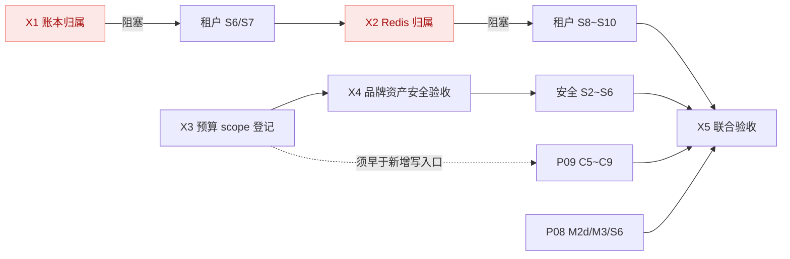

# 开发调度（临时）

日期：2026-11-12　状态：**临时调度文档**。四条并行专项全部完成后，本文归档，长期约束回到 [P11](proposals/P11-cross-stream-resource-ownership.md) 与各专项进度。

本文只排顺序和并行关系，不定义功能。每项任务的设计依据、验收标准和证据仍在各自方案与专项进度中；本文不复制它们的内容，也不代表任何阶段已完成。

## 1. 强制规则

1. **双写进度**：任何子任务验证通过后，必须在同一批改动中同时更新本文的状态列**和**该任务所属专项进度文档。只更新一处视为未完成。
2. **失败不前进**：验证失败或无法验证时，记录原因与待办，先处理当前任务，不标记完成、不开始下一项。
3. **前置不可跳**：标注"阻塞"的依赖必须真实完成（有验证证据）才能开工，不能以"后续补齐"为由先行实施。
4. **库与输出隔离**：各线继续使用自己的专用库和输出目录；合流验证使用 `sma_test_convergence`，不复用任何单线库。
5. **证据边界**：本地验收、隔离联调、真实外部联调分别记录，不互相替代。

## 2. 当前状态基线

2026-11-12 工作区已按模块提交并推送（`446dee4`→`5aade1d`，12 个提交），根 reactor `test-compile` BUILD SUCCESS。此前"靠源码快照才能跑可信验证"的做法退役，后续验证直接在提交点执行。

| 专项 | 进度文档 | 当前位置 |
| --- | --- | --- |
| P11 跨线约束 | [开发进度](development-progress.md) X0～X5 | X0、X1、X3、X4完成（X1/X3/X4本地）；X2/X5待实施 |
| 租户平台 | [tenant-platform-progress](tenant-platform-progress.md) | S5与X1已本地完成；S6可开工，S6～S10待实施 |
| P08 缓存与多实例 | [cache-governance-progress](cache-governance-progress.md) | M2完成（含本机17组双JVM证据）；M3进行中，S6及X5待验收 |
| P09 身份/邮件/存储 | [integration-services-progress](integration-services-progress.md) | C4d 实施中，C5～C9 未开始 |
| 安全专项 | [security-defense-progress](security-defense-progress.md) | S1c/S1d及S2a/b/c/d1/d2a/d2b完成本地验收；元数据/旧包兼容/真实库及查询分轮通过，最后11项聚焦修复通过；下一d3维护/完整闭环，S3～S6待实施 |

## 3. 依赖关系



只有两处是硬门槛：**X1 阻塞租户 S6**，**X2 阻塞租户 S8**。其余均为"先做收益更高"，不是正确性前提。

## 近期优先级调整：单实例稳定二开

2026-11-12用户要求尽快进入稳定二开，按[单实例基线计划](secondary-development-baseline-progress.md)优先B1～B4：S7阻塞修复→X2a缓存归属和共享资源契约→业务接入验证→固定版本验收。专用Redis/在线改绑（X2b/S8）、SQL运维UI（S9）及多实例/云能力等后补。完整X2/X5及原后续任务仍保留，局部基线不替代这些验收，不将整个Redis多资源契约提前标完成。

## 4. 执行顺序与并行分组

### 第 1 组（可立即并行，互不依赖）

| 任务 | 所属 | 依赖 | 完成后更新 | 状态 |
| --- | --- | --- | --- | --- |
| X3 预算 scope 登记 | P11 | 无 | 本文＋[开发进度](development-progress.md) | 完成（本地）：14项预算、351端点；审查6项及普通/架构25项通过 |
| 安全 S1c（前端请求治理） | 安全专项 | 无 | 本文＋[安全进度](security-defense-progress.md)＋[前端拆分](security-frontend-progress.md) | 完成（本地）：C1～C4；新版完整verify315项，安全64场景分轮/原流程20/随手栏4，旧版标准55项及独立兼容4通过；不替代S1d |
| P09 C4d 安全流水线 | P09 | 无 | 本文＋[P09 进度](integration-services-progress.md) | 进行中：d2d1原生44项、d2d2b握手40项/制品14项/镜像上下文14项本地通过；上下文测试镜像摘要为夹具，真实镜像构建/容器执行与隔离、完整杀毒未验收 |
| P08 M2d 双 JVM 证据 | P08 | 无 | 本文＋[P08 进度](cache-governance-progress.md) | 完成（本地）：17组双JVM通过、清理完成；Redis显式1s，同机共享目录，非LB/多主机验收 |
| 租户 S5d～S5f | 租户平台 | 无 | 本文＋[租户进度](tenant-platform-progress.md) | 完成（本地）：S5f根reactor完整verify 7模块SUCCESS，backend 1124项0失败/错误、57跳过；旧库升级/前端证据见专项进度 |

X3 必须在 P09 C5 开工前完成，否则 C5～C8 新增的写入口要返工一轮登记。

### 第 2 组（依赖第 1 组内的指定项）

| 任务 | 所属 | 依赖 | 完成后更新 | 状态 |
| --- | --- | --- | --- | --- |
| X4 品牌资产安全验收 | P11／安全 | X3 | 本文＋开发进度＋安全进度 | 完成（本地）：41项图片/URL/架构；组合64项中63通过后，HEAD改用真实HTTP核验，最终10项HTTP全通过；不替代P09完整扫描或X5 |
| **X1 账本归属** | P11 | X3、租户 S5 | 本文＋开发进度＋租户进度 | 完成（本地）：X1a～X1c；最终独立业务库迁移/双库/架构25项，平台回归17项通过；S6门禁已解除 |
| 安全 S1d | 安全专项 | 安全 S1c | 本文＋安全进度 | 完成（本地）：d1/d2历史4/6场景，d3当前制品39门禁/组合11场景，6隔离原语/新版315/旧版55及兼容4通过并清理；生产multi/LB、P09外部服务与X5仍待验收 |
| P09 C5（S3 直传分片） | P09 | C4d、**X3** | 本文＋P09 进度 | 待实施 |
| P08 M3 | P08 | M2d | 本文＋P08 进度 | 进行中（M3a/b/c1及c2a/b1～b8完成；b9清单/公共观察/本地文件、共享见证及Google/Console传输已分项通过，其余传输/隐式执行待收口；整机排空/LB未完成，multi仍关闭） |

### 第 3 组（串行，分库主线）

| 任务 | 所属 | 依赖 | 完成后更新 | 状态 |
| --- | --- | --- | --- | --- |
| 租户 S6 资源登记与路由 | 租户平台 | **X1** | 本文＋租户进度 | 完成（本地；S6d HTTP/策略22项及三库/故障11项通过，正式开通归S7） |
| 租户 S7 业务库 Flyway／Outbox | 租户平台 | S6 | 本文＋租户进度 | 进行中（S7a～S7c及S7d-1/2本地通过；下一S7d-3引导与收口） |
| **X2 Redis 归属** | P11 | S7 | 本文＋开发进度＋租户进度＋P08 进度 | 待实施（**阻塞 S8**） |
| 租户 S8 Redis 多资源 | 租户平台 | **X2** | 本文＋租户进度＋P08 进度 | 待实施 |
| 租户 S9 SQL 源目录与运维 UI | 租户平台 | S8 | 本文＋租户进度 | 待实施 |

第 3 组串行期间，第 4 组的三条线可并行推进，它们都不碰分库。

### 第 4 组（与第 3 组并行）

| 任务 | 所属 | 依赖 | 完成后更新 | 状态 |
| --- | --- | --- | --- | --- |
| 安全 S2 事件采集 | 安全专项 | S1d、**X4** | 本文＋安全进度＋[采集拆分](security-event-progress.md) | 实施中：a/b/c/d1/d2a/d2b本地通过；d3a有界保留维护开工，逐项验证配置/工作许可/held/容量/停用租户，之后d3b完整采集闭环 |
| 安全 S3 诱捕与告警 | 安全专项 | S2；邮件通道等 P09 mail 验收 | 本文＋安全进度 | 待实施 |
| 安全 S5 封禁与 WAF 接入 | 安全专项 | S3 | 本文＋安全进度 | 待实施 |
| P09 C6／C7（R2／OSS） | P09 | C5 | 本文＋P09 进度 | 待实施 |
| P09 C8 管理页面与上传组件 | P09 | C7 | 本文＋P09 进度 | 待实施 |

### 第 5 组（收尾，须全部前置完成）

| 任务 | 所属 | 依赖 | 完成后更新 | 状态 |
| --- | --- | --- | --- | --- |
| **X5 联合验收** | P11 | 第 3、4 组全部 | 本文＋全部四份专项进度 | 待实施 |
| 租户 S10／P08 S6／P09 C9／安全 S6 | 各线 | X5 | 本文＋各自进度 | 待实施 |

任一条线标记"整体完成"之前，X5 必须已完成。各线的收尾阶段不得在 X5 之前宣称整体交付。

## 5. 合流验证环境

已创建专用库 `sma_test_convergence`，仅授予本机既有测试账号该库权限，不复用任何单线专用库。使用方式：

```
SMA_TEST_DB_URL=jdbc:mysql://127.0.0.1:3306/sma_test_convergence?useUnicode=true&characterEncoding=utf8&connectionTimeZone=UTC&forceConnectionTimeZoneToSession=true&useSSL=false&allowPublicKeyRetrieval=true&rewriteBatchedStatements=true
```

输出目录使用 `backend/target/convergence/target`（保留 `/target/test-classes/` 后缀供 ArchUnit 排除测试类）。该库会被 Flyway clean 清空，只用于 X5 及跨线回归，不得指向开发库或任一单线库。

## 6. 进度更新示例

完成"X3 预算 scope 登记"后，同一批改动需要：

1. 本文第 4 组表格中 X3 状态改为"完成（本地）"。
2. [开发进度](development-progress.md) 的 X3 行同步状态，并写明实际执行的命令、通过项数、日志路径与未验证范围。
3. 若该任务同时影响某条线（如接口清单属于安全专项），一并更新该线进度。

两处状态不一致时，以专项进度的验证证据为准，并立即修正本文。


安全线调度对齐（2026-11-12）：沿第1组继续S1c，不启动尚未具备前置证据的S1d/S2。C3c规则的43项根reactor及20项分轮浏览器证据见前端专项进度；已有快照证据仅作为历史记录，今后基于当前提交及已记录差异直接验证，不再创建源码快照。当前基点ab8f46a及工作区差异，插件恢复已本地验收；X3已本地完成，X4仍待验收，不能据品牌页面回归把X4记为完成。

P08 M3b已按依赖拆为M3b1受控迁移入口、M3b2配置/密钥证据、M3b3共享存储双向见证；当前实施M3b1。先完成专用MySQL和实际制品验证，再同步专项进度并推进后续子项；multi仍关闭，M3c/d、S6及X5未验收。

P08 M3b1阶段证据更新：31项最新命令/配置/结构门禁与首轮25项MySQL整合通过，实际JAR迁移/校验/重复执行及无管理员初始化通过；服务节点validate互通及增强MySQL拒绝断言仍在验收，M3b1未标完成。并行品牌测试编译冲突已由其当前源码修正，本线独立重编译复验，详见P08进度。

P08 M3b1实际制品补充：23组真实双JVM通过并完成本轮资源清理，包含独立迁移/校验与撤销CREATE/ALTER/DROP/INDEX后的validate启动；原登录、撤销、消息、文件和重启矩阵保留。31项最新边界检查通过；增强MySQL2项尚在执行，M3b1待最终登记，后续M3b2/b3不提前开工。

P08 M3b1已完成：p08-m3b1-mysql-latest增强MySQL2/2通过（09:05，10:37），与31项最新门禁、23组已清理的真实制品场景形成完整本子项证据；专项进度、README/规则与部署说明已同步。下一项M3b2配置/密钥一致性证据，M3b3及M3c/d、S6、X5仍待完成；不得将受控迁移和single模式双JVM验收当作multi已开放。

P08继续M3b2，按[部署一致性设计](proposals/P08-deployment-evidence.md)分a密钥证据与SPI、b配置白名单、c持久租约绑定及双JVM验收。当前a进行中；b/c须前置通过后推进，M3b2尚未完成，multi仍关闭。

P08 M3b2a：41项证据/原密码学/结构专项通过（p08-m3b2a-unit.log）；真实宿主集合与受影响安全账本消费者回归进行中，子项未标完成，M3b2b/c与multi仍未开放。

P08 M3b2a已完成：41专项＋34安全消费者分轮通过，真实宿主装配单项1/1复验通过（p08-m3b2a-host-recheck），源码/规则/运行说明与P08进度同步。下一项M3b2b配置白名单，b2c持久租约及后续M3仍待验收。

P08 M3b2b配置白名单37项专项通过（p08-m3b2b-unit）；真实11域宿主装配与原消费者回归待完成，仍不推进持久资格b2c。

P08 M3b2b已完成：39配置/结构专项、字段清单1项、37宿主消费者及最终12域宿主3项分轮通过，证据详见P08进度。Tenant平台运维名单、入口与品牌默认值已纳入；12域不是流量就绪，持久基线/租约资格b2c仍待实施，继而b3/M3c/d/S6/X5，multi保持关闭。

P08进入M3b2c，按c1持久证据与V14迁移、c2有界worker/状态联接、c3独立双JVM拒绝与故障隔离依赖推进。当前c1实施，b2c整体未完成，multi仍关闭；验证后同时更新P08进度。

P08 M3b2c1：V13→V14/空库及结构门禁23项通过，真实存储协议和原节点/确认回归进行中；V14已验证后只追加，不提前推进c2。

P08 M3b2c1完成：迁移/结构23项与真实存储/节点/确认27项通过，0跳过（含Redis确认）。接续c2有界运行时/状态联接，c3独立JVM配置拒绝仍待验收，b2c整体未完成。

P08 M3b2c2运行时/结构26项通过，真实宿主UP→错误/缺失证据DOWN→恢复UP及心跳独立性正在验收；c2完成前不进入c3双JVM。

P08 M3b2c2已完成：最终6项真实宿主健康联接/运行时通过（10:43），含200 UP→错误/缺失证据503 DOWN→恢复200 UP及心跳独立性。此前c1迁移23/存储节点27、c2结构26分轮通过；本轮只是单宿主模拟错误证据，不能替代c3双JVM真实错误钥/配置拒绝。下一项c3，multi与完整M3仍未开放。

P08 M3b2c3开始独立JVM矩阵：真实错误/缺失/遗漏旧键与会话配置差异、readiness显式组合、健康peer继续认证、重启重新取证及原23组保留。先用根标准入口验证当前制品，再运行隔离runner，全部通过后双写状态；multi仍关闭。

P08 M3b2完成：最终独立JVM34组（p08-cluster-m3b2c3-evidence，cluster-1794451764894）passed/cleanupComplete均true，8类配置/密钥差异拒绝、健康A连续访问、B恢复、A退出超租约/B连续访问与A重启重新证明通过。当前制品38项门禁通过；P08进度/README/规则/部署说明同步。下一项M3b3共享存储互证，multi仍受M3c/d及S6/X5后续门禁。

P08开始M3b3a共享存储注册及进程探针，依赖M3b2已完成；后续b持久双向围栏、c运行时与双JVM逐项验收。单向校验不构成共享资格，状态同步P08进度，multi不变。

P08 M3b3a：38项探针/实际文件/架构检查通过；正在补最新畸形输入及真实宿主兼容回归。持久双向证书b与worker/双JVM c仍待实施，尚不形成共享存储资格。

P08 M3b3a完成：38项首轮探针/结构及最新19项真实宿主/File回归通过，0跳过。下一项M3b3b持久锚点/双向确认，c运行时/双JVM待实施，multi不变。

P08 M3b3b迁移与结构分轮通过（22结构＋1真实V14/V15迁移），7项双向存储协议及原节点/配置证据回归进行中。V15已验证后只追加，不提前开放共享健康或multi。

P08 M3b3b完成：22结构、V14→V15/空库迁移1项、真实MySQL协议/原节点/配置回归23项分轮全通过，0跳过。下一项M3b3c有界实际I/O/健康及双JVM，multi保持关闭。

P08 M3b3c1本地验收完成：最终7项线程/真实文件MySQL互证/默认宿主通过（11:56），首轮29通过/1测试夹具失败已单独记录并修复复验。M3b3a/b已完成；下一项c2独立双JVM错误挂载与健康矩阵，不能把同JVM两runtime当作生产多主机挂载通过；multi仍关闭。

P08 M3b3c2开工：独立JVM sharedStorage/readiness矩阵，双节点同步启动、错误/缺失目录、探针丢失/恢复/重启与健康peer访问；保留原34组。按P08进度记录，multi仍关闭。

P08 M3b完成：最新41专项、40组真实双JVM（cluster-1794456095162）通过且cleanupComplete=true；共享存储错/缺目录、探针丢失/恢复、健康peer与原身份/消息/文件/配置矩阵保留。README/部署/规则与P08进度同步；下一项M3c健康/摘流/代理，M3d实际LB及S6/X5仍待完成，multi不开放。

P08开始M3c1统一接流/健康分离，依赖M3b已完成；c2受控排空/WS/进程验证、c3可信代理/部署流程后续按依赖验收，M3d与S6/X5仍待完成，multi不提前开放。

P08 M3c1首轮37项门禁/过滤/配置/结构测试通过（p08-m3c1-gate-unit，12:27），默认关闭且multi不变。正在验证真实HTTP入口、健康分离及恢复；未完成c1前不推进c2，具体证据见P08进度。

P08 M3c1 HTTP首轮出现Modulith生命周期类代理与final冲突（17通过/1装配错误），已修正并补类代理回归，正复验；不跳过失败推进双JVM/c2，multi保持关闭。

P08 M3c1修复后39项（含真实HTTP）通过，最新根健康映射增强制品38项通过；开始SMA_CLUSTER_TRAFFIC=1实际双JVM直接接流矩阵，c1最终状态待结果及清理。前端完整verify首轮并行页面i18n问题已在当前文件修正，保留他人修改复验中。详情与制品哈希见P08进度。

P08 M3c1前端完整verify最终通过（60文件/312单测、类型/i18n/构建及发布门禁退出0），两次并行页面中途错误及复验均记录在P08进度。独立双JVM cluster-1794458905801仍在验证，尚不标c1完成。

P08 M3c1独立双JVM首轮在初始登录后的参数GET遇503（四组前置通过，passed=false/cleanupComplete=true），原因待只读失败快照复现；未加业务写重试、未放宽生产门禁。c1继续，不推进c2，具体证据见P08进度。

P08 M3c1排查确定一个并发见证缺陷：独立JVM共享读锁回归在原实现6通过/1失败，verify误用排他锁。现将不可变见证读取改为shared，发布/退役保持exclusive；组合复验中，随后重跑新库双JVM。原503仍按证据边界记录，不跳阶段。

P08 M3c1并发见证修复60项组合全部通过（13:09），保持独占写/退役和失败关闭约束；新制品已开始全新库双JVM矩阵，待最终结果与清理后更新c1状态。multi仍关闭。

P08 M3c1第二轮双JVM发现首次平台租户引导主键竞争，B退出且A按未互证拒绝接流；本轮已清理。正对既有Tenant bootstrap作原子幂等/当前读修复及专用真实MySQL并发验证，无新表/迁移/权限豁免；c1继续，c2不推进。最新前端完整verify315项通过。详见P08进度。

P08 M3c1租户引导修复40项全部通过（13:29，真实MySQL旧快照/双事务及原门禁/File/架构回归）。使用包含共享读锁和原子引导的最新制品继续全新库双JVM，c1尚待最终矩阵及清理，multi保持关闭。

P08 M3c1最新完整双JVM41组通过且已清理（cluster-1794461473552），但审查发现部分故障只观察到启动期NOT_READY拒绝。正在使用同JAR及受校验的完整结果引用，补11次启动完成后的具体配置/存储拒绝证据；通过前c1仍进行中，不推进c2。详情见P08进度。

P08 M3c1最终完成：同一JAR（ce55737e…734910）完整双JVM41组＋聚焦启动后23组全部通过，两轮passed/cleanupComplete均true；后者明确记录8次WAITING_CONFIGURATION、3次WAITING_STORAGE，排除只测启动期NOT_READY的假通过。健康peer和恢复后的原会话保持，端口/临时进程/库/账号/密钥已清理。当前制品40项后端门禁（含真实MySQL并发引导）、此前60项存储/门禁与39项真实HTTP分轮通过；最新前端完整verify315项通过。README/部署/规则/运维与P08进度同步。下一项M3c2受控摘流、WS/业务worker准入及排空，再c3/M3d/S6/X5；multi仍关闭，未替换用户服务。

P08 M3c2开工，按[摘流方案](proposals/P08-deployment-drain.md)分c2a状态/工作许可、c2b worker/WS、c2c本机控制/HTTP/实际进程、c2d索引与合并验收。当前c2a；通过后双写进度再推进，M3c3/d、S6/X5仍保留，multi不开放。

P08 M3c2a工作许可/共享摘流状态45项专项通过（14:31），真实HTTP及默认装配回归进行中。仍无外部摘流控制或完整worker接线；当前子项未完成前不推进c2b。

P08 M3c2a完成：45项核心/结构与19项真实HTTP/默认装配分轮通过（14:43），摘流与HTTP/工作许可共用不可逆状态，保留在途计数。文档同批同步，下一项c2b1缓存任务领取接线，继而其他worker/WS；本机控制及实际进程排空仍归c2c，multi继续关闭。

P08 M3c2b1缓存任务准入44项首轮通过（15:04），新增HTTP调度拒绝和真实MySQL“在途完成、后续留队”回归验证中；原生未知/fence协议同轮检查。当前子项完成前不推进Mail，整机受控排空尚未交付。

P08 M3c2b1完成：33项真实MySQL/调度/原生回归全部通过（15:22，0跳过），已领取任务保持许可并提交APPLIED，后续任务留在QUEUED/PENDING，fence及UNKNOWN协议未变。连同c2a核心45/真实HTTP19及调度首轮44形成分轮证据，文档同批同步。下一项c2b2 Mail，再其他worker/事件/WS；c2c本机控制与真实进程排空、c3/M3d/S6/X5仍待完成，multi不开放。

P08 M3c2b2开工：Mail调度仅host进入，目录发现、恢复及每次claim在事务外分别准入；排队不预占。单份发送许可同时覆盖结果处理和SMTP线程真实退出，取消Future不视为物理完成；超时与开始DATA线性化。先验收调度/取消/饱和/中断及本地TLS协议，再使用P08专用库验证摘流后在途提交、后续留队和Identity邮件回归。范围为mail内部服务/测试及文档，不改公开MailSendApi或数据结构，不发外部邮件；当前进行中。

P08 M3c2b2首轮p08-m3c2b2-mail-unit.log **53/53通过、0跳过、BUILD SUCCESS（15:48，01:42）**：调度9、传输生命周期8、本机TLS5、网络策略4、工作许可7及结构20。超时/中断期间底层线程继续运行则许可不释放，拒绝/开始前取消无泄漏，超时与DATA竞争保守分类。随后补本机peer观察真实断连断言及真实MySQL摘流夹具，开始原MailOutbox/IdentityEmailDelivery及当前协议组合复验；子项仍进行中，未推进其他worker。

**P08 M3c2b2完成**：p08-m3c2b2-mail-mysql.log **55/55通过、0跳过、BUILD SUCCESS（15:56，06:20）**。真实应用/MySQL两租户分别提交ACCEPTED/UNKNOWN，摘流后后续记录保持QUEUED，结果提交后仍等待传输分支结束才释放许可；原MailOutbox15/IdentityEmailDelivery6及当前调度/传输/TLS/准入全部通过。首轮53项含结构/模块门禁，分轮证据不能相加冒充无重复全量。制品6c2768ea…78bed2，README/后端规则/部署与P08进度同步；无外部投递，无用户服务重启。下一项c2b3维护任务，再持久事件/独立定时器/WS；c2c实际进程排空及c3/M3d/S6/X5未完成，multi仍关闭。

P08 M3c2b3开工：SessionMaintenance、NonceMaintenance、IdentityLoginMaintenance、IdentityEmailMaintenance分别按目录发现和每次领域维护事务准入，Auth清理与重加密、Identity邮箱与重新认证独立检查。host入口拒绝HTTP/身份/外层事务，排队回调重查，拒绝不推进租户游标；已准入事务完成后再释放。先验证拒绝/恢复/队列/事务顺序，再专用MySQL真实清理与原身份维护回归；持久事件消费者和整机排空不并入本子项完成范围。

M3c2b3首轮p08-m3c2b3-maintenance-unit.log **46通过/1失败、0跳过（16:05）**：IdentityEmailMaintenance恢复阶段用when重设mock时执行旧Answer，错误触发实际执行期active=1断言。改为doReturn设置，不改生产准入逻辑；先完整复跑47项，再进入MySQL，当前不标完成。

M3c2b3夹具修复复验p08-m3c2b3-maintenance-fixed.log **47/47通过、0跳过、BUILD SUCCESS（16:07，01:48）**；四维护器各5、Work7及结构20通过。进入专用MySQL的在途提交/后续保留、原会话/nonce清理及Identity维护持久协议，完成前不推进事件消费者。

**P08 M3c2b3完成**：p08-m3c2b3-maintenance-mysql.log **55/55通过、0跳过、BUILD SUCCESS（16:18，10:27）**，真实MySQL在途会话/nonce清理提交后活动数归零、下一租户保持原数据；原批量/跨租户/SKIP LOCKED及Identity登录/邮箱/重新认证维护通过。结合修复后47项结构/目录门禁，README/后端规则/部署及专项进度同步；首轮夹具失败保留。下一项c2b4持久事件事务前准入/拒绝保留与重投，之后消息信号、存储池、独立定时器和WS；c2c实际停机、代理/LB及S6/X5仍待完成，multi不开放，用户服务未重启。

P08 M3c2b4开工：Common对ApplicationModuleListener统一接入两层Advisor，异步执行线程先申请许可，外层覆盖Modulith完成/失败记录，内层在领域事务前拒绝未获准事件，让框架保留FAILED而非正常返回。核对当前Modulith2.1.2完成Advisor顺序为HIGHEST+10，新增外层+5、内层+20；真实代理/持久框架验证该顺序，不改监听器标识、事件载荷或已发布迁移。先单元/架构，再P08专用库验证拒绝无业务写、许可覆盖提交与完成记录、恢复后原事件重投及原Audit/Auth/Message消费者。

M3c2b4首轮p08-m3c2b4-event-unit.log **33/33通过、0跳过、BUILD SUCCESS（16:28，01:31）**：真实框架Advisor/异步/事务组合5、监听契约清单1、Work7及结构20。开始专用MySQL真实宿主代理顺序、FAILED/COMPLETED与原ID重投，以及Audit/Publication治理/Auth/Socket回归；通过前不标完成或推进其他消费者。

M3c2b4宿主首轮 **10通过/6失败、0跳过，BUILD FAILURE**（p08-m3c2b4-event-mysql）：默认异步执行器通过Micrometer传播请求上下文，正常HTTP产生的事件/重投均触发严格host拒绝；FAILED确实保留但无法恢复消费。新增专用deploymentEventExecutor（4线程/128队列、禁止CallerRuns与继承/传播请求上下文、非默认候选），七个监听方法显式选用并加架构门禁；不放宽DeploymentWork、不清空任意调用者上下文。先单元及真实执行器复验，再原失败矩阵和六消费者拒绝重投，当前仍进行中。

执行器单测首轮因新增测试lambda括号笔误编译失败，日志p08-m3c2b4-event-executor保留；修复后以event-executor-fixed复验，未推进数据库或其他子项。

M3c2b4执行器修复复验 **34/34通过、0跳过、BUILD SUCCESS（16:41，01:35）**，p08-m3c2b4-event-executor-fixed证明真实4线程/128队列、请求身份和继承ThreadLocal隔离、满载拒绝不CallerRuns及原Advisor/契约门禁。开始含全部7监听拒绝/原ID重投的宿主MySQL复验，当前未标完成。

event-fixed-mysql在并行Tenant StorageSwitchState编译期间缺bindingForSwitch方法而失败，未执行测试（16:43）；只读复核StorageDirectory当前已补该方法，保留并行修改，用全新event-current-mysql目录重建/复验，不改租户实现、不把编译失败当本项通过。

event-current-mysql **14通过/4失败、0跳过**：原审计/Socket已恢复，六消费者夹具job前缀不符合message约束已修正；三个重投失败定位到原PublicationService的全局LIMIT1先于ID谓词，较早FAILED会阻止所选事件。改用框架IncompleteEventPublications精确ID＋FAILED＋当前租户谓词，保留框架CAS与权限，不直接调用监听器；补较早外租户FAILED的回归，再完整复验。本子项尚未完成。

event-retry **37通过/1失败、0跳过**：六消费者全部拒绝/重投、原审计/Auth/Socket、Publication精确ID及HTTP治理、结构全部通过；唯一失败为新夹具在EventPublicationRegistry.markCompleted内部错误期待无事务，实际是框架独立完成记录事务。修正断言为真实独立事务，同时保留领域已提交/计数仍1及后续摘流断言；聚焦复验当前失败和六消费者/原重投，未通过前不标完成。

**P08 M3c2b4完成**：event-final **12/12通过、0跳过、BUILD SUCCESS（17:18，07:13）**，七个生产监听拒绝无领域写/原ID重投、真实代理顺序、领域已提交而框架完成事务仍在执行时许可保留、摘流拒绝后续全部通过。此前event-retry的37项通过覆盖原Audit/Auth/Socket、结构及HTTP治理；其唯一夹具失败已本轮复验，分轮证据不称一次全绿。修复默认事件执行器传播请求身份和指定重投被全局首条失败阻塞两问题。README/后端规则/部署/二开说明与P08进度同步。下一项c2b5消息信号及其余worker，继而存储池/独立定时器/WS与c2c实际停机；multi仍关闭，用户服务未重启。

P08 M3c2b5开工：SocketSignalProcessor按订阅发现、信号读取、每条实际推送/会话重验、目录发现和过期清理分别事务外准入。严格host入口，排队不预占、执行回调重查、不继承ThreadLocal；拒绝不记observed、不跳批次/维护游标，已进入的同步推送收尾。先专项拒绝/恢复/队列/在途/异常测试，再专用MySQL真实信号保留与原Socket/Store回归；SocketHub连接关闭、ping和底层缓冲发送生命周期归后续WS子项，本项不称整机排空。

M3c2b5首轮p08-m3c2b5-signal-unit.log **37/37通过、0跳过、BUILD SUCCESS（17:25，01:32）**：SignalProcessor10、Work7及结构20。验证排队不占许可/执行重查，读后拒绝保留当前批次，当前推送结束前计数不归零，下一条停止，清理拒绝不推进游标/截止，以及真实线程上下文隔离。开始专用MySQL信号保留与原Store/真实Socket回归，本项未完成前不推进其他worker。

**P08 M3c2b5完成**：p08-m3c2b5-signal-mysql.log **24/24通过、0跳过、BUILD SUCCESS（17:32，05:55）**，SignalDrain1/Processor10/Store5/真实Socket1/Work7。真实MySQL两条已提交信号读取后停在第一条Hub调用，摘流保持许可1，释放后只完成一条、下一条及维护不启动，计数归零；原信号ID/版本与portal隔离保持。该用例Hub为受控替身，另一个真实Tomcat/WS用例验证通知/待办/私信/强退，不混称实际连接已排空。首轮37项含结构/模块门禁，分轮证据不相加冒充无重复全量。

当前制品backend/target/p08-m3c2b5-signal-mysql/target/springboot-modulith-admin-0.0.1-SNAPSHOT.jar SHA256=bc2d6166bf04a0e9749b40e67fca7902f6133a72584b5b7e630b7bcc1f500597；两轮根tools/dev/verify-backend.ps1 -Standard，输出目录target/p08-m3c2b5-signal-unit/target与target/p08-m3c2b5-signal-mysql/target，-Dtest对应上述类，其他reactor模块用-Dsurefire.failIfNoSpecifiedTests=false。只用P08专用sma_test_p08_local，测试进程已退出，未操作用户服务。README/后端规则/部署/方案和两份进度同步。

下一项c2b6存储相关后台调度：最新源码新增StorageOutboxWorker、StorageDrainWorker，需与StoragePoolRegistry一同审查业务消费和基础排空确认的归属，不能照旧清单漏掉。随后Extension独立定时器、SocketHub ping/缓冲/连接关闭及清单门禁，c2c实际进程排空、c3/M3d/S6/X5仍未完成，multi不开放。

P08 M3c2b6开工：StorageOutboxWorker业务消费停止新领取，改独立单worker有界调度、host/回调准入；StoragePoolRegistry目录发现与逐项deliverOne/定时evictIdle事务外申请许可，覆盖消费者真实返回、结果提交及池租约释放。拒绝不推进资源游标，当前执行结束后再归还，原至少一次/UNKNOWN租约重投和fence保持。StorageDrainWorker是存储切换的技术排空确认例外，摘流时继续扫描既有DRAINING任务，不提交切库/执行业务；加强host入口与预算测试，c2c仍须等协调线程结束才销毁DB。池在途会话释放/关闭兜底不能因摘流跳过。先单元/结构验证，再独立P08物理业务库真实Outbox在途完成/后续保留及默认宿主兼容；不使用并行P10/P11现有库。

M3c2b6首轮p08-m3c2b6-storage-unit.log **41/41通过、0跳过、BUILD SUCCESS（17:40，01:38）**：Outbox调度5、Drain协调2、Pool5、SessionTracker2、Work7及结构20。证明拒绝/恢复游标、8资源预算、独立执行线程、在途消费保留池租约直到返回、异常归还、定时回收资格与关闭释放区别。开始专用P08物理库sma_test_p08_storage_drain_20261112（13306，本轮新建）真实Outbox UNKNOWN/在途DONE/后续PENDING和默认宿主兼容验证；不复用并行P10/P11测试资源，未完成前不推进后续。

验证命令核对：storage-mysql列表中的SpringbootModulithAdminApplicationTests不是仓库实际类名，实际为ApplicationSmokeTests；该轮不计默认HTTP冒烟证据。真实Outbox用例仍正常运行，结束后顺序补跑正确ApplicationSmokeTests，不并发清理平台库、不把未选中测试记为通过。

storage-mysql首轮 **21通过/1错误、0跳过，BUILD FAILURE**：新StorageOutboxDrainMysqlTests夹具请求键p08-drain-0短于RequestCommand要求16位，入队前失败；只读确认业务Outbox仍0行。改测试键为p08-storage-drain-*并显式配置测试指纹密钥，生产协议不放宽；使用新日志复验真实Outbox与正确ApplicationSmokeTests，保留首轮失败记录。

storage-fixed **23通过/1错误、0跳过**：正确ApplicationSmokeTests2/2已通过，其余单元通过；新Outbox夹具仍有单独eventKey短于16位，原请求键修复不覆盖事件键。只读确认Outbox0行、请求账本1条，保留FAILED_FINAL证据，修正事件键并为后续合成用例统一生成32位随机前缀（新测试意图），不清除失败回执、不放宽生产校验。只复验当前失败真实Outbox及相关调度/池测试，默认宿主已取得本轮证据。

**P08 M3c2b6完成**：p08-m3c2b6-storage-final.log **22/22通过、0跳过、BUILD SUCCESS（18:18，11:13）**，真实Outbox1、Outbox调度5、Drain协调2、Pool5、SessionTracker2、Work7。真实物理业务库先一次消费失败保留UNKNOWN；第二条执行期间摘流保持许可1，完成后DONE，第三条PENDING。把原UNKNOWN租约调为已过期后，本机仍不再领取；直接读库核对state=UNKNOWN/DONE/PENDING、attempt和fence=1/1/0。当前任务正确恢复可信tenant，消费者不占数据库事务，finish之后计数归零。保留原FAILED_FINAL夹具回执1条、新成功入队回执3条，未删证据。

分轮证据为首轮41项单元/结构和storage-fixed默认ApplicationSmokeTests2项通过，加本轮22项；中途请求键/事件键夹具失败及错误冒烟选择均保留，不称首次全绿或相加冒充无重复全量。制品backend/target/p08-m3c2b6-storage-final/target/springboot-modulith-admin-0.0.1-SNAPSHOT.jar SHA256=4e08e32e02cb13d533b140fb8b496a19069ea29d665123a98bb06e8a560854cf。命令均经根tools/dev/verify-backend.ps1 -Standard，-Dsma.verify.directory=target/<各日志前缀>/target、-Dtest按各轮上述类、-Dsurefire.failIfNoSpecifiedTests=false供其他reactor模块使用。

数据库仅P08的sma_test_p08_local与本轮新建sma_test_p08_storage_drain_20261112（127.0.0.1:13306），后者保留合成状态用于核对；测试进程已退出，未动用户服务/P10/P11库。README/后端与租户规则/部署/二开说明及两份进度同步。StorageDrainWorker只是原技术确认例外，未宣称真实多实例切库通过；业务会话/Outbox与切库的联合证据仍归X5。

下一项c2b7插件独立定时器与运行时同步，随后WS连接/ping/缓冲发送和调度清单；c2c本机控制/HTTP异步/有序退出、c3代理/M3d LB/S6/X5仍待完成，multi继续关闭。

P08 M3c2b7开工：ExtensionRuntimeService.synchronize每个控制同步周期在执行线程、事务外申请许可，覆盖信任/撤销/租约/准备/激活/回收及权限登记的整个同步调用；摘流后不开始新周期，当前周期继续收尾。PluginRuntime调用同步执行、入口检查租约，在途实例持有inFlight引用且没有宿主Future提前返回，因此停止新同步不会中断已有execute；未开始调用遇到租约过期仍按原协议拒绝。后台invokeJob严格host并在policy.resolve之前准入，许可覆盖journal领取、同步插件执行和结果提交；不修改HTTP同步调用原入口，HTTP生命周期由c2c另验。独立scheduler禁止继承ThreadLocal，销毁前禁止再启动runtime。先调度/服务单元与真实插件JAR回归，再默认宿主及原journal持久协议验证；无外部发布/部署消息，不使用用户插件服务。

c2b7首轮extension-unit：真实PluginRuntimeTests9/9通过；宿主37项中35通过/2失败，空信任数组夹具被原parseTrust非空校验拒绝，未进入控制I/O。修正夹具为临时Ed25519公钥/有效期限/用途，不放宽生产信任校验，复跑相同专项后再进入数据库。真实JAR用例已证明租约过期拒绝新调用、已进入宿主能力的原调用保留inFlight并完成。

M3c2b7修复后专项 p08-m3c2b7-extension-fixed.log：真实PluginRuntimeTests **9/9**、宿主单元/架构/模块/端点 **37/37通过，0跳过，BUILD SUCCESS**。有效临时公钥夹具已进入控制I/O，验证拒绝新同步/新job、在途I/O及结果提交期间许可保持、线程上下文隔离、UNKNOWN不重复执行；下一步使用P08专用平台MySQL验证原持久回执与默认宿主。本项尚未完成，不推进WS。

c2b7夹具复核：ExtensionJobDrainMysqlTests原制品摘要与旧ExtensionWorkJournalTests重复；平台引用计数是全局技术状态，测试顺序可能互相干扰。当前mysql进程使用编译时的旧夹具继续完成，源码已改为专项独立摘要并把引用断言收紧为精确1；该源码必须另以相反类顺序复验后才能标完成，生产代码无变化。

c2b7 p08-m3c2b7-extension-mysql.log **7/7通过，0跳过，BUILD SUCCESS（18:44，11:47）**：默认ApplicationSmokeTests2、原ExtensionWorkJournalTests4、新JobDrain1；拒绝后恢复读取原UNKNOWN/claim/版本及引用通过。此轮旧夹具按原journal先执行顺序通过，不能替代独立摘要修订；接着使用reversealphabetical顺序执行新JobDrain再原journal，验证平台引用不受顺序污染。未开始WS。

**P08 M3c2b7完成（本地）**：p08-m3c2b7-extension-final.log **5/5通过，0跳过，BUILD SUCCESS（18:53，08:13）**，reversealphabetical实际先执行ExtensionJobDrainMysqlTests1，再ExtensionWorkJournalTests4。新夹具专属摘要保留原UNKNOWN、同一claim/版本与精确1条持久引用，原回执固定版本/唯一claim/权限/对账全部通过；独立SQL读取核对tenant97290为UNKNOWN1条、claim仍存在，专属摘要reference_count=1。生产逻辑无需因夹具隔离而修改。

分轮证据：extension-fixed真实PluginRuntimeTests9/9、宿主单元/结构37/37；extension-mysql默认ApplicationSmokeTests2＋原journal4＋摘流1共7/7；extension-final反向顺序5/5。不相加冒充无重复全量，首轮信任夹具失败及摘要隔离修订均保留。最终制品backend/target/p08-m3c2b7-extension-final/target/springboot-modulith-admin-0.0.1-SNAPSHOT.jar SHA256=9d695f4b2644eb0bf81fdf3e02718a77d58fabcf583c1f35fc8600721e12dc7c。

命令均经根tools/dev/verify-backend.ps1 -Standard，-Dsma.verify.directory=target/<对应日志前缀>/target及-Dsurefire.failIfNoSpecifiedTests=false；final指定-Dtest=ExtensionJobDrainMysqlTests,ExtensionWorkJournalTests和-Dsurefire.runOrder=reversealphabetical，mysql额外ApplicationSmokeTests，fixed专项列表见原记录/日志。只用P08专用sma_test_p08_local（13306），测试进程已退出；未接触用户插件控制服务/用户进程/P10/P11库。7个范围源码摘要核对无漂移，9份文档225条本地链接检查通过，范围git diff --check通过。

README、后端/插件规则、插件接入/二开缓存/部署手册及两份进度已同步。升级说明明确SNAPSHOT后台入口收紧：事务内/附身份旧调用须由业务持久意图交给可信host worker，不能清空身份绕过；外部旧业务制品兼容矩阵未验收。控制I/O受控替身、真实签名JAR和MySQL分别提供证据，不等于真实HTTPS控制服务或整机关闭。

下一项c2b8：SocketHub连接准入、ping/缓冲发送生命周期、1001部署关闭与会话保留/重新取票，再补调度及异步入口完整清单。c2c本机控制/HTTP异步/有序停机、c2d组合审计、c3代理/M3d无粘性LB、S6和X5仍未完成；multi保持关闭。

P08 M3c2b8开工：Common新增只读DeploymentConnections生命周期观察SPI，Message接入握手预留→连接交接→所有发送/关闭操作计数，握手失败释放、升级成功回调交接且晚到回调重查摘流；拒绝新握手不消费票据。沿用Spring有界并发发送装饰器，统计全部同步调用以覆盖其缓冲刷新线程，不能只跟踪信号发送者。独立单worker负责每连接ping准入与技术关闭，摘流停止新业务发送，等待原发送后1001关闭，不发送session-ended/不注销共享会话；计数等真实回调和I/O结束，不超时清零。拟改common/deployment公开只读契约、message SocketHub/握手适配及测试；前端沿用现有重新取票/REST刷新逻辑，补契约测试。先单元/握手/结构，再专用MySQL真实Tomcat/原票据及消息回归，再更新双进度；实际双JVM滚动停机归c2c，不以本项替代。

P10 S7d-3进行中：非默认平台ID=42首次启动根reactor专项`backend/target/p10-s7d3-isolated.log`22/22通过，目录/域名/IAM/权限落点核对通过，运行说明已补。完整默认回归`p10-s7d3-full.log`在编译后遇安全专项新增Defense控制器/后更新策略基线，普通门禁4条快照不一致；当前源码复编`p10-s7d3-policy.log`又遇P08握手适配器先于SocketHub落盘，主源码未编过。两轮失败保留，不覆盖并行专项文件；待并行源码收敛重跑普通门禁和根reactor全量，S7与X2状态保持原值。

P10 S7d-3增量：当前源码`p10-s7d3-policy2.log`22/22架构/端点/模块/身份通过。完整根reactor第二轮`p10-s7d3-full2.log`专用库启动/迁移2/2通过，但运行到Identity重认证阶段已有Mail摘流时序、Common号段IdWorker、Defense固定事件总数三项失败；主测试JVM约6.5GB且MySQL网络读长停滞，保留日志后仅停止本轮自有Surefire。需先处理这三项及全量运行隔离，再做根reactor通过验收；S7、X2、S8均不提前推进。

c2b8首轮p08-m3c2b8-socket-unit.log **44通过/1夹具错误，0跳过**。Hub生命周期6、原信号10、Work7及结构20通过；握手用例重设when时调用旧throw stub，改doReturn。复核另补每轮128项轮转队列，失败关闭不得饿死后续连接；晚到升级除摘流外还重验资格，资格不足1001且不查会话。新增预算/晚到资格测试后复验当前专项，不推进数据库。

c2b8 socket-fixed测试编译失败：并行安全专项SecuritySignalCaptureService增加CacheNodeIdentity参数时，测试仍为旧构造调用；未执行测试。只读确认当前SecuritySignalCaptureTests已同步双参数构造，保留并行修改，使用新输出socket-current重新构建。前端消息状态12/12通过，新增1001保留token/新票据/重连REST刷新，前端运行逻辑无改动。子项仍进行中。

c2b8 socket-current **47/47通过、0跳过、BUILD SUCCESS**，Hub8/握手2/原信号10/Work7及结构20。另复核最终销毁与晚到升级竞争：原已预留握手若在worker关闭后才到连接回调，仍需主动1001关闭，不能只标记等待已停止worker；补finally关闭兜底及专门测试。先聚焦复验Hub/握手，不把前一轮制品当作这次小修已验证。前端12项及type-check:tests通过。

c2b8 socket-late **11/11通过、0跳过、BUILD SUCCESS**：Hub9＋握手2，销毁后晚到升级仍1001关闭、预留交接/真实回调计数通过。进入P08专用MySQL真实Tomcat 1001且共享会话保留、拒绝新握手不消费票据、原推送/强退及票据一次消费回归；本子项未完成前不推进调度清单/整机停机。

c2b8前端完整npm run verify通过：62文件/318项测试，类型、测试类型、lint、i18n、路由/基线、Vite构建和release预算均通过，日志backend/target/p08-m3c2b8-frontend-verify.log；本轮前端仅新增测试，保留并行安全身份修改。后端真实MySQL验证仍进行中，不用模拟WebSocket测试替代真实关闭/共享会话证据。

**P08 M3c2b8完成（本地Tomcat/MySQL）**：p08-m3c2b8-socket-mysql.log **14/14通过，0跳过，BUILD SUCCESS（19:28，11:25）**：SocketDeploymentMysql1、SignalDrain1、Store5、Ticket6、原Socket1。真实JDK客户端收到1001，Hub等待实际afterConnectionClosed后计数归零，无session-ended；原登录仍能resolve并发行新票据，摘流节点拒绝新握手且未消耗该票据，随后原协议一次消费成功/重复拒绝。原通知/待办/私信/强退及共享票据竞争、过期/会话绑定全部回归。此轮是单机单宿主真实连接，新票据在服务层核验，不称另一真实节点已重连或实际进程滚动停机。

分轮证据：socket-current **47/47**含Hub8/握手2/信号10/Work7/结构20；销毁后晚到升级小修socket-late **11/11**含Hub9/握手2；真实mysql **14/14**；frontend-next完整npm run verify **318/318**及类型/lint/i18n/构建/release通过，messages.test.ts12项含新增1001保留token/退避/新票据/REST刷新。保留首轮Mockito夹具错误及并行安全构造器编译失败，不相加冒充一次完整后端回归。

最终JAR：backend/target/p08-m3c2b8-socket-mysql/target/springboot-modulith-admin-0.0.1-SNAPSHOT.jar，SHA256=9fbf1b3d669b8191489738e25226ed74f282d327349c05331fbe4458acbe5199。后端均经根tools/dev/verify-backend.ps1 -Standard，-Dsma.verify.directory=target/<日志前缀>/target、-Dtest按各轮上述测试类、-Dsurefire.failIfNoSpecifiedTests=false。前端日志backend/target/p08-m3c2b8-frontend-verify.log。只用P08平台库sma_test_p08_local（13306）；8个范围源码摘要未漂移，测试JVM43696和最后随机端口55955已退出；用户服务、其他专项库及并行改动保持。

规则/方案/二开手册明确：DeploymentConnections为只读观察SPI，握手/连接/在途I/O分别计数；101保留预留到回调交接，关闭返回和超时都不能清零。正常ping逐连接准入，独立worker每250ms轮转最多128项；技术关闭继续运行，失败关闭保留且不会饿死后续连接。原Spring 64KiB缓冲/5秒观察限额保持，所有发送线程覆盖计数；不是客户端送达确认或严格网络时限。10000连接无阻塞轮转约20秒，实际宽限和执行器结束仍须c2c验收。

下一项c2b9调度/异步完整清单及遗漏收口，尤其文件检查/安全采集/规则执行等并行新增来源；之后c2c本机控制、HTTP异步及有序停机，c2d组合审计、c3/M3d代理/LB、S6与X5。multi仍拒绝启动，本项未重启/部署用户服务。

c2b8收口核对：独立SQL确认tenant98740原auth_session共1条，未删除1、未锁定1、仍未到期1（不读取token/hash）。8份文档233个本地链接有效；范围git diff --check通过，8个源码/测试文件摘要无漂移。README、后端/前端规则、部署/二开手册及双进度已同步，本地WS子项完成；全目标仍未完成。

P08 M3c2b9开工，按依赖拆分：b9a先建立编译后调度/异步/线程池/HTTP异步/子进程及外部规则执行入口的精确清单门禁与人工归属台账；台账显式区分已准入业务、技术协调、父请求同步、需补踪的子线程/进程及独立worker，不用登记代替验收。b9b逐项补Google/LocalTransfer/FileCluster等Future取消后仍存活的实际执行观察，Console异步响应和TLS超时线程另核验；b9c检查检查容器/子进程与规则引擎隐式并发；b9d同制品回归和清单收口。实际有序关闭及数据库/协调资源销毁仍归c2c。

本轮拟改backend架构测试/测试资源清单、docs/proposals/P08-deployment-activity-inventory.md及现有方案/双进度；b9a通过后再实施生命周期公共观察契约与逐个消费者。发现GoogleHttpTransport、LocalTransferStorage、FileClusterStorage在Future.cancel后方法可先返回，父许可/HTTP计数不能单独证明真实子线程结束；SecurityCollectionWorker已逐I/O单元准入；ContentInspectionWorker是独立进程入口，不能误作宿主定时器。并行安全/文件变更继续保留。

b9a首轮inventory-discovery编译成功，发现86条入口；空审查清单使门禁按预期失败（1通过/1拒绝），未自动批准。逐项核对后剔除把AbortPolicy误当执行器的噪声，新增自定义Executor继承识别、Caffeine/HttpClient/Hikari/Lettuce资源及异步返回类型，补真实编译夹具验证组合/重复注解、虚拟线程、并行流、子进程和异步HTTP可被发现；只做源码/字节码检查，夹具不执行线程或命令。待扩展发现结果人工登记后复验，再推进生命周期修复。

b9a扩展发现inventory-expanded：真实字节码检测夹具通过，空清单仍按预期拒绝（1通过/1拒绝）；审查后最终80条：Scheduled17、Async7、异步返回2、执行器20、提交18、HTTP4、规则库1、子进程1、独立线程1、资源9（含重复调用次数）。已逐类核对并登记新台账，明确Google/本地传输/见证子线程等未完成项，保留库自动线程与运行时调度核对边界。按审查结果写入固定基线，开始普通门禁及模块/架构复验，无自动批准开关。

**M3c2b9a完成（静态入口审查）**：p08-m3c2b9-inventory-reviewed.log **23/23通过、0跳过、BUILD SUCCESS**（Inventory2、持久事件清单1、架构17、模块2、端点1）。80条精确基线与人工归属台账一致；真实检测夹具验证了组合/重复Scheduled、组合Async、自定义Executor、虚拟线程/并行流、异步HTTP及子进程的发现。先前两轮因空审查基线拒绝为预期引导记录，未自动批准或放宽比较。此完成仅指入口发现/审查门禁，不表示b9剩余生命周期或整机排空通过。

进入b9b1公共实际任务观察：增加只读DeploymentActivity与有界DeploymentTaskTracker，登记提交/运行状态，Future取消前未启动可释放、已启动须等run finally，拒绝与shutdownNow取消队列不泄漏；不另建线程、不授予工作/租户权限、不替代父HTTP/DeploymentWork。先并发/取消/异常/关闭/容量专项和结构门禁，再接入LocalTransfer/FileCluster及Google等消费者，不提前声称消费者已修复。

**M3c2b9b1完成（公共观察原语）**：p08-m3c2b9-task-tracker.log **34/34通过，0跳过，BUILD SUCCESS**（Tracker5、Work7、Inventory2及结构20）。真实执行器证明运行中Future取消/close保持running，未启动取消及拒绝释放，shutdownNow移出队列结合close不泄漏，40轮启动/取消/关闭竞争无重复执行/负计数，成功/异常及重复run保持一次释放。清单新增唯一公共Executor.execute转交点，共81条。公共原语不创建线程、不赋权，消费者尚未接入不能据此称已修复。

下一b9b2先接入LocalTransferStorage：跟踪真实文件工作与资源finally，超时后的原不可变对象/未知账本保持；关闭后的Future取消保守映射原STORAGE错误而不是NotStarted。线程禁止继承调用者ThreadLocal，原maximumConcurrent/零队列/路径检查不变。验证真实文件锁、超时且忽略中断的线程仍计数、关闭/拒绝和原写入/冻结/隔离回归，通过后再处理FileCluster见证。

**M3c2b9b2-1 LocalTransfer完成（真实本地文件）**：p08-m3c2b9-local-transfer.log **34通过、0失败/错误、1跳过，BUILD SUCCESS（19:46，01:36）**，新Deployment2全部通过；旧Storage7中6通过、符号链接权限夹具1跳过，Windows Junction拒绝已通过。新用例证明方法超时后线程忽略中断仍保持running1及真实FileLock，close两次不清零；释放阻塞后才归零/释放锁，原不可变证据文件仍存在；未开始拒绝关闭输入且不创建对象。子线程无继承ThreadLocal/认证身份，原校验/写入/冻结协议保持。Tracker5/Inventory2/结构19同轮通过。

制品backend/target/p08-m3c2b9-local-transfer/target/springboot-modulith-admin-0.0.1-SNAPSHOT.jar SHA256=b368366b77338ec858609cd04b8c467df313abace561ff9323b0e2a98e2f9dfa。未执行数据库或HTTP联调，本项不改变数据结构/公开上传入口；未来整机关闭仍需c2c。顺手补静态门禁对“子类仅在类上加Async、全部继承父方法”的遗漏检测，真实继承夹具聚焦复验后再进入FileCluster；生产运行代码无再次修改。

b9继承检测补验：p08-m3c2b9-inventory-inherited.log **2/2通过，0跳过，BUILD SUCCESS**，类级Async即使只继承方法也会产生ASYNC_TYPE条目；当前基座仍81条。5个本项运行class（观察接口/快照、tracker/Task、本地传输）与已通过本地文件专项的编译字节完全一致，未因清单测试修订偷换运行证据。8份文档228个本地链接有效，范围git diff --check通过。

本轮后端命令均为tools/dev/verify-backend.ps1 -Standard，-Dsma.verify.directory=target/<对应日志名>/target、-Dsurefire.failIfNoSpecifiedTests=false；inventory-reviewed指定DeploymentActivityInventoryTests,DeploymentEventBoundaryTests,ArchitectureRulesTests,ModularityTests,SecurityEndpointInventoryTests；task-tracker指定DeploymentTaskTrackerTests,DeploymentActivityInventoryTests,DeploymentWorkTests,ArchitectureRulesTests,ModularityTests,SecurityEndpointInventoryTests；local-transfer指定LocalTransferDeploymentTests,LocalTransferStorageTests,DeploymentTaskTrackerTests,DeploymentActivityInventoryTests,ArchitectureRulesTests,ModularityTests；inventory-inherited仅DeploymentActivityInventoryTests。所有验证会话已结束，仅临时测试文件，无数据库/用户进程改动；原symlink跳过不冒充已测。

下一项b9b2-2 FileClusterStorage真实见证子线程，之后Google/Console/TLS的库活动和规则/独立检查边界；b9整体、c2c有序停机、c2d/c3/M3d/S6/X5未完成。公共观察不自动阻止业务工作，不替代父准入；multi继续关闭。

P08 M3c2b9b2-2开工：FileClusterStorage使用DeploymentTaskTracker观察内层见证线程，组件id=file.shared-witness；发布/核验/退役原协议保持，2线程零队列和原探针预算不变，工作线程禁止继承ThreadLocal。Future取消/组件关闭不能清除运行计数；取消保守映射原unavailable，不返回成功或重建不确定探针。只将内部execute开放为包内测试接缝并保留host入口校验，不构成二开API。先真实线程/文件锁超时及原独立JVM共享读锁/路径/摘要测试，再共享Probe/Runtime及专用MySQL互证回归；不改变SharedStorageRuntime/Store状态协议或用户挂载。

b9b2-2见证单元p08-m3c2b9-witness-unit.log **46/46通过、0跳过，BUILD SUCCESS（19:52，01:46）**：受控内部I/O夹具在方法超时后仍持真实FileLock/running1，close重复不清零；未开始取消/执行器饱和无探针落盘，正常和异常均实际归还，线程无继承身份。原独立JVM共享读锁/发布退役排他、摘要/目录链接拒绝及SharedStorageProbe/Runtime、入口清单/结构通过。下一步使用P08专用MySQL执行真实双runtime＋文件/持久互证及默认宿主兼容，不把单元计数通过当作完整互证已复验。

**M3c2b9b2-2 FileClusterStorage完成（本地）**：p08-m3c2b9-witness-mysql.log **4/4通过、0跳过、BUILD SUCCESS（20:03，09:47）**，ApplicationSmokeTests2＋SharedStorageRuntimeIntegrationTests2。真实文件与MySQL双runtime维持互证，丢失一侧probe后该侧UNAVAILABLE且持久代次推进/撤销资格，健康peer继续READY，原文件不重建；独立目录不能取得双向资格。此用例同JVM双runtime，不称独立双JVM滚动停机或生产NFS/SMB验收。

结合witness-unit **46/46通过、0跳过**：新Deployment3、原Storage7（含独立JVM共享读锁及Windows Junction）、Tracker5、Probe7、Runtime3、Inventory2及结构19。阻塞夹具调用内部实际执行接缝并持真实FileLock，方法超时/close后仍计running1，实际退出后才归零；原公开见证读写/锁/摘要另由原Storage专项验证，边界分别记录。无迁移/用户配置变更，技术见证继续服务摘流收尾，观察计数不授予资格。

最终制品backend/target/p08-m3c2b9-witness-mysql/target/springboot-modulith-admin-0.0.1-SNAPSHOT.jar SHA256=843c617047e8f70fc1ee9566c35e60ba71122e7dd3de0272ccd7544ca99b0083。两轮均根tools/dev/verify-backend.ps1 -Standard，-Dsma.verify.directory=target/p08-m3c2b9-witness-unit/target或target/p08-m3c2b9-witness-mysql/target，-Dtest按上述测试类，-Dsurefire.failIfNoSpecifiedTests=false。仅P08专用sma_test_p08_local（13306），测试JVM9080已退出；3个范围源码/清单摘要未漂移，未动用户服务/其他专项库。

README、部署/二开手册、后端规则、活动台账与两份进度同步。下一b9b3逐个核验Google/Console/TLS实际传输与库资源；随后规则/独立检查进程边界及b9收口。c2c整机控制/HTTP异步/有序关闭、c2d/c3/M3d/S6/X5仍未完成，multi保持关闭。

b9b2-2最终核对：7份文档225个本地链接有效，范围git diff --check通过；FileClusterStorage在单元与MySQL两轮编译字节一致。当前总目标继续进行，不把共享见证这一子项完成等同于完整multi可用。

P08 M3c2b9b3-1 Google传输开工：GoogleHttpTransport接入DeploymentTaskTracker，仍4线程零队列/12秒总等待/64KiB响应预算与固定Google端点；取消后实际任务仍计数，禁止继承调用者ThreadLocal。新增common::deployment的DeploymentTransport受控关闭契约：host停止新提交，执行器等待已接受任务，线程池真正terminated后才调用HttpClient.shutdown；transportTerminated同时核对线程池、任务和JDK客户端真实终止，不把任务0等同于库资源结束。PreDestroy仅保留强制取消兜底，不能假称优雅关闭。

公共tracker新增stopAccepting（只拒绝新提交，不取消已有任务），先与原取消/竞争单元验证，再Google受控忽略中断夹具、真实本地HTTP成功/慢正文取消/断连/优雅终止及原Google协议/IDToken回归；通过后再进原Identity真实MySQL HTTP/登录操作专项。控制契约无用户HTTP入口，内部关闭要求host/无事务，无外部Google账号调用；Console/TLS/NodeControl后续单独验收，当前不放开multi。

b9b3关闭契约前置p08-m3c2b9-transport-contract.log **34/34通过、0跳过、BUILD SUCCESS（20:09，01:51）**：Tracker6证明stopAccepting保留原队列/结果并拒绝新提交，原取消/竞争及Work7/Inventory2/结构19通过。DeploymentTransport契约只定义host关闭及真实终止观察，尚无消费者不能称传输已完成。进入Google接线及真实本地协议专项。

b9b3-1 Google专项p08-m3c2b9-google-unit.log **43/43通过、0跳过、BUILD SUCCESS**：HttpTransport5含真实请求优雅完成/客户端终止，Deployment3含忽略中断任务仍计数、host关闭拒绝与事务前置、真实慢正文取消后peer断连及JDK isTerminated；IdToken7、Tracker6、Inventory2及结构20。生产无跳转/无Cookie/4并发/64KiB/固定端点/原错误码保持。清单为82条（专属TransportExecutor构造链），新增库关闭不计作资格或请求成功。

进入P08专用MySQL的原IdentityLoginTransaction、IdentityGoogleOperation、IdentityApplicationHttp与默认ApplicationSmoke回归，验证原单次兑换/未知不重换/租户与HTTP契约及真实装配；这些集成使用原受控Google签名/传输夹具，不访问供应商。本项数据库通过前不推进Console/TLS。

Google关闭契约补充（仅Javadoc/文档，无运行行为修改）：宿主必须先停止新父请求/工作准入并等待已准入父流程完成，再调用shutdownTransport；同一父流程可能先兑换再取公钥，不能在其两次调用之间提前关闭传输。父方法超时后存活的子任务由tracker/客户端继续观察收尾；完整父HTTP/worker顺序仍归c2c。当前MySQL验证继续原编译代码，不因注释修改重启。

**M3c2b9b3-1 Google传输完成（本地）**：p08-m3c2b9-google-mysql.log **27/27通过、0跳过、BUILD SUCCESS（20:22，09:03）**，ApplicationSmoke2、IdentityApplicationHttp9、IdentityGoogleOperation8、IdentityLoginTransaction8。原state/proof/PKCE/租户/Origin/登录与重认证区分、单次兑换竞争、未知VERIFYING不重换、失败会话提交与配置变化保留原行为；真实MySQL和应用HTTP链通过，Google签名/传输为原受控夹具，无供应商账号访问。

分轮证据：transport-contract **34/34**验证stopAccepting保留已接受队列；google-unit **43/43**（Transport5、Deployment3、IdToken7、Tracker6、Inventory2及结构20）验证真实本地请求完成后才关闭客户端、慢正文取消后peer真实断连/JDK终止、忽略中断的替身任务仍计数、host关闭/事务门禁、4并发和原64KiB/无跳转/Cookie约束。不能将工作计数0当作客户端已关闭，transportTerminated同时核对真实库终止；PreDestroy仅强制取消兜底，不是完整滚动停机。

最终制品backend/target/p08-m3c2b9-google-mysql/target/springboot-modulith-admin-0.0.1-SNAPSHOT.jar SHA256=7d92cea5f4cfc304318025214932b3ee8de74105b1a7241558ed36d95a83387b。所有命令经根tools/dev/verify-backend.ps1 -Standard，-Dsma.verify.directory=target/<对应日志前缀>/target、-Dsurefire.failIfNoSpecifiedTests=false，-Dtest按上述各轮类（统一后缀Tests）。google-mysql精确列表IdentityLoginTransactionTests,IdentityGoogleOperationTests,IdentityApplicationHttpTests,ApplicationSmokeTests；google-unit精确列表GoogleTransportDeploymentTests,GoogleHttpTransportTests,GoogleIdTokenTests,DeploymentTaskTrackerTests,DeploymentActivityInventoryTests,ArchitectureRulesTests,ModularityTests,SecurityEndpointInventoryTests。

数据库仅P08的sma_test_p08_local（13306），测试JVM43060已退出；单元与MySQL两轮4个关键运行class字节一致。期间仅对DeploymentTransport补父流程关闭顺序Javadoc并记录，无行为漂移或重启验证。清单82条已人工审查/普通门禁验证，未自动批准。README/后端规则/部署及二开手册/活动台账与双进度同步，用户服务和其他专项库未改。

下一b9b3-2 Console代理传输，再TLS/NodeControl库资源及规则/独立检查边界；c2c父HTTP/worker与辅助传输的实际关闭顺序、c2d/c3/M3d/S6/X5仍未完成，multi继续关闭。

Google子项收口核对：7份文档227个本地链接有效，范围git diff --check通过；6个范围源码/测试/清单摘要与已记录最终版本一致。关闭契约注释修订已单独记录，未修改测试中的运行行为；全目标仍在实施中。

P08 M3c2b9b3-2 Console代理开工：ConsoleProxyService按整个forward（可信身份/机器凭据读取→发布会话交换→原代理动作）登记运行计数，固定最多1024个本机在途、无队列。host shutdownTransport拒绝新forward但保留原两阶段流程，全部forward返回后才HttpClient.shutdown；终止必须同时父调用为0及JDK客户端isTerminated。无新线程或身份传播，Future取消/超时不当作库已退出；PreDestroy强制关闭阻止尚未发出的下一阶段，不自动重做未知发布写。

保持HTTPS配置、路径白名单、权限、原host token不外传、机器token ACL、2MiB响应/1MiB分片、请求20秒/等待25秒及NATIVE回执协议。包内测试接缝可缩短等待/容量但不能放宽生产配置。先受控客户端两阶段/容量/拒绝/取消及真实本地HTTPS证书校验、慢正文未知写/优雅终止，再原Console请求治理HTTP和默认宿主MySQL回归。只用合成回环服务，无用户发布服务/外部发布动作；通过后再推进TLS/NodeControl。

Console首轮p08-m3c2b9-console-unit.log在测试编译阶段失败，未执行测试：并行新增DefenseMaintenanceConfigurationTests给已有primitive boolean的DefenseCollectionProperties.enabled传null。仅将该测试夹具首参数修为false（默认禁用采集），不修改安全生产实现/其他字段。记录此一行跨线编译修正后复跑，未标当前子项完成。

并行新增SecurityRetentionService已源码审查：宿主入口、单线程有界调度/禁止继承身份，平台清理/目录发现/逐租户清理各自DeploymentWork准入，关闭等待原事务而不提前归还；它是业务维护而非基础协调例外。仅在P08活动清单登记新增构造、Scheduled（含initialDelay）及提交3条，基线由82到85；不修改其生产代码、不把登记当作安全专项已验收。Console没有新增执行器或外部发布调用。

Console修复后p08-m3c2b9-console-fixed.log **35/35通过、0跳过、BUILD SUCCESS（20:34，01:42）**：ConsoleTransportDeployment5（含真实本地HTTPS、可信/不可信证书、两阶段优雅完成、未知命令只发一次、库终止）、原Proxy5/Scope1、跨线夹具Configuration2、Inventory2及结构20。已审新增SecurityRetention3条也通过普通入口门禁，当前85条；首轮编译笔误记录保留。

进入P08专用MySQL的ConsoleRequestGovernanceHttpTests与ApplicationSmokeTests，验证原QUERY/NATIVE/分片重复拒绝、权限/白名单及默认宿主实际装配。代理外部目标仍受控替身，真实HTTPS传输证据来自上轮本机合成服务；不调用用户发布服务、不自动重发未知动作，数据库通过前不推进其他传输。

**M3c2b9b3-2 Console传输完成（本地）**：p08-m3c2b9-console-mysql.log **3/3通过、0跳过、BUILD SUCCESS（20:40，05:44）**，ApplicationSmoke2＋ConsoleRequestGovernanceHttp1。默认宿主实际装配通过，原QUERY/NATIVE、分片重复/伪造查询拒绝、权限/白名单保持；治理用例代理为受控替身，真实HTTPS来自console-fixed本机合成服务，分别记录，不宣称真实发布服务验收。

console-fixed **35/35通过**包括新Deployment5、原Proxy5/Scope1、Inventory2/结构20及跨线夹具Config2。真实HTTPS确认已接受会话交换在关闭后仍完成原命令，后续请求拒绝；慢正文未知命令只发送1次、JDK客户端实际终止；不可信证书在进入合成处理器前拒绝。受控客户端另验证2项容量同时占用、强制close不清运行计数/迟到会话不再开始后续阶段、Future完成仍须独立库终止证据。生产每次20秒请求/25秒等待与凭据隔离保持，1024本机在途无排队。

首轮console-unit在编译阶段被并行DefenseMaintenanceConfigurationTests的primitive boolean传null阻断；只修测试首参false，并在console-fixed验证该配置2项通过，不更改安全生产实现。并行SecurityRetentionService新增3入口已按源码人工审查登记，85条普通清单通过；登记不代表保留维护已完成。

制品backend/target/p08-m3c2b9-console-mysql/target/springboot-modulith-admin-0.0.1-SNAPSHOT.jar SHA256=8b8a98f3f01e5d1a6723c5af214f9fa8fc2d9f869feb8ae7c0dc339b23204e8f。均根tools/dev/verify-backend.ps1 -Standard，-Dsma.verify.directory=target/<对应日志前缀>/target、-Dsurefire.failIfNoSpecifiedTests=false；fixed指定ConsoleTransportDeploymentTests,ConsoleProxyTests,ConsoleRequestScopeTests,DeploymentActivityInventoryTests,ArchitectureRulesTests,ModularityTests,SecurityEndpointInventoryTests,DefenseMaintenanceConfigurationTests；mysql指定ConsoleRequestGovernanceHttpTests,ApplicationSmokeTests。P08专用sma_test_p08_local（13306），JVM30628已退出；2个Console运行class两轮字节一致，4个范围源码/清单/修复夹具摘要无漂移。

README/后端及插件规则/部署说明/活动台账与双进度已同步；无外部发布动作，无用户服务重启或其他库改动。下一b9b3-3 TLS定时关闭及NodeControl客户端资源，随后规则/独立检查边界和b9收口；c2c/c2d/c3/M3d/S6/X5未完成，multi继续关闭。

Console子项最终文档核对：7份文档229个本地链接有效，范围git diff --check通过。失败记录、跨线夹具一行修正和新增维护入口审查均保留；当前全目标继续实施，不将本地代理传输通过当作完整多实例交付。

P08 M3c2b9b3-3a TLS探测开工：DomainTlsProbe同时观察同步探测/套接字归属与截止关闭回调，回调经DeploymentTaskTracker登记后交原单线程scheduler，取消未开始任务移出延迟队列，已运行回调保留计数至finally。固定最多1024个本机探测，线程不继承身份；原固定地址、SNI/证书主机名/信任、端口443和≤12秒预算保持。host shutdownTransport拒绝新探测，但在既有探测真正返回前保留其截止任务；之后关scheduler，并同时核对套接字归属、回调计数和scheduler终止。PreDestroy同样保留在途截止保护，不提前shutdownNow丢失关闭任务。

包内Socket工厂仅用于受控竞争夹具；真实Socket关闭后才释放归属，关闭异常且isClosed=false保持未完成，不超时清零。先新回调竞争/失败保留/host门禁与原真实TLS固定地址/证书/无响应peer/优雅关闭，再对应领域回归；不改变租户域名授权/数据库状态或用户服务。通过后再独立处理NodeControl流式响应及HttpClient资源。
