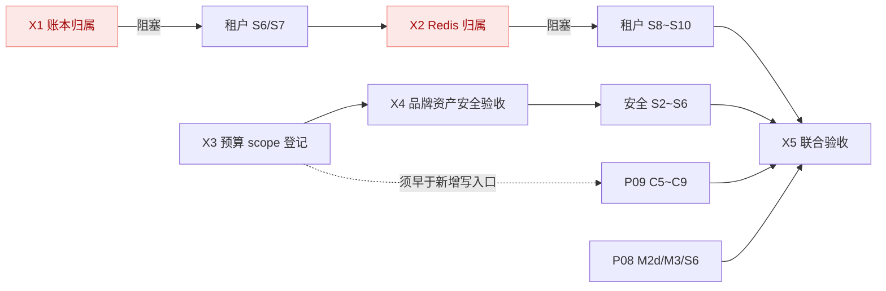

# 开发调度（临时）

日期：2026-11-12　状态：**临时调度文档**。四条并行专项全部完成后，本文归档，长期约束回到 [P11](proposals/P11-cross-stream-resource-ownership.md) 与各专项进度。

本文只排顺序和并行关系，不定义功能。每项任务的设计依据、验收标准和证据仍在各自方案与专项进度中；本文不复制它们的内容，也不代表任何阶段已完成。

## 1. 强制规则

1. **双写进度**：任何子任务验证通过后，必须在同一批改动中同时更新本文的状态列**和**该任务所属专项进度文档。只更新一处视为未完成。
2. **失败不前进**：验证失败或无法验证时，记录原因与待办，先处理当前任务，不标记完成、不开始下一项。
3. **前置不可跳**：标注"阻塞"的依赖必须真实完成（有验证证据）才能开工，不能以"后续补齐"为由先行实施。
4. **库与输出隔离**：各线继续使用自己的专用库和输出目录；合流验证使用 `sma_test_convergence`，不复用任何单线库。
5. **证据边界**：本地验收、隔离联调、真实外部联调分别记录，不互相替代。

## 2. 当前状态基线

2026-11-12 工作区已按模块提交并推送（`446dee4`→`5aade1d`，12 个提交），根 reactor `test-compile` BUILD SUCCESS。此前"靠源码快照才能跑可信验证"的做法退役，后续验证直接在提交点执行。

| 专项 | 进度文档 | 当前位置 |
| --- | --- | --- |
| P11 跨线约束 | [开发进度](development-progress.md) X0～X5 | X0 完成，X1～X5 待实施 |
| 租户平台 | [tenant-platform-progress](tenant-platform-progress.md) | S5 进行中（S5a～S5c 完成），S6～S10 待实施 |
| P08 缓存与多实例 | [cache-governance-progress](cache-governance-progress.md) | M2 进行中（M2a/b/c 完成，M2d），M3、S6 待实施 |
| P09 身份/邮件/存储 | [integration-services-progress](integration-services-progress.md) | C4d 实施中，C5～C9 未开始 |
| 安全专项 | [security-defense-progress](security-defense-progress.md) | S1c 进行中（C3c），S1d～S6 待实施 |

## 3. 依赖关系



只有两处是硬门槛：**X1 阻塞租户 S6**，**X2 阻塞租户 S8**。其余均为"先做收益更高"，不是正确性前提。

## 4. 执行顺序与并行分组

### 第 1 组（可立即并行，互不依赖）

| 任务 | 所属 | 依赖 | 完成后更新 | 状态 |
| --- | --- | --- | --- | --- |
| X3 预算 scope 登记 | P11 | 无 | 本文＋[开发进度](development-progress.md) | 待实施 |
| 安全 S1c（C3c/C3d 收尾） | 安全专项 | 无 | 本文＋[安全进度](security-defense-progress.md)＋[前端拆分](security-frontend-progress.md) | 进行中 |
| P09 C4d 安全流水线 | P09 | 无 | 本文＋[P09 进度](integration-services-progress.md) | 进行中 |
| P08 M2d 双 JVM 证据 | P08 | 无 | 本文＋[P08 进度](cache-governance-progress.md) | 进行中 |
| 租户 S5d～S5f | 租户平台 | 无 | 本文＋[租户进度](tenant-platform-progress.md) | 待实施 |

X3 必须在 P09 C5 开工前完成，否则 C5～C8 新增的写入口要返工一轮登记。

### 第 2 组（依赖第 1 组内的指定项）

| 任务 | 所属 | 依赖 | 完成后更新 | 状态 |
| --- | --- | --- | --- | --- |
| X4 品牌资产安全验收 | P11／安全 | X3 | 本文＋开发进度＋安全进度 | 待实施 |
| **X1 账本归属** | P11 | X3、租户 S5 | 本文＋开发进度＋租户进度 | 待实施（**阻塞 S6**） |
| 安全 S1d | 安全专项 | 安全 S1c | 本文＋安全进度 | 待实施 |
| P09 C5（S3 直传分片） | P09 | C4d、**X3** | 本文＋P09 进度 | 待实施 |
| P08 M3 | P08 | M2d | 本文＋P08 进度 | 待实施 |

### 第 3 组（串行，分库主线）

| 任务 | 所属 | 依赖 | 完成后更新 | 状态 |
| --- | --- | --- | --- | --- |
| 租户 S6 资源登记与路由 | 租户平台 | **X1** | 本文＋租户进度 | 待实施 |
| 租户 S7 业务库 Flyway／Outbox | 租户平台 | S6 | 本文＋租户进度 | 待实施 |
| **X2 Redis 归属** | P11 | S7 | 本文＋开发进度＋租户进度＋P08 进度 | 待实施（**阻塞 S8**） |
| 租户 S8 Redis 多资源 | 租户平台 | **X2** | 本文＋租户进度＋P08 进度 | 待实施 |
| 租户 S9 SQL 源目录与运维 UI | 租户平台 | S8 | 本文＋租户进度 | 待实施 |

第 3 组串行期间，第 4 组的三条线可并行推进，它们都不碰分库。

### 第 4 组（与第 3 组并行）

| 任务 | 所属 | 依赖 | 完成后更新 | 状态 |
| --- | --- | --- | --- | --- |
| 安全 S2 事件采集 | 安全专项 | S1d、**X4** | 本文＋安全进度 | 待实施 |
| 安全 S3 诱捕与告警 | 安全专项 | S2；邮件通道等 P09 mail 验收 | 本文＋安全进度 | 待实施 |
| 安全 S5 封禁与 WAF 接入 | 安全专项 | S3 | 本文＋安全进度 | 待实施 |
| P09 C6／C7（R2／OSS） | P09 | C5 | 本文＋P09 进度 | 待实施 |
| P09 C8 管理页面与上传组件 | P09 | C7 | 本文＋P09 进度 | 待实施 |

### 第 5 组（收尾，须全部前置完成）

| 任务 | 所属 | 依赖 | 完成后更新 | 状态 |
| --- | --- | --- | --- | --- |
| **X5 联合验收** | P11 | 第 3、4 组全部 | 本文＋全部四份专项进度 | 待实施 |
| 租户 S10／P08 S6／P09 C9／安全 S6 | 各线 | X5 | 本文＋各自进度 | 待实施 |

任一条线标记"整体完成"之前，X5 必须已完成。各线的收尾阶段不得在 X5 之前宣称整体交付。

## 5. 合流验证环境

已创建专用库 `sma_test_convergence`，仅授予本机既有测试账号该库权限，不复用任何单线专用库。使用方式：

```
SMA_TEST_DB_URL=jdbc:mysql://127.0.0.1:3306/sma_test_convergence?useUnicode=true&characterEncoding=utf8&connectionTimeZone=UTC&forceConnectionTimeZoneToSession=true&useSSL=false&allowPublicKeyRetrieval=true&rewriteBatchedStatements=true
```

输出目录使用 `backend/target/convergence/target`（保留 `/target/test-classes/` 后缀供 ArchUnit 排除测试类）。该库会被 Flyway clean 清空，只用于 X5 及跨线回归，不得指向开发库或任一单线库。

## 6. 进度更新示例

完成"X3 预算 scope 登记"后，同一批改动需要：

1. 本文第 4 组表格中 X3 状态改为"完成（本地）"。
2. [开发进度](development-progress.md) 的 X3 行同步状态，并写明实际执行的命令、通过项数、日志路径与未验证范围。
3. 若该任务同时影响某条线（如接口清单属于安全专项），一并更新该线进度。

两处状态不一致时，以专项进度的验证证据为准，并立即修正本文。
