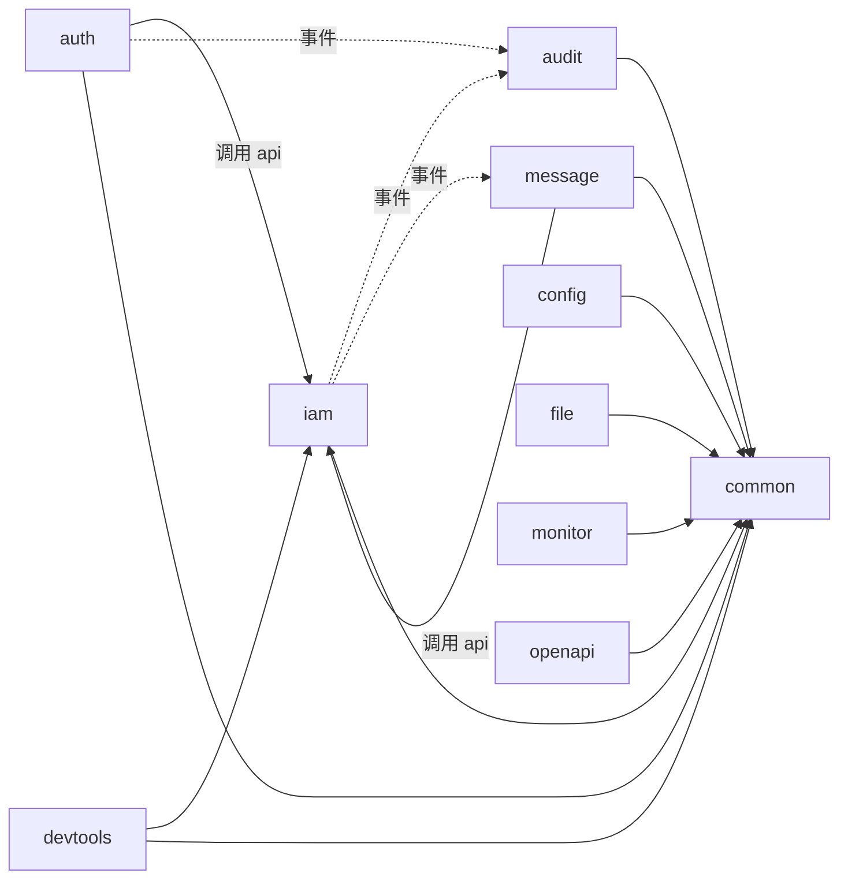

# JBolt 产品能力迁移到 Spring Modulith 的执行方案

> 编写日期：2026-11-10
> 参考工程：..\jbolt_ai_platform_jfinal_customer（JBoltAI Platform 4.5.0，JFinal 基座版）
> 目标基座：Spring Boot 4.1.x + Spring Modulith 2.1.x（当前稳定版 4.1.2 / 2.1.2）

## 1. 总体原则：照着 JBolt 的产品能力重新实现

JBolt 在这里的角色是“产品规格”：它规定了要做哪些功能、页面如何交互、数据应当怎样组织。新框架的代码需要按 Spring 的方式重新编写。原因有三点。

1. **核心逻辑不在源码里。** 工程里的 `UserService`、`RoleService`、`PermissionService`、`RolePermissionService` 都是空子类，只继承 `lib/jbolt_core.jar` 中的 `JBolt*Service`。权限拦截（`JBoltAdminAuthInterceptor`）、缓存（`JBolt*Cache`）、代码生成（`cn/jbolt/core/gen`）和 Enjoy 模板指令也都在这个闭源 jar 里。
2. **技术栈不能直接对接。** JBolt 基于 JDK 1.8、`javax`、JFinal 的 Controller/ActiveRecord/Enjoy/`@Inject`、cron4j 和 JFinal-event。Spring Boot 4 至少需要 Java 17，并且使用 `jakarta`、Spring MVC 和 Spring 的依赖注入、事务与事件体系。
3. **授权限制。** README 写明：源码只允许已获得使用权的成员使用，范围是学习、二次开发、客户定制和自有产品研发，并且“禁止使用 JBoltAI 平台源码开发的项目直接开源”。如果新框架只给自己或公司使用，参考 JBolt 属于这个范围。如果新框架计划开源，就不要复制 JBolt 的代码、SQL 脚本、页面模板和前端插件（例如 `jbolt-table`），只按功能规格重新实现，并事先和 JBolt 官方确认。

因此，迁移流程是：**运行 JBolt，记录它的功能和交互，写成功能清单，按 Modulith 的模块边界重新设计表和接口，然后实现，最后逐项验收。**

## 2. JBolt 现有能力盘点

以下信息来自初始化 SQL（`readme/jbolt_mysql_id_long.sql`）、`cn.jbolt._admin.*` 包、`PermissionKey.java` 和 `_view/_admin` 页面目录。

| 能力 | JBolt 证据（表 / 包） | 新框架模块 | 优先级 |
|---|---|---|---|
| 用户管理（含头像、重置密码、扩展信息、启用禁用） | `jb_user`、`jb_user_extend`、`_admin/user` | `iam` | P1 |
| 部门（树形，`dept_path`） | `jb_dept`、`_admin/dept` | `iam` | P1 |
| 岗位 | `jb_post`、`_admin/post` | `iam` | P1 |
| 角色（支持父角色 `pid`） | `jb_role`、`_admin/role` | `iam` | P1 |
| 权限资源（菜单和按钮同一棵树，`permission_key`、`is_menu`、打开方式） | `jb_permission`、`_admin/permission` | `iam` | P1 |
| 角色授权 | `jb_role_permission`、`_admin/rolepermission` | `iam` | P1 |
| 顶部导航分组（顶部导航对应左侧一级菜单） | `jb_topnav`、`jb_topnav_menu`、`_admin/topnav` | `iam` | P1 |
| 超级管理员（默认拥有所有权限，可免校验） | `is_system_admin`、`is_system_admin_default`、`@UnCheckIfSystemAdmin` | `iam` + `auth` | P1 |
| 登录、验证码、异地登录识别 | `cn/jbolt/core/captcha`、`jb_remote_login_log`、ip2region | `auth` | P1 |
| 在线用户和强制下线 | `jb_online_user`、`_admin/onlineuser`、`JBoltOnlineUserClearTask` | `auth` | P2 |
| 数据字典（类型和条目） | `jb_dictionary_type`、`jb_dictionary` | `config` | P2 |
| 全局参数（类型和参数） | `jb_global_config_type`、`jb_global_config` | `config` | P2 |
| 用户界面偏好（主题、布局等） | `jb_user_config`、`_admin/userconfig` | `config` | P2 |
| 登录日志 | `jb_login_log`、`_admin/loginlog` | `audit` | P2 |
| 关键操作日志 | `jb_system_log`、`_admin/systemlog` | `audit` | P2 |
| 系统通知、已读记录、站内信、待办 | `jb_sys_notice`、`jb_sys_notice_reader`、`jb_private_message`、`jb_todo`、`_admin/msgcenter` | `message` | P3 |
| WebSocket 推送 | `_admin/websocket` | `message` | P3 |
| 文件中心、七牛云存储 | `jb_jbolt_file`、`jb_qiniu`、`jb_qiniu_bucket` | `file` | P3 |
| 服务器、Druid 和日志监控 | `_admin/monitor`、oshi、Druid | `monitor` | P3 |
| 缓存管理 | `_admin/cache`、`JBolt*Cache` | `monitor` | P3 |
| 代码生成器 | `jb_code_gen`、`jb_code_gen_model_attr`、`_admin/codegen` | `devtools` | P4 |
| 数据库文档 | `admin/devdoc/database`、screw | `devtools` | P4 |
| 开放平台应用（AppID、Secret、签名） | `jb_application`、`admin/appdevcenter`、`JBoltApiAuthInterceptor` | `openapi` | P4 |
| 敏感词 | `jb_sensitive_word` | `common` 工具 + `config` 维护 | P4 |
| 打印模板 hiprint、UReport 报表 | `jb_hiprint_tpl`、`common/ureport` | 按需 | P5 |
| 微信公众号 | `jb_wechat_*`、`admin/wechat` | `wechat`（可选） | P5 |
| AI 平台（知识库、智能体、模型资源） | `com.jboltai.platform.ai.*` | `ai`（可选，单独立项） | P5 |

权限注解的使用情况：`@CheckPermission` 89 处，`@UnCheck` 84 处，`@UnCheckIfSystemAdmin` 43 处。常见写法是在控制器类上声明需要的权限，再在方法上用 `@UnCheck` 豁免下拉选项、自动补全等公共接口。jar 里还有 `OnlySaasPlatform` 和 `MustCheckSaasTenantPermission` 两个注解，说明 JBolt 有 SaaS 多租户版本，但当前工程的表里没有租户字段。

## 3. 目标模块划分

```text
com.example.admin
├─ AdminApplication            @Modulithic(sharedModules = "common")
├─ common     共享基础设施：统一返回、异常、分页、审计字段、ID 生成、权限注解、当前用户接口、Excel 工具
├─ auth       登录、令牌、验证码、在线用户、异地登录、安全过滤器
├─ iam        用户、部门、岗位、角色、权限资源、顶部导航
│   └─ api    @NamedInterface("api")：UserQuery、PermissionQuery 等只读接口和 DTO
├─ config     数据字典、全局参数、用户偏好
├─ audit      登录日志、操作日志（只消费事件）
├─ message    通知、站内信、待办、WebSocket
├─ file       文件元数据、本地/OSS/七牛存储适配
├─ monitor    服务器指标、缓存管理、事件发布管理
├─ devtools   代码生成、数据库文档
└─ openapi    开放平台应用和签名校验
```



依赖规则如下。

- `common` 是共享模块，所有模块都可以依赖它，它不依赖任何业务模块。
- 其他模块只能调用 `iam::api` 暴露的只读查询。修改用户、角色等数据只能通过 `iam` 自己的接口完成。
- `audit` 只监听事件，其他模块都不依赖它，这样日志功能可以单独开关和替换。
- 在每个模块的 `package-info.java` 中用 `@ApplicationModule(allowedDependencies = ...)` 写明白名单，再由 `ModularityTests` 执行 `verify()`。
- 表名前缀标明所属模块，例如 `iam_user`、`config_dictionary`、`audit_login_log`。SQL 不能跨模块 join；需要其他模块的数据时调用 API，或者在本模块保存一份快照（例如操作日志里直接存用户名）。

## 4. 关键设计如何从 JBolt 转换过来

### 4.1 权限校验

| JBolt | 新框架 |
|---|---|
| 类级 `@CheckPermission(PermissionKey.USER)` | `common` 提供 `@RequiresPermission("iam:user")`，实现为 Spring Security 的 `@PreAuthorize` 元注解模板 |
| 方法级 `@UnCheck` | `@PermitLoggedIn`（登录即可访问）或 `@PermitAll`（无需登录） |
| `@UnCheckIfSystemAdmin` | 超级管理员在权限判断中统一放行，不再逐个控制器标注 |
| `JBoltAdminAuthInterceptor` 挂在后台路由上 | `auth` 模块的 SecurityFilterChain 对 `/api/admin/**` 默认要求登录，方法安全负责细粒度权限 |
| 页面上用 `#permission` 指令控制按钮 | 后端 `/api/auth/me` 返回权限 key 集合，前端用 `v-permission` 指令控制按钮显示 |

后端必须对每个写操作接口做权限校验。前端隐藏按钮只改善体验，不能代替后端校验。

### 4.2 权限资源与 key 的来源

JBolt 通过 GUI 维护 `jb_permission`，再生成 `PermissionKey.java` 常量。新框架改为**由代码声明权限，启动时同步到数据库**。

- 每个模块提供一个 `PermissionCatalog` Bean，在代码里声明本模块的菜单、按钮和 key，例如 `iam:user`、`iam:user:create`。
- `iam` 模块实现一个 `ApplicationModuleInitializer`，启动时按模块依赖顺序把声明增量写入 `iam_permission`。已有记录按 key 匹配，只更新代码负责的字段；管理员在界面上调整过的排序、图标、顶部导航归属等字段保留不变。代码里已经删除的 key 标记为“失效”，不直接删除。
- 注解里使用的 key 和数据库中的 key 来自同一处声明，可以避免 key 写错或忘记录入。

表结构建议规范化：

- `iam_permission`：用 `type`（目录、菜单、按钮）代替 `is_menu`，并增加 `owner_module`、`route_path`、`component`、`open_type`（标签页、iframe、弹窗、新窗口）、`visible`、`enabled` 和 `builtin`。
- JBolt 的 `jb_user.roles`、`jb_user.posts` 是逗号分隔字符串。新框架拆成 `iam_user_role` 和 `iam_user_post` 两张关联表，方便查询和建立索引。
- 保留角色父子关系（`parent_id`）。是否让子角色继承父角色的权限需要先决定；JBolt 闭源部分的具体规则无法从源码确认，需要运行 JBolt 实测。

### 4.3 缓存

JBolt 为用户、角色、权限、字典和全局参数分别写了缓存类。新框架统一使用 Spring Cache，单实例用 Caffeine，多实例换成 Redis。缓存清理通过事件触发：例如 `RolePermissionsChanged` 事件发布后，由监听器清理相关用户的权限缓存。

### 4.4 日志与事件

JBolt 用 JFinal-event 和线程池异步写日志。新框架的做法如下。

- `auth` 发布 `UserLoggedIn`、`LoginFailed`、`UserLoggedOut` 事件。
- 业务模块的关键操作在 `common` 的 `@AuditLog` 切面中发布 `OperationPerformed` 事件。
- `audit` 用 `@ApplicationModuleListener` 消费事件。事件先进入 `event_publication` 表，消费失败后可以重新投递。
- `monitor` 增加一个“事件发布管理”页面，展示失败的事件并支持一键重试。这是 Modulith 新增的能力，JBolt 没有对应功能。

### 4.5 登录状态与在线用户

JBolt 支持在线用户列表和强制下线，所以服务端必须保存会话状态。可选两种做法。

- **服务端保存的不透明令牌**（推荐）：令牌存在 Redis 或数据库里，在线用户列表直接查令牌表，强制下线就是删除令牌。前后端分离和多实例部署都容易实现。
- **JWT 加服务端黑名单**：令牌本身无状态，但要实现强制下线，仍然需要一张黑名单。复杂度不比上一种低。

### 4.6 前端

JBolt 前端是 Enjoy 服务端模板，搭配 jQuery、Bootstrap、layer 和 JBolt 自研的 `jbolt-table`、ajax portal，与 JFinal 的结合很紧。建议新框架改为前后端分离：

- 前端使用 Vue 3、TypeScript、Vite，组件库在 Element Plus、Ant Design Vue 和 Naive UI 中选一个。
- 复刻 JBolt 的布局能力：顶部导航分组、左侧菜单、多标签页、iframe 和弹窗打开方式，以及用户界面偏好（主题、布局）。
- 后端提供 `/api/auth/me`，返回当前用户、权限 key 集合和菜单树。前端根据菜单树生成动态路由。

### 4.7 其他需要尽早决定的问题

- **多数据库。** JBolt 支持 MySQL、Oracle、PostgreSQL、SQL Server 和达梦。如果新框架也要支持多种数据库，从第一张表开始就要按数据库厂商分别准备 Flyway 脚本，SQL 写法也要兼容这些数据库。
- **多租户。** 如果将来要做 SaaS，第一阶段就要在表里加 `tenant_id`，并决定隔离方式（共享表加租户字段、每个租户一个 schema，或每个租户一个库）。后补的代价很大。
- **数据权限。** 当前 JBolt 版本的表结构里没有看到数据权限字段。可以借助 `dept_path` 实现“本部门”“本部门及下级”“仅本人”等数据范围，作为 `iam` 的增强功能。
- **`of_module`。** JBolt 在用户和权限表里用 `of_module` 区分多个后台（例如核心后台和其他业务后台）。如果新框架也有多个后台入口，可以保留一个 `portal` 字段，否则不需要。

## 5. 技术选型建议

| 项目 | 建议 | 说明 |
|---|---|---|
| JDK | 21 LTS（也可用 25） | Boot 4 至少需要 Java 17 |
| 基座 | Spring Boot 4.1.2 + Spring Modulith 2.1.2 | Modulith 2.1.2 基于 Boot 4.1.2 编译 |
| 持久层 | MyBatis-Plus 3.5.18.1（`mybatis-plus-spring-boot4-starter`） | 它基于 Boot 4.1.0 构建，CRUD 写法接近 JBolt 的 ActiveRecord；也可以用 JPA 或 jOOQ |
| 数据库迁移 | Flyway，开启 `spring.modulith.runtime.flyway-enabled` | 脚本按模块放在 `db/migration/<模块名>` |
| 事件登记表 | `spring-modulith-starter-jdbc` | 和 MyBatis 共用 `DataSourceTransactionManager` |
| 安全 | Spring Security 7 + 服务端令牌 | 支持在线用户和强制下线 |
| 缓存 | Spring Cache + Caffeine，多实例时用 Redis | |
| 接口文档 | springdoc-openapi | 第 0 阶段需要确认它对 Boot 4 的兼容版本 |
| 前端 | Vue 3 + TS + Vite + 一套组件库 | 前后端分离 |

## 6. 分阶段执行计划

每个阶段都遵循同一条底线：每个模块有自己的 Flyway 脚本、`@ApplicationModuleTest` 集成测试，并且全局 `verify()` 通过。

| 阶段 | 内容 | 验收标准 |
|---|---|---|
| 0. 环境与骨架 | 安装 JDK 21 和 Maven（或使用 Maven Wrapper），准备 MySQL 8；搭建 Boot + Modulith 工程、`common` 模块、统一返回和异常处理、Flyway、`ModularityTests`、Documenter 文档生成；同时在本机跑起 JBolt 作为对照（JDK 8，导入 `jbolt_mysql_id_long.sql`，默认账号 admin / 123） | 能启动、`verify()` 通过、生成模块图；能登录 JBolt 对照环境 |
| 1. 身份与权限核心 | `auth`：登录、验证码、令牌、退出；`iam`：用户、部门、岗位、角色、权限资源、角色授权、顶部导航、超级管理员；`PermissionCatalog` 同步；`/api/auth/me` | 新建角色后只授权部分菜单和按钮，用该角色的用户登录，只能看到对应菜单；直接调用未授权接口返回 403；超级管理员拥有全部权限 |
| 1'. 前端外壳（与阶段 1 并行） | 登录页、顶部导航加左侧菜单、多标签页、动态路由、`v-permission`；用户、角色、菜单、部门、岗位管理页面 | 上述权限场景在界面上表现一致 |
| 2. 系统配置 | 数据字典、全局参数、用户界面偏好，以及缓存和事件驱动的缓存清理 | 修改字典或参数后，不需要重启即可生效 |
| 3. 审计与运维 | 登录日志（含 IP 归属地）、操作日志、在线用户和强制下线、异地登录提醒；服务器监控（Actuator + oshi）、事件发布管理页面 | 被强制下线的用户下一次请求返回 401；失败事件可在界面上重试 |
| 4. 消息与文件 | 系统通知、已读状态、站内信、待办、WebSocket 推送；文件中心、本地 / OSS / 七牛存储适配 | 发布通知后，在线用户实时收到，已读状态正确 |
| 5. 开发平台 | 代码生成器：从表结构生成符合 Modulith 规范的模块，包括包结构、`package-info`、实体、Mapper、Service、Controller、Flyway 脚本、`PermissionCatalog` 声明、Vue 页面和模块测试；数据库文档；开放平台应用和签名校验 | 生成的模块无需修改即可通过 `verify()`，菜单自动出现并可授权 |
| 6. 可选能力 | 微信公众号、hiprint 打印、报表、敏感词、AI 平台 | 按需立项 |

## 7. 每项能力的迁移流程

1. **观察。** 在 JBolt 对照环境中操作这个功能，记录列表字段、查询条件、表单字段与校验规则、按钮及其权限 key、边界行为（例如删除部门时下面还有用户怎么处理），并截图。
2. **写功能清单。** 用 Markdown 列出可以逐项验证的条目，放在 `docs/features/<模块>.md`。
3. **设计。** 确定表结构（规范化、加模块前缀）、REST 接口、发布与监听的事件，以及对外暴露的 API。
4. **实现。** 按模块开发，完成后运行 `verify()` 和模块测试。
5. **验收。** 对照功能清单逐项检查，并和 JBolt 的行为做对比。

## 8. 决策记录与待决策事项

已确定（2026-11-10）：

- 前后端分离：后端 backend/（Spring Boot 4.1.2 + Spring Modulith 2.1.2，Java 21），前端 frontend/（Vue 3 + Vite + TypeScript）。
- 首版只支持 MySQL 8，后续再扩展其他数据库。
- 骨架默认选用 MyBatis-Plus 3.5.18.1 和 Element Plus 2.14，可在开发开始前调整。
- JBolt 的详细研究见 docs/jbolt-research/，其中第 6 节的分阶段计划仍然适用。

仍待决定：

1. 新框架是自用或公司内部使用，还是准备开源？这决定了能在多大程度上参考 JBolt 的实现细节。
2. 是否需要多租户？
3. 登录状态：服务端令牌还是 JWT？是否需要单点登录（SSO）？

