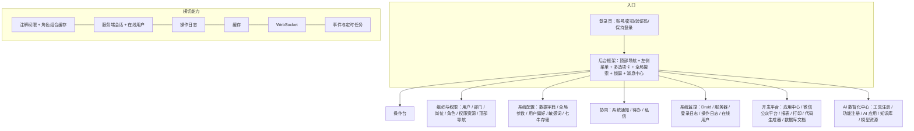
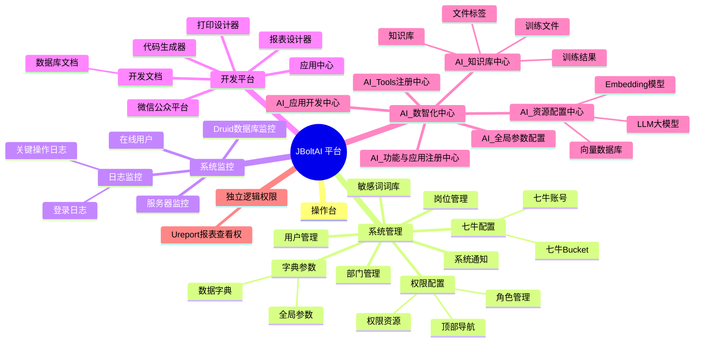
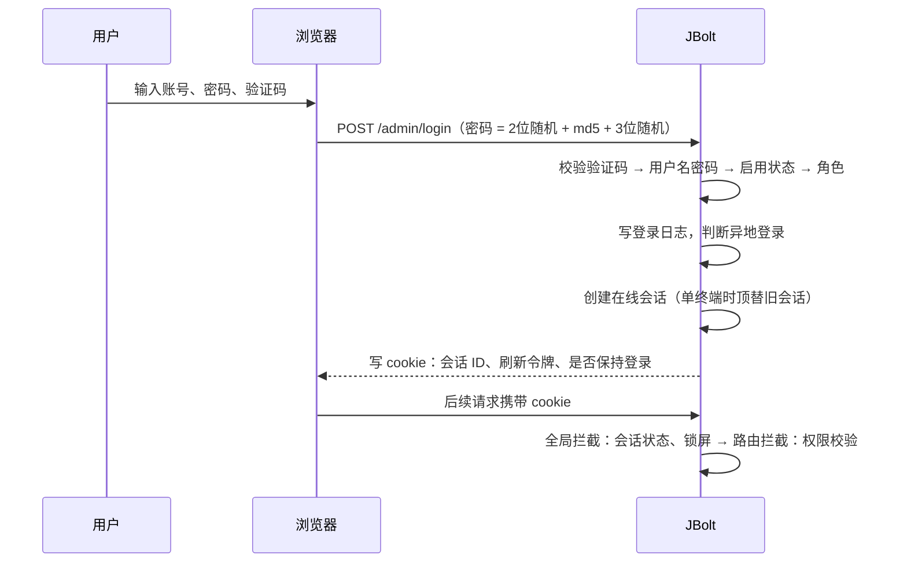
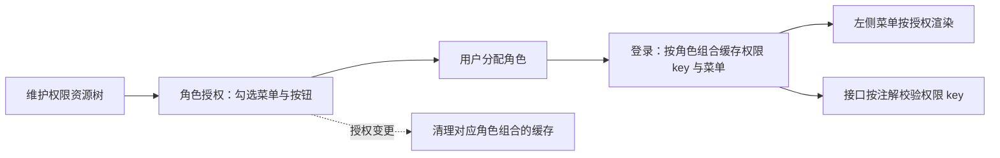

# JBolt 产品设计与功能地图

> 研究对象：JBoltAI Platform 4.5.0（JFinal 基座版，jbolt_core 5.3.6），原工程目录 `jbolt_ai_platform_jfinal_customer`。
> 依据：源码与页面模板、初始化数据（permission_init.json、dictionary_init.json）、闭源 jbolt_core.jar 的字节码与反编译、本机运行的参考实例（巡检 24 个菜单页面）。
> 明细资料：[07 功能目录](jbolt-research/07-feature-catalog.md)（每个菜单的页面元素与全部控制器动作）、[08 配置目录](jbolt-research/08-config-catalog.md)（全局参数与内置字典）、[03 数据字典](jbolt-research/03-data-dictionary.md)、[05 接口清单](jbolt-research/05-endpoint-inventory.md)、[06 运行观察](jbolt-research/06-runtime-observation.md)、[02 底层能力](jbolt-research/02-core-capabilities.md)。

## 1. 产品定位

JBolt 是面向企业内部管理系统的**后台底座产品**：开箱提供组织权限、系统配置、安全审计、消息协同和开发工具，具体业务由二次开发或代码生成器在其上扩展。JBoltAI 版本在原版 JBolt Pro 之上增加了 AI 数智化中心（模型资源、知识库、AI 应用、工具注册）。

| 维度 | 设计 |
|---|---|
| 用户 | 系统超级管理员、业务管理员、普通后台用户、开发人员（代码生成、开发文档） |
| 形态 | 单体 Web 应用，服务端渲染（Enjoy 模板 + pjax），一个后台入口，可通过“所属模块”扩展多个后台 |
| 默认账号 | admin / 123（超级管理员“总管理”），首次启动自动创建 |
| 可配置性 | 约 40 个全局参数控制登录、安全、界面、部门/岗位/扩展信息开关；41 类内置字典 |
| 多数据库 | MySQL、Oracle、PostgreSQL、SQL Server、达梦 |
| 多语言 | 无（界面与提示均为中文硬编码） |

## 2. 产品架构

## 3. 功能地图

### 3.1 全景

### 3.2 功能总表

“状态”列来自参考实例巡检：正常 = 页面可打开且无异常；关闭 = 默认配置关闭；AI = 依赖闭源 jboltai_sdk，参考实例未包含。

| 一级 | 功能 | 权限 key | 打开方式 | 核心能力 | 主要数据表 | 状态 |
|---|---|---|---|---|---|---|
| 操作台 | 操作台 | dashboard | 主区域 | 系统首页、快捷入口 | — | 正常 |
| 系统管理 | 用户管理 | user | 主区域 | 增删改查、启停、重置密码、头像、角色/部门/岗位分配、扩展信息 | jb_user、jb_user_extend | 正常 |
| | 部门管理 | dept | 主区域 | 树表、新增下级、排序、启停、路径补全 | jb_dept | 正常 |
| | 岗位管理 | post | 主区域 | 列表、排序、启停 | jb_post | 正常 |
| | 角色管理 | role | 主区域 | 角色树、编码、查看角色用户、分配权限入口 | jb_role、jb_role_permission | 正常 |
| | 顶部导航 | topnav | 主区域 | 导航项、图标、排序、启停、分配一级菜单 | jb_topnav、jb_topnav_menu | 正常 |
| | 权限资源 | permission | 主区域 | 菜单/按钮树、打开方式、超管默认、插入位置、生成 PermissionKey | jb_permission | 正常 |
| | 数据字典 | dictionary | 主区域 | 字典类型树 + 字典项、一级/多级、内置保护、检测并初始化 | jb_dictionary_type、jb_dictionary | 正常 |
| | 全局参数 | globalconfig | 主区域 | 参数分组、编辑、布尔切换、刷新缓存、重置、自定义参数 | jb_global_config、jb_global_config_type | 正常 |
| | 系统通知 | sys_notice | 主区域 | 发布通知、接收范围、附件、已读统计、回收站 | jb_sys_notice、jb_sys_notice_reader | 正常 |
| | 七牛账号 / Bucket | qiniu / qiniu_bucket | 主区域 | 账号 AK/SK、默认账号、Bucket 同步与回调配置 | jb_qiniu、jb_qiniu_bucket | 正常 |
| | 敏感词词库 | sensitive_word | 主区域 | 词库维护、启停 | jb_sensitive_word | 正常 |
| 系统监控 | Druid 数据库监控 | druid_monitor | 主区域 | SQL 统计、连接池 | — | 正常 |
| | 服务器监控 | jbolt_server_monitor | 主区域 | CPU、内存、磁盘、JVM | — | 正常 |
| | 登录日志 | jbolt_login_log | 主区域 | 登录结果、IP 归属地、浏览器/系统、异地登录 | jb_login_log、jb_remote_login_log | 正常 |
| | 关键操作日志 | systemlog | 主区域 | 按时间、关键字查询，查看被操作对象 | jb_system_log | 正常 |
| | 在线用户 | online_user | 主区域 | 会话列表、状态、强制下线 | jb_online_user | 正常 |
| 开发平台 | 应用中心 | application | 主区域 | 应用类型、AppId/Secret、签名校验、关联对象 | jb_application | 正常 |
| | 微信公众平台 | wechat_mpinfo（+9 个按钮权限） | 主区域 | 多公众号/小程序、基础/支付配置、菜单、自动回复、素材、粉丝 | jb_wechat_*（9 张） | 正常 |
| | 报表设计器 | ureport_designer | iframe | UReport 设计器 | — | 关闭 |
| | 打印设计器 | hiprint_design | iframe | hiprint 模板设计、测试数据 | jb_hiprint_tpl | 正常 |
| | 代码生成器 | jbolt_code_gen | 主区域 | 表选择、生成配置、字段配置、生成代码与菜单 | jb_code_gen、jb_code_gen_model_attr、jb_datasource_filter | 正常 |
| | 数据库文档 | admin_dev_doc_database | 主区域 | 基于 screw 生成数据库文档 | — | 正常 |
| AI 中心 | Tools 注册、功能注册、应用开发、知识库（4 项）、全局参数、资源配置（3 项） | admin_ai_* | 主区域 | 见 4.16 | tb_ai_*（16 张） | AI |
| 逻辑权限 | Ureport 报表查看权 | ureport_detail | — | 不出现在菜单中的纯权限点 | — | — |

菜单之外还有 47 个路由前缀：页面级子功能（如字典类型、全局参数分组、待办、消息中心）、公共接口（上传、富文本、编辑器预览）、对外 API（`/api/*` 的 JWT、用户、WebSocket 访客令牌）、微信回调与测试入口，完整列表见 07 功能目录末尾。

## 4. 功能域设计

每个功能域的完整页面元素（查询条件、工具栏、列表字段、行操作、表单字段）和全部控制器动作见 [07 功能目录](jbolt-research/07-feature-catalog.md)，本节说明产品设计意图和业务规则。

### 4.1 登录与后台框架

- **登录页**：用户名、密码、验证码（图形，点击刷新）、“保持登录”。登录页模板可通过全局参数切换（多套登录页）；验证码可关闭，类型可选默认图形、GIF、气泡、算术、中文算术。前端提交 `2 位随机串 + md5(密码) + 3 位随机串`。
- **登录校验顺序**：验证码 → 用户名密码 → 是否禁用 → 是否分配角色（超管除外）→ 记录登录日志 → 异地登录判断 → 创建在线会话 → 写入 cookie。每一步失败都写登录日志（状态码 1 成功、2 验证码错误、3 用户名或密码错误、4 已禁用、5 未分配角色、6 未知异常）。
- **后台框架**：左侧多级菜单（最多三级）、可选顶部导航分组、可选多选项卡（刷新后可保持选项卡）、全局菜单搜索、主题样式、左侧导航宽度。页面在主区域、弹窗、iframe、独立单页、侧滑层五种容器中复用同一模板。
- **会话安全**：保持登录与不保持登录两种 cookie 时长；可设置单终端登录（新登录顶替旧会话，旧会话收到“异端顶替”提示）；无操作自动锁屏，可设置自动登录后先锁屏；解锁需输入密码；超过设定天数未改密码给出提醒。
- **个人中心**：修改密码、修改头像、个人界面偏好（主题、多选项卡、登录页背景模糊与线条特效）。

### 4.2 用户管理

- 列表：序号、姓名、头像、性别、角色、（部门）、（岗位）、用户名、手机号、邮箱、是否超管、扩展信息、启用开关。查询：关键字（姓名/用户名/手机/拼音）、所属模块、性别、岗位、角色、状态；启用部门时左侧部门树筛选，可查看“未分配部门”的用户。
- 表单：姓名、编号、性别、年龄、手机号、E-Mail、用户名、密码（仅新增）、角色（多选）、部门、岗位（多选）；启用“用户扩展信息”后同屏维护身份证、民族、地址、婚姻、政治面貌、职称等。
- 规则：用户名唯一且不超过 40 字符；非超管看不到超管账号；不能删除或禁用超管；不能删除、禁用自己，不能修改自己的角色；新增时自动生成拼音码、按性别给默认头像、写入部门路径；变更角色时清理对应的权限缓存；每次新增、修改、删除写关键操作日志。

### 4.3 部门与岗位

- 部门是树表：部门名称、全称、类型（字典 dept_type）、负责人、电话、邮箱、地址、邮编、机构代码（唯一）、备注、排序、启停；支持新增下级、上移下移、初始化排序、部门路径补全。管理界面可在“树形表格”与“JS 树”两种形态间切换。
- 岗位是平铺列表：名称、类型（字典 post_type）、编码、备注、排序、启停。
- 部门、岗位、用户扩展信息三项功能各有全局开关，关闭后相关字段和筛选条件从界面上消失。

### 4.4 角色、权限资源、角色授权、顶部导航

- **角色**：树形结构（父子关系仅用于组织展示，**不继承权限**），名称 + 编码；有下级或已被用户使用的角色不能删除；可查看、移除角色下的用户；角色编码可生成常量类供代码判断。
- **权限资源**：菜单与按钮在同一棵树中维护。字段：所属模块、上级、名称、图标、地址、权限 key、是否菜单、加载方式（当前窗口/新窗口）、打开类型（系统默认/iframe/弹窗/侧滑层）、组件属性、是否超管默认、插入位置（开头/之前/之后/末尾）。可一键生成 PermissionKey 常量类，让代码中的注解引用。
- **角色授权**：左侧角色、右侧完整权限树勾选，提交后整体替换该角色的授权并刷新缓存。
- **顶部导航**：定义导航项（名称、图标、排序、启停），每项挂若干一级菜单；启用后顶部出现导航条，切换导航即切换左侧菜单组。
- **生效规则**：用户权限 = 所有直接分配角色的授权并集；超级管理员不是无条件全权，而是自动拥有“超管默认”权限，再叠加自身角色权限；控制器未声明任何权限的接口默认拒绝访问。

### 4.5 数据字典

- 字典类型：名称、类型 key、层级（一级/多级）、启停、是否内置；字典项：名称、编码、上级、排序、启停、是否内置。
- 内置字典不可修改、不可禁用；是否允许删除字典由全局参数控制；“检测并初始化”按钮按初始化文件补齐内置字典（41 类、301 项，见 08 配置目录）。
- 字典在全系统用于下拉选项、列表翻译、代码生成器的字段翻译。

### 4.6 全局参数

- 参数按分组管理（系统基础、系统安全、备案、后台登录、后台样式、微信开发，及 AI 配置），每个参数有名称、KEY、值、值类型（string/boolean/int）、是否内置、备注。
- 内置参数不可删除，可修改值；布尔参数可直接切换；提供刷新缓存、重置全部、自定义参数。参数在首次被读取时自动创建（参考实例访问各页面后共 39 项）。
- 完整参数表见 08 配置目录，其中影响产品行为的关键开关见第 8 节。

### 4.7 系统通知、待办、私信与消息中心

- **系统通知**：标题、富文本内容、类型、优先级、接收人类型（全部/角色/部门/岗位/指定用户）与接收人、附件；列表显示已读数、创建/更新时间与人；支持回收站（逻辑删除）。用户阅读后写入阅读记录。
- **待办**：所属用户、标题、内容或链接、优先级、状态、规定完成时间、实际完成时间、取消时间、是否已读；预留第三方来源字段（来源系统、消息/流程 ID、来源 URL、收发人标识），可承接 OA 或流程引擎推送的待办。
- **私信**：发信人、收信人、内容。
- **消息中心**：后台右上角统一入口，汇总通知、待办、私信；新消息通过 WebSocket 实时推送。

### 4.8 文件与存储

- 文件库记录上传文件的本地路径、访问 URL、CDN 地址、类型（图片/附件/视频）、大小、后缀和上传人；全局上传位置可选本地、七牛、阿里 OSS。
- 七牛账号（AK/SK、默认账号、启停）与 Bucket（地区、域名、回调地址与回调体、有效期、默认）分开维护，可从七牛同步 Bucket。

### 4.9 敏感词

词库维护与启停；开启全局检测后，可在业务中调用检测接口（如顶部导航名称输入会被拦截）。

### 4.10 系统监控

- **Druid 数据库监控**：SQL 执行统计、慢 SQL、连接池状态，受独立权限保护。
- **服务器监控**：CPU、内存、磁盘、JVM 等运行指标（oshi）。
- **登录日志**：用户名、IP、国家/省/市、浏览器与版本、操作系统、是否移动端、登录状态、是否异地登录、登录时间。
- **关键操作日志**：数据类型、操作类型（新增/更新/删除/恢复及其关联子表操作）、日志描述（可点击打开被操作对象）、操作人、时间。
- **在线用户**：用户名、会话 ID、关联登录日志、在线状态（在线/离线/强退/顶替）、登录/更新/过期/离线时间；超管可强制下线他人，不能强退自己和超管；每分钟清理过期会话。

### 4.11 开发平台

- **应用中心**：应用名称、类型（内置平台、PC 网页、H5、公众号 H5、各类小程序、APP、桌面端等 13 种）、AppId/AppSecret、简介、是否启用、是否校验签名、关联对象。对外 API 使用 JWT（HS256）与签名（timestamp + nonce + signature），可通过“有效性因子”使已签发令牌整体失效。
- **微信公众平台**：多个公众号/小程序（订阅号、服务号、企业微信、小程序），每个平台有基础配置、支付配置、其它配置、自定义菜单、素材库、关注回复、关键词回复、默认回复、粉丝管理，以及与应用中心的关联。
- **报表设计器**（UReport，默认关闭）与 **打印设计器**（hiprint，模板 + 测试 API/JSON）。
- **代码生成器**：从数据源选择表，配置构建类型（普通 CRUD、普通表格、主从、子表等）、是否树表、是否可编辑表格、页面布局（头/左/右/底区域）、工具栏、导入导出 Excel、查询条件与模糊查询、表单组件与校验、字段翻译（字典/枚举/缓存/Service）、上传到七牛、缓存策略，生成 Model、Service、Controller、路由、页面，并自动创建菜单权限、绑定顶部导航与角色。
- **数据库文档**：一键生成项目数据库结构文档。

### 4.12 AI 数智化中心（依赖闭源 SDK）

| 功能 | 设计要点 |
|---|---|
| AI_Tools 注册中心 | 注册可被大模型调用的工具：编码、类型（Java Service 方法或 HTTP API）、功能描述、调用前置要求、必填参数、返回值处理、参数管理、调用次数、启停 |
| AI_功能与应用注册中心 | 注册系统功能页面供 AI 检索跳转：名称、编号、类型、描述、打开方式、页面地址、应用角色、权限 key；可同步到向量库 |
| AI_应用开发中心 | 配置 AI 应用：模型参数（温度、top_p、top_k、max_tokens）、system/prompt 模板、首次进入场景、知识库无匹配回复、挂载工具与知识库、UI 布局/对话/气泡风格、背景与头像、移动端/PC 测试、发布与访问链接（访客、密码、系统内嵌、iframe 四种入口） |
| AI_知识库中心 | 知识库；训练文件（上传或抓取网页，拆分 → 训练 → 向量化三段状态，可重新训练）；训练结果（问答对，可编辑）；文件标签 |
| AI_全局参数配置 | AI 模块的参数分组 |
| AI_资源配置中心 | LLM（供应商、部署规格、用途场景、私有化、思考模式、API Key/URL、默认参数、频率限制、在线测试）、Embedding 模型、向量数据库 |

## 5. 权限与角色模型（产品视角）

| 概念 | 设计 |
|---|---|
| 权限资源 | 菜单（目录或页面）、按钮、逻辑权限三类，同一棵树，权限 key 全局唯一 |
| 角色 | 树形组织，多个角色可分配给同一用户，权限取并集，父角色不向子角色传递权限 |
| 超级管理员 | 用户属性；自动拥有“超管默认”权限；可额外分配角色；部分接口对超管免校验 |
| 默认拒绝 | 接口必须声明权限、登录即可或免登录，三者都没有则拒绝 |
| 顶部导航 | 把一级菜单分组，属于界面组织，不影响权限 |
| 所属模块 | 用户和权限资源都带“所属模块”，一个系统可以有多个后台入口，各自管理用户与菜单 |
| 数据权限 | 无内置机制，按部门路径在业务代码中自行过滤 |

## 6. 关键业务流程

### 6.1 登录与会话

### 6.2 授权生效

### 6.3 系统通知

管理员填写通知并选择接收范围 → 保存 → 在线接收人通过 WebSocket 收到提醒 → 用户在消息中心阅读 → 写入阅读记录，已读数增加。

### 6.4 代码生成

选择数据源与表 → 填写基础信息（包名、模型名、作者、构建类型）→ 设计字段（列表、查询、表单、翻译、校验）→ 生成代码与页面 → 自动创建菜单权限并挂到顶部导航与角色 → 重启（或热加载）后即可使用。

## 7. 交互规范

| 类别 | 规范 |
|---|---|
| 页面结构 | 标题区（图标 + 标题）、查询区（关键字 + 下拉条件 + 查询按钮）、工具栏（新增、刷新、初始化排序、导入导出等）、列表区（JBoltTable）、分页 |
| 列表 | 序号列、开关列（启停直接切换）、标签列（角色、状态）、操作列（编辑、删除、上移、下移、新增下级）；支持树表、固定列、列宽拖拽、行内编辑、主从表 |
| 表单 | 弹窗打开，数据属性驱动校验（必填、格式、长度）；下拉选项自动从字典或接口加载；保存后刷新列表 |
| 危险操作 | 删除、强退、重置等需二次确认 |
| 反馈 | 统一 JSON 结果（state + msg + data），按容器（主区域、弹窗、iframe）显示成功或失败 |
| 公共组件 | 部门树选择、用户选择、字典下拉、图片上传与裁剪、富文本、日期、地区、二维码、PDF 预览、打印 |

## 8. 配置能力

| 分组 | 关键参数 | 对产品行为的影响 |
|---|---|---|
| 系统基础 | 系统名称、LOGO、版权信息、静态资源版本 | 界面品牌与缓存刷新 |
| 系统安全 | 单终端登录、保持/不保持登录时长、自动锁屏秒数、自动登录后锁屏、改密提醒天数、字典删除开关、API 用户有效性检测 | 会话与安全策略 |
| 备案 | 备案号与链接 | 登录页页脚 |
| 后台登录 | 登录页模板、是否启用验证码、验证码类型、背景图、背景模糊、线条特效 | 登录体验 |
| 后台样式 | 主题、多选项卡、刷新保持选项卡、H50 紧凑布局、默认菜单图标、全局搜索、左侧导航宽度、部门管理形态、启用部门/岗位/用户扩展 | 界面形态与功能开关 |
| 微信开发 | 公众号、小程序、静态资源根 URL | 微信回调地址 |

内置字典 41 类，涵盖通用选项（布尔、启用、性别）、组织（机构类型、岗位类型）、消息（通知类型/优先级/接收人类型、待办优先级/状态/类型）、存储（七牛类型、地区）、代码生成器（主键策略、组件类型、校验规则、翻译类型等）以及 AI 相关字典，完整列表见 08 配置目录。

## 9. 数据对象地图

| 功能域 | 数据表 |
|---|---|
| 组织与权限 | jb_user、jb_user_extend、jb_dept、jb_post、jb_role、jb_permission、jb_role_permission、jb_topnav、jb_topnav_menu |
| 系统配置 | jb_dictionary_type、jb_dictionary、jb_global_config_type、jb_global_config、jb_user_config、jb_sensitive_word |
| 安全审计 | jb_online_user、jb_login_log、jb_remote_login_log、jb_system_log |
| 协同 | jb_sys_notice、jb_sys_notice_reader、jb_todo、jb_private_message |
| 文件存储 | jb_jbolt_file、jb_qiniu、jb_qiniu_bucket |
| 开发平台 | jb_application、jb_code_gen、jb_code_gen_model_attr、jb_datasource_filter、jb_hiprint_tpl、jb_wechat_*（9 张） |
| AI | tb_ai_*（16 张） |
| 自定义表格（未启用） | jbc_*（4 张） |

建模特点：雪花 bigint 主键、无外键、布尔用 char(1)、多对多用逗号串、树用 pid + 排序（部门另有物化路径）。详见 [04 数据结构分析](jbolt-research/04-data-model-analysis.md)。

## 10. 非功能特性

| 方面 | JBolt 的做法 |
|---|---|
| 安全 | 服务端会话 + 注解权限默认拒绝；XSS 过滤；禁用 PUT/DELETE 等 HTTP 方法；验证码；IP 限流；敏感词；数据库账号可加密 |
| 审计 | 登录日志（含地理位置与设备）、关键操作日志（可回跳对象）、异地登录记录 |
| 性能 | 各类主数据缓存（Caffeine 默认，可切 Redis），按角色组合缓存权限与菜单 |
| 实时 | WebSocket 推送消息与访客令牌 |
| 扩展 | 二开配置类（路由、拦截器、插件、数据源、启停钩子）、所属模块枚举、操作日志类型扩展、代码生成器 |
| 部署 | jar + 外置配置目录的 zip 包；支持多数据源与 5 种数据库；框架预留 SaaS 分表能力（本工程未启用） |
| 国际化 | 不支持 |

## 11. 到 Springboot Modulith Admin 的映射

| JBolt 功能域 | 新系统模块 | 优先级 | 主要变化 |
|---|---|---|---|
| 登录、会话、在线用户、锁屏 | auth | P1 | 前后端分离，服务端不透明令牌；保留单终端、强退、锁屏 |
| 用户、部门、岗位、角色、权限资源、角色授权、顶部导航 | iam | P1 | 多对多改关联表；权限资源由代码声明并同步；新增数据范围 |
| 数据字典、全局参数、用户偏好、敏感词 | config | P2 | 内置数据带消息 key，支持多语言 |
| 登录日志、操作日志 | audit | P2 | 通过事件写入，失败可重试 |
| 系统通知、待办、私信、消息中心 | message | P3 | WebSocket 推送；接收范围通过 iam 查询 |
| 文件库、七牛 | file | P3 | 存储适配器抽象（本地/对象存储） |
| Druid、服务器监控、缓存 | monitor | P3 | Actuator + 事件发布管理（失败事件重试） |
| 代码生成器、数据库文档 | devtools | P4 | 生成符合 Modulith 约束的模块、Flyway 脚本与 Vue 页面 |
| 应用中心、对外 API | openapi | P4 | 应用凭据与签名 |
| 微信、报表、打印、AI 中心 | 按需立项 | P5 | AI 能力需重新选型（不依赖闭源 SDK） |
| （新增）多语言 | 全模块 | P0 底座 | 见 [P03 i18n 方案](proposals/P03-i18n-architecture.md) |

