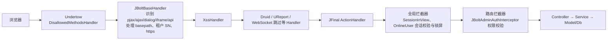

# 02 JBolt 底层能力与架构

> 证据：ProjectConfig、Starter、AdminRoutes 等源码；jbolt_core.jar 的 411 个 class（解析结果见 jbolt-core-api.md）；config.properties。标注“待反编译确认”的细节要在安装 JDK 后用反编译器核实。

## 1. 技术栈与运行方式

| 方面 | 实现 |
|---|---|
| 语言与构建 | Java 8（`jdk.version=1.8`），Maven，打包为 jar + lib + config 目录的 zip（maven-assembly-plugin，配置文件放在 jar 外） |
| Web 容器 | jfinal-undertow 3.8（Undertow 2.2），入口 `cn.jbolt.starter.Starter#main`，端口等在 undertow.properties |
| MVC | JFinal 5.2.7：Routes 注册控制器，URL = 路由前缀 + 方法名；Interceptor 实现 AOP；```Inject` 依赖注入 |
| 视图 | Enjoy 模板（服务端渲染），自定义指令 25 个（权限、角色、日期、字典翻译、图片地址等） |
| 持久层 | JFinal ActiveRecord（Model + Db + SQL 模板 .sql），自研 `JBoltActiveRecordPlugin`、方言（MySQL、Oracle、PostgreSQL、SQL Server、达梦）、多数据源 |
| 连接池 | Druid 1.2.24（带 SQL 监控），也引入 HikariCP |
| 缓存 | 可选 ehcache、Caffeine（默认）、Redis（jedis + fst/fury 序列化）、j2cache |
| 事件 | JFinal-event（net.dreamlu），16~32 线程池异步执行，扫描 `cn.jbolt._admin.event` |
| 定时任务 | cron4j，内置每分钟清理在线用户 |
| JSON | fastjson 1.2.83 为主，同时有 jackson、gson |
| 工具 | hutool、pinyin4j、zxing、POI（Excel/Word）、ip2region、oshi、jsoup、okhttp、javax.mail、jsqlparser、toolgood-words（敏感词）、sentinel（可选限流） |
| 闭源依赖 | `lib/jbolt_core.jar`（system scope）和 Maven 坐标 `com.jboltai:jboltai_sdk:4.2.93` |

## 2. 请求处理链



- `disallowed_http_methods` 默认禁用 TRACE、TRACK、PUT、DELETE、PATCH、CONNECT，后台接口只用 GET 和 POST。
- `JBoltBaseHandler` 根据请求头 `X-PJAX`、`X-Requested-With`、`Accept` 和参数 `_jb_rqtype_` 判断请求类型（normal、pjax、ajax、ajaxportal、dialog、iframe、singlepage、jboltapi），后续用来选择布局和错误渲染方式。
- 全局拦截器 `JBoltOnlineUserGlobalInterceptor`：根据 cookie `jboltid` 找在线会话，处理过期、被顶替、被强退、锁屏（锁屏时只放行 `/admin/unLockSystem`），把当前用户放入线程上下文 `JBoltUserKit`。
- 后台路由拦截器 `JBoltAdminAuthInterceptor`：要求控制器继承 `JBoltBaseController`，委托 `JBoltAuthInterceptorKit` 读取注解并校验。

## 3. 权限模型

- 注解：```CheckPermission(keys…)`（类或方法级，可要求全部满足 `isCheckAll`）、```UnCheck`（登录即可）、```UnCheckIfSystemAdmin`（超管跳过校验）、```Clear`（JFinal 原生，清除拦截器，用于登录页等）、```OnlySaasPlatform`、```MustCheckSaasTenantPermission`。
- 校验过程（已反编译 `JBoltAuthInterceptorKit.intercept` 确认）：
  1. 未登录 → 返回未登录提示；类或方法标了 `@UnCheck` → 放行。
  2. 读取方法级 `@CheckPermission`，没有则读类级；两者都没有 → “无权访问,当前访问资源尚未设置任何可校验权限”。也就是说后台接口默认拒绝，必须显式声明权限或 `@UnCheck`。
  3. 超管：标了 `@UnCheckIfSystemAdmin` → 放行；所需 key 全部（或任一，取决于 `checkAll`）属于“超管默认拥有”的权限 → 放行；否则继续按角色校验。**超管并不是无条件拥有全部权限。**
  4. 取当前用户角色 ID 串 → `JBoltPermissionCache.getRolePermissionKeySet(roles)`（按角色组合缓存，键形如 `roles_permission_keyset_<roles>`）→ 判断是否包含所需 key。角色无任何权限时提示“当前用户所属角色下尚未分配任何权限”，不包含时提示“无权访问”。
- 菜单：`getRoleMenus(roles)` 按角色组合缓存菜单树；超管使用 `is_system_admin_default` 菜单；顶部导航通过 `topnavId` 过滤一级菜单。
- 缓存失效：修改用户角色、角色授权、权限资源时调用 `removeRolesPermissionKeySet`、`removeRolesMenus` 等方法清理对应角色组合的缓存。
- 模板与代码中的判断：Enjoy 指令 `#permission`、`#role` 和 `JBoltUserAuthKit.hasPermission/hasRole/hasRoleSn`。
- 角色树的父子关系**不参与**权限继承：`JBoltRolePermissionService.getListByRoles` 只执行 `select distinct permission_id from jb_role_permission where role_id in (用户角色)`，取直接授权的并集（已反编译确认）。
- 超管菜单：`getMenusByRolesWithSystemAdminDefault` = 用户角色授权的菜单 ∪ 所有 `is_system_admin_default` 菜单；超管没有角色时只显示默认菜单。
- 没有数据权限（数据范围）机制；部门维度过滤靠业务代码使用 `dept_path` 自行实现。

## 4. 会话、令牌与 API 安全

- 后台：服务端会话表 `jb_online_user` + cookie `jboltid`（sessionId）+ cookie `jbolt_refresh_token`（JWT，比会话多 8 小时）+ cookie `jbolt_keeplogin`。这是“服务端会话 + 可续期令牌”的模式，因此能做在线列表、强退、单终端、锁屏。
- 对外 API：`JBoltApiJwtManger` 用 HS256 签发 `jboltjwt` 和 `jboltrefreshjwt`，携带 ApiUser 和应用信息；可开启签名校验（timestamp + nonce + signature）；可开启“API 用户有效性检测因子”，修改因子即可让已签发令牌全部失效。
- 密码（已反编译确认）：存储值 = `sha256(pwd_salt + md5(明文))`，盐由 `HashKit.generateSaltForSha256()` 生成。登录和解锁时前端提交 `2 位随机串 + md5(明文) + 3 位随机串`，后端 `calFrontendPasswordWithSalt` 截掉首 2 位、尾 3 位后计算 `sha256(salt + md5)` 比对。前端这一步只是混淆，传输安全仍依赖 HTTPS；无盐的 md5 中间值等同于口令本身。初始管理员 admin / 123。新系统若要迁移 JBolt 用户，可以实现一个兼容该格式的 `PasswordEncoder`，在用户首次登录成功后升级为 BCrypt/Argon2。
- 其他安全措施：XssHandler、验证码（多种类型，可走缓存支持集群）、IP 限流拦截器（`JBoltRateLimitType`：DEFAULT、IP，可用 Redis）、敏感词检测、可选 sentinel 限流、DES 加密数据库账号密码（`is_encrypted`）。

## 5. 数据访问基座

- `JBoltBaseModel`：自动处理主键（snowflake、snowflake_string、auto、sequence）、创建/更新时间、创建人/更新人、删除时间/删除人（逻辑删除）、按 ID 或业务 key 的自动缓存（`_isAutoCache`、`_isIdCacheEnable`、`_isKeyCacheEnable`）、SaaS 分表名解析、树形 `items` 辅助。
- `JBoltBaseService`（112 个公共方法）把后台高频操作做成标准件：分页（关键字、SQL 模板、JBoltTable 菜单筛选）、存在性检查（名称、编号、同级）、启用切换与布尔字段切换、默认项切换、排序（下一个 sort_rank、上移下移、初始化顺序）、树（子节点、所有祖先、转 jstree、转树形 Model）、下拉选项、自动补全、批量保存更新、逻辑删除与恢复、删除前/切换前检查钩子（`checkCanDelete`、`checkInUse`、`checkCanToggle`）、缓存清理。
- `Sql` 构造器：链式 `eq/eqIfOk/likeMulti/findInSet/in/orderById/page` 等，屏蔽方言差异。
- 主键：全局默认雪花算法 bigint，表上可单独指定。
- 多数据源：`dbconfig/<db_type>/config.properties` 定义主数据源，可扩展其他数据源，Model 用 ```TableBind(datasource=…)` 绑定。

## 6. 缓存体系

`JBoltCache` 抽象 + 每类数据一个缓存类：用户、角色、权限、部门、岗位、字典、字典类型、全局参数、全局参数类型、用户配置、顶部导航、在线用户、应用、微信配置等（共 22 个）。`JBoltCacheInterceptor` / `JBoltEvictInterceptor` 提供方法级缓存与清除。缓存实现可切换（Caffeine 默认，Redis 支持集群）。Enjoy 模板里通过共享对象 `CACHE` 直接取名称、翻译字典。

## 7. 事件、定时、实时消息

- 事件：JFinal-event 线程池异步，项目里 `cn.jbolt._admin.event` 下定义监听器。不持久化，进程退出即丢失。
- 定时：cron4j，`ExtendProjectConfig.configPlugin` 可追加任务。
- WebSocket：`JBoltWebSocketServerEndpoint`（JSR-356），8 个 websocket 相关类处理连接、按用户推送、访客 token；前端 `assets/js/jbolt_websocket`。

## 8. 扩展点（二开机制）

- `ExtendProjectConfig`：常量、路由、模板引擎、插件、拦截器、Handler、主/扩展数据源、启动与停止钩子、SaaS 处理器。
- `ExtendProjectOfModule` 枚举：定义“所属模块”（核心后台 = 1，二开从 101 开始），用户和权限资源都带 `of_module` / `of_module_link`，支持一个系统里多个后台入口各自管理用户和菜单。
- `ProjectSystemLogType` / `ProjectSystemLogTargetType`：扩展操作日志的类型和对象类型。
- `CacheExtend`：扩展模板可访问的缓存。
- 自定义业务表格渲染（jbc_* 四张表）：按角色、按用户定制业务表格的显示列（默认未启用路由）。

## 9. SaaS 多租户（框架支持，当前工程未启用）

jbolt_core 支持按租户分表（`JBoltBaseRecordTableSeparateService`、`_getCurrentTenantTableName`、`configProjectSaasSeparateTableModels`）、租户 SN 解析（Handler）、租户权限初始化（saas/tenant_permission_init.json）、租户超管初始化。当前工程的配置里 SaaS 相关处理器都是空实现。

## 10. 代码生成

- 两套模板：`gentpl/*.jf`（基础生成）与 `gentpl/codegen/*.jf`（可视化生成器），产物是 Enjoy 页面 + JFinal Controller/Service/Model/Routes。
- 生成器还会写权限资源、绑定顶部导航与角色，并能生成 PermissionKey、RoleSn、字典类型 Key 常量类。
- 新系统需要重新设计模板，生成 Spring Modulith 模块、MyBatis-Plus 实体与 Mapper、REST 控制器、Flyway 脚本和前端页面。

## 11. 对新系统的结论

| JBolt 能力 | 新系统实现建议 |
|---|---|
| Undertow + JFinal 路由 + 方法名即 URL | Spring MVC REST，资源化 URL（GET/POST/PUT/DELETE） |
| Enjoy + pjax + JBoltTable | Vue 3 SPA + 组件库表格；保留统一的列表/表单/树/选项接口约定 |
| 注解权限 + 角色组合缓存 | Spring Security 方法安全 + 自定义 ```RequiresPermission` + Caffeine 缓存权限 key 集合 |
| 服务端会话 + refresh JWT cookie | 服务端不透明令牌（Bearer），令牌表/Redis 支撑在线用户、强退、单终端、锁屏 |
| JBoltBaseModel 自动字段 | MyBatis-Plus `MetaObjectHandler` 自动填充、雪花 ID、逻辑删除插件 |
| JBoltBaseService 标准件 | `common` 中的基础 Service/工具：排序、树、启用切换、选项、存在性校验 |
| JFinal-event（不持久） | Spring Modulith 事件 + 事件发布登记表（可重试） |
| cron4j | Spring Scheduling，必要时加分布式锁 |
| 5 种数据库方言 | 首版只做 MySQL；SQL 只写在 Mapper XML/注解中，为后续方言扩展保留余地 |
| SaaS 分表 | 首版不做；表设计预留扩展余地即可 |

