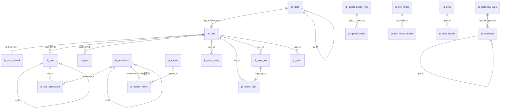

# 04 JBolt 数据结构设计分析

> 完整字段见 [03-data-dictionary.md](03-data-dictionary.md)（60 张表、1006 个字段，由脚本从 DDL 生成）。本文分析建模约定、实体关系和新系统的改进点。

## 1. 表的分组

| 分组 | 表 | 说明 |
|---|---|---|
| 组织权限 | jb_user、jb_user_extend、jb_dept、jb_post、jb_role、jb_permission、jb_role_permission、jb_topnav、jb_topnav_menu | 核心 |
| 配置 | jb_dictionary_type、jb_dictionary、jb_global_config_type、jb_global_config、jb_user_config、jb_sensitive_word | |
| 安全审计 | jb_online_user、jb_login_log、jb_remote_login_log、jb_system_log | |
| 协同 | jb_sys_notice、jb_sys_notice_reader、jb_todo、jb_private_message | |
| 文件存储 | jb_jbolt_file、jb_qiniu、jb_qiniu_bucket | |
| 开发平台 | jb_application、jb_code_gen、jb_code_gen_model_attr、jb_datasource_filter、jb_hiprint_tpl | |
| 微信 | jb_wechat_*（9 张） | 可选 |
| AI | tb_ai_*（16 张） | 可选，依赖闭源 SDK |
| 自定义表格 | jbc_*（4 张） | 默认未启用 |

## 2. 核心实体关系

## 3. 建模约定

1. **主键**：全部 `bigint id`，应用层雪花算法生成，表上不用自增。没有外键约束，引用完整性靠代码和“删除前检查”保证。
2. **布尔**：一律 `char(1)` 存 '0'/'1'（is_menu、enable、is_system_admin 等），这是为了兼容 Oracle、达梦等没有布尔类型的数据库。
3. **多值关联用逗号串**：`jb_user.roles`、`jb_user.posts`、`jb_sys_notice.receiver_value`、`jb_code_gen.roles`，查询时用 FIND_IN_SET。读取方便，但无法建索引，角色被删除时需要逐个清理字符串。
4. **树**：`pid` + `sort_rank`，部门额外用 `dept_path` 物化路径，权限额外用 `permission_level` 冗余层级。
5. **审计字段**：多数业务表有 create_time、update_time、create_user_id、update_user_id（也有用 user_id 表示创建人的旧表），由基类自动填充。
6. **逻辑删除**：部分表用 is_deleted 或 del_flag，各表命名不统一。
7. **键值配置**：全局参数和用户配置用 key/value + value_type（string、boolean、int）。
8. **冗余快照**：日志表直接存 username、user_name，避免关联查询，也保留历史。
9. **业务编码**：多数主数据有 sn（编码）+ name，并做唯一性校验。
10. **of_module / of_module_link**：用户和权限资源所属的“后台模块”，用于多后台入口。
11. **类型与状态**：多用 int 或 varchar 编码 + 字典表翻译（如 dept.type 关联字典 dept_type 的 sn）。

## 4. 存在的问题

- 逗号串多对多（用户-角色、用户-岗位）无法建索引和约束，按角色查用户只能全表扫描。
- 布尔用 char(1)、时间有 datetime(0) 与 datetime 混用，审计字段命名不统一（user_id 和 create_user_id 并存）。
- 无外键、无唯一索引（如 username、permission_key、dictionary 的 type_key+sn），唯一性只靠代码检查，并发时可能重复。
- 日志表、在线用户表没有针对查询条件的索引（只有主键）。
- jb_code_gen 一张表 165 个字段，把页面布局、表格、表单、权限等配置平铺在一起，扩展困难。
- `jb_permission` 用 `is_menu` 区分菜单与按钮，没有“目录”类型，前端路由信息（路由路径、组件）也没有字段，只能存 url。

## 5. 新系统数据模型建议（首版仅 MySQL 8）

- 按 Spring Modulith 模块加表名前缀：`sys_`（或 iam_、config_、audit_、msg_、file_），每个模块的 Flyway 脚本只管自己的表。
- 主键继续用雪花 bigint（前端用字符串接收，避免 JS 精度丢失）。
- 布尔改用 `tinyint(1)` / `bit`；时间统一 `datetime(3)`；审计字段统一 created_at、created_by、updated_at、updated_by，逻辑删除统一 `deleted`。
- 用户-角色、用户-岗位改为关联表，并加联合唯一索引；保留 `dept_path` 物化路径以支持数据范围。
- 为 username、permission 的 code、字典 (type_code, value)、全局参数 key 等建唯一索引；为日志表按 user_id、时间建索引。
- 权限资源增加 type（目录/菜单/按钮/逻辑权限）、route_path、component、redirect、hidden、keep_alive、owner_module 等前端路由字段，保留 open_type、is_target_blank、is_system_admin_default 的产品语义。
- 引入数据范围（全部、本部门及下级、本部门、仅本人、自定义部门）作为角色属性，弥补 JBolt 的空白。
- 首版不做 SaaS 分表，但所有业务表的唯一索引和查询都集中在 Mapper 层，后续需要时可以加 tenant_id。

