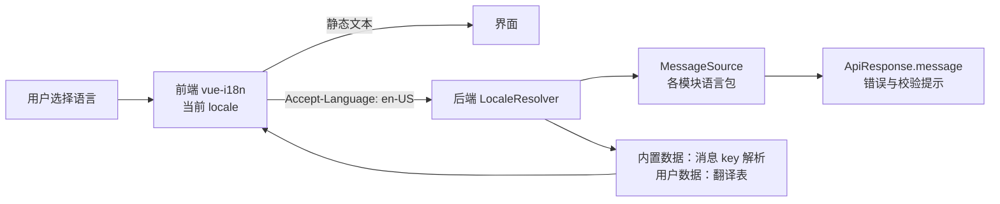

# P03 管理后台多语言（i18n）架构


## 9. 决策记录（2026-11-10）

- 首批语言 zh-CN、en-US。
- 用户录入数据首版只翻译菜单、字典、参数名称。
- 时间：数据库一开始就统一存 UTC（取代第 5.7 节“沿用单一时区”的原建议）。按用户转换本地时间的规则：
  1. 每个用户有时区偏好（IANA 时区名，如 `Asia/Shanghai`、`America/New_York`），优先级：个人偏好 > 租户默认时区 > 浏览器时区 > `UTC`；
  2. 前端每个请求携带 `X-Time-Zone` 请求头，接口时间统一为带偏移的 ISO-8601，前端用 dayjs（timezone 插件）按用户时区显示；
  3. 后端在请求上下文中解析出 `ZoneId`（与 `Locale` 一起放入 `TimeZoneAwareLocaleContext`），用于导出文件、通知文本、按“自然日”查询等服务端计算；日期范围查询把用户时区的起止时刻换算成 UTC 再查库。
- 多租户、数据权限、`portal` 字段从 P0 开始纳入底座，见开发进度文档。
## 1. 目标与范围

管理后台从第一个业务模块开始就支持多语言，覆盖：

| 范围 | 内容 |
|---|---|
| 前端静态文本 | 菜单外的所有界面文字：按钮、表头、表单标签、提示、校验信息、空状态 |
| 后端消息 | 业务错误、参数校验、401/403 等统一响应中的 `message` |
| 内置数据 | 由代码声明的菜单与按钮名称、内置字典、内置全局参数名称 |
| 用户录入数据 | 后台录入、需要多语言展示的字段（菜单自定义名称、字典项、参数名称等） |
| 格式 | 日期时间、数字、时区 |

首批语言：**zh-CN（默认）**、**en-US**；新增语言只需增加语言包，不改代码。JBolt 没有任何 i18n 能力（源码中无相关实现，界面与提示都是写死的中文），这是新系统新增的能力，迁移每个 JBolt 功能时都要同时提供两种语言的文本。

## 2. 总体结构



语言的唯一来源是前端当前选择：用户选择后保存在本地，并同步到个人偏好；每个请求带 `Accept-Language`，后端按它解析，不在服务端维护会话语言。

## 3. 语言标识与协商

- 语言标识采用 BCP 47：`zh-CN`、`en-US`。
- 前端初始语言：个人偏好 > 本地存储 > 浏览器语言 > `zh-CN`；登录前使用本地存储或浏览器语言。
- 后端：`AcceptHeaderLocaleResolver`，配置支持列表与默认语言 `zh-CN`；不支持的语言回退默认语言。
- 个人偏好由 config 模块的用户偏好保存（对应 JBolt 的 `jb_user_config`），键为 `locale`。

## 4. 前端

| 项 | 做法 |
|---|---|
| 框架 | vue-i18n 11（当前 11.4.18），Composition API 模式（`legacy: false`） |
| 语言包位置 | `frontend/src/locales/<locale>/<模块>.json`，与后端模块一一对应（common、auth、iam、config、audit、message、file、monitor、devtools、openapi） |
| 加载 | 当前语言的 common 包随应用加载，其余模块包按路由懒加载 |
| key 规范 | `<模块>.<页面或领域>.<含义>`，例如 `iam.user.form.username`；`common.action.save` 等通用词放 common |
| 类型安全 | 以 zh-CN 为源生成 TypeScript 类型，错误的 key 在编译期报错 |
| 组件库 | Element Plus 的 `ElConfigProvider` 随语言切换 locale；日期库 dayjs 同步切换 |
| 路由与菜单 | 路由 meta 使用 `titleKey`；后端返回的菜单已按请求语言解析好名称 |
| 校验 | 引入 ESLint 规则禁止模板中出现未翻译的原始文本；CI 脚本检查各语言 JSON 的 key 完全一致 |

## 5. 后端

### 5.1 语言包

- 每个模块自带语言包：`src/main/resources/i18n/<模块id>/messages.properties`（默认，zh-CN 内容）、`messages_en_US.properties`，UTF-8 编码。
- common 中提供一个配置组件，启动时扫描 `classpath*:i18n/*/messages*.properties` 自动注册所有模块的 basename，模块新增语言包无需改公共配置，符合“模块自带资源”的原则。
- key 以模块 id 开头：`iam.user.username-exists`、`common.error.forbidden`。

### 5.2 错误码化

- 新增 `ErrorCode` 接口（`code()`、`messageKey()`），各模块用枚举实现，例如 `IamErrorCode.USERNAME_EXISTS`。
- `BizException` 改为只接受 `ErrorCode` + 参数，不再接受字符串文本；`GlobalExceptionHandler` 按请求语言从 MessageSource 解析 `message`。前端依据稳定的 `code` 做逻辑判断，`message` 只用于展示。
- 401、403、400、500 等通用提示使用 `common.error.*` 的 key。

### 5.3 参数校验

Bean Validation 注解的 message 写成 `{iam.user.username.not-blank}`，由 Spring Boot 默认 Validator 通过 MessageSource 解析（实施时用测试验证中英文结果）。

### 5.4 内置数据

由代码声明的权限资源、内置字典、内置全局参数，在声明时同时给出消息 key 和默认文本：

| 数据 | 存储 | 展示 |
|---|---|---|
| 菜单与按钮（iam） | `name_key` + `name`（默认文本） | 按请求语言解析 `name_key`，缺失时回退 `name` |
| 内置字典类型与字典项（config） | 同上 | 同上 |
| 内置全局参数名称（config） | 同上 | 同上 |

### 5.5 用户录入数据

只对明确标记为“可翻译”的字段提供多语言，首批为：自定义菜单名称、字典类型与字典项名称、全局参数名称。每个模块在自己的库表中维护翻译（遵守数据所有权，不建全局翻译表）：

```sql
-- 示例：iam 模块
CREATE TABLE iam_i18n_text (
  id          BIGINT       NOT NULL PRIMARY KEY,
  entity_type VARCHAR(64)  NOT NULL,  -- 例如 permission
  entity_id   BIGINT       NOT NULL,
  field       VARCHAR(64)  NOT NULL,  -- 例如 name
  locale      VARCHAR(16)  NOT NULL,  -- 例如 en-US
  text        VARCHAR(512) NOT NULL,
  UNIQUE KEY uk_iam_i18n_text (entity_type, entity_id, field, locale)
);
```

查询接口按请求语言返回翻译，缺失时回退默认文本；编辑表单提供“多语言”页签逐语言录入。通知正文、部门名称等业务自由文本首版不做翻译。

### 5.6 日志与审计

操作日志保存消息 key、参数（JSON）以及写入时按默认语言渲染的文本；列表按当前语言重新渲染，key 缺失时显示保存的文本。登录日志的状态保存为状态码（沿用 JBolt 的 1～6），展示时翻译。

### 5.7 时间与数字

- 接口中的时间统一为带时区偏移的 ISO-8601 字符串，由前端按用户语言和时区格式化；数字、金额的格式化也由前端完成。
- 数据库首版沿用单一时区（`Asia/Shanghai`），接口层已带偏移，以后支持多时区时不需要修改接口。

## 6. 新增的框架约束（实施后写入 README 第 5 节）

| 编号 | 约束 | 校验方式 |
|---|---|---|
| I1 | `BizException` 只能用 `ErrorCode` 构造，代码中不出现给用户看的字面文本 | 编译期（构造器签名） |
| I2 | 各模块语言包位于 `i18n/<模块id>/`，key 以 `<模块id>.` 开头 | 自动：语言包测试 |
| I3 | 每种支持的语言 key 集合完全一致，占位符个数一致 | 自动：语言包测试 |
| I4 | 每个 `ErrorCode` 的 `messageKey` 在所有语言包中都存在 | 自动：语言包测试 |
| I5 | 前端各语言 JSON key 一致，模板中不出现未翻译文本 | 自动：`npm run lint` 与 `i18n:check` 脚本 |

## 7. 实施步骤（确认后执行）

1. **i18n 底座（第一个业务模块之前）**：后端 LocaleResolver、MessageSource 自动注册、`ErrorCode` 与 `BizException` 改造、`GlobalExceptionHandler` 本地化、语言包测试；前端 vue-i18n、语言切换器、Element Plus 与 dayjs 联动、`Accept-Language` 请求头、key 一致性脚本与 ESLint 规则。
2. **随模块落地**：每个模块提交 zh-CN 与 en-US 两份语言包，前后端同步。
3. **内置数据与翻译表**：实现 iam 菜单、config 字典与参数时加入 `name_key` 和 `*_i18n_text` 表。

## 8. 待确认

1. 首批语言是否为 zh-CN、en-US 两种？
2. 用户录入数据的翻译首版是否只覆盖菜单、字典、参数名称？
3. 数据库时间是否维持单一时区 `Asia/Shanghai`（接口带偏移），还是一开始就统一存 UTC？

