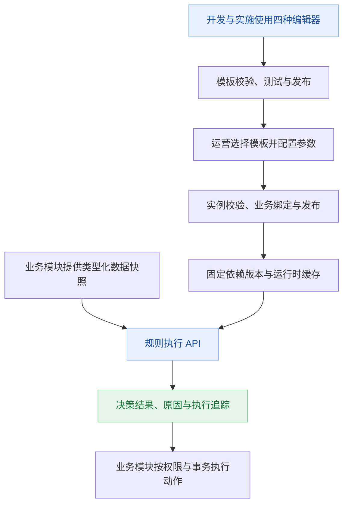

# P06 通用规则引擎与规则管理平台：调研与方案草案

- 初稿日期：2026-11-10；最近修订：2026-11-11，v5（新版规则界面）。
- 状态：后端B0～B4共24项完成，完整verify共175项通过；next柔光框架验收后已实施新版规则界面，测试边界以专项前端证据为准。逐项状态和证据见规则进度台账。
- 用户明确要求：通用规则引擎与管理；支持条件构建器、决策表、可视化规则流程编排、表达式规则编辑；按应用场景提供多种规则模板；开发和专业实施人员配置规则，运营人员选择使用模板，业务员通常不接触规则。
- 范围演进：本文保留产品与架构调研；用户随后授权实施后端，执行范围与测试结果以规则进度和证据文档为准。新版规则前端另按专项进度跟踪。
- 证据边界：第2、12节保留调研依据。后续实际引入 QLExpress4 4.1.4 / LiteFlow 2.16.3，核对同版发行POM许可证与源码API并完成兼容和分阶段验证；最终全量结果见证据记录。Vue Flow / Monaco已按需接入，实际浏览器证据见[前端验证](../rule-engine/frontend-evidence.md)。

重点阅读：第 4～5 节为角色和四种编辑界面，第 13 节为场景模板与运营选用，第 14 节为商品折扣样例，第 15 节为执行组合与验证任务；第 16 节区分用户确认与设计建议。最新执行顺序与逐期验收见[分阶段实施计划](../rule-engine/implementation-plan.md)，任务状态见[进度台账](../rule-engine/progress.md)。

执行顺序：后端先行；next柔光框架验收后，规则前端采用现行UI并单独跟踪。每项实现必须通过相应测试核验才标完成。当前后端接口说明见[API 约定](../rule-engine/backend-api.md)，实际验证及内核限制见[证据记录](../rule-engine/backend-evidence.md)。

## 1. 建议与待决策事项

建议建设一个独立的 `rule` 应用模块，采用“场景 → 规则模板 → 使用实例 → 业务绑定”的产品模型，并提供统一规则管理与执行契约。开发及专业实施人员使用四种编辑方式设计规则，封装模板参数与适用边界；运营人员选择已发布模板、填写获准参数并绑定使用；业务员通常不进入规则中心。

推荐优先验证“LiteFlow 编排 + QLExpress 4 表达式 + 平台规则 / 模板治理”。界面确定在 `frontend-next/` 使用 Vue Flow 画布和 Monaco 编辑器；npm peer 范围与工程技术栈检查支持这一接入选择，实际构建、Worker、主题、生命周期与包体积验收安排在 RE0。条件构建器与决策表仍保留为正式编辑方式。是否接入标准 DMN 内核取决于标准交换需求，复杂事实推理仍单独评估 Drools。后端组合和具体依赖版本不据此前端决定视为已实测。

首版重点是可配置的确定性业务决策：校验、分类、准入、分配建议、参数与公式计算。这里只说明能力类型，不代表用户已经要求建设相应业务。

标准功能目标如下；实际按 RE0 → RE1 → RE2 → RE3 → RE4 分阶段交付，不要求在第一个可用版本一次交齐四种编辑方式：

1. 条件组、决策表、可视化规则流程、表达式规则四种编辑方式，以及统一类型化输入输出与模拟测试。
2. 场景目录、模板目录、参数表单、实例化、业务绑定及各自的版本发布。
3. 版本、发布、停用、回滚、权限、执行解释与审计；后续按需扩展评分卡与灰度。
4. 仅在确有需求时增加多事实推理、连续事件处理、长期状态或跨服务动作。

首个可用版本 RE1 优先表达式 / 条件、模板制作与运营选用、试算与执行、版本及权限闭环；RE2 增加流程编排，RE3 补齐决策表，RE4 增强规模化治理。基础隔离、发布、回滚和审计从 RE1 起具备。

“通用”通过稳定数据契约、可扩展字段与函数、可组合规则实现，不承诺第一版覆盖所有推理、流程和数据处理场景。

**已确认：四种编辑方式；开发 / 专业实施负责规则设计；运营选用场景模板。待定：具体业务计算口径、运营可调整参数与启用权限、DMN 标准交换、调用方式、规模目标、商业组件预算。**

## 2. 调研范围与证据状态

### 2.1 官方资料核验记录

- `https://www.drools.org/` 跳转至 `https://kie.apache.org/`，首页可读取；可确认 Apache KIE 当前展示为 incubating，包含 Drools、Kogito、Tools 等组件。首页本身不能证明某个版本的运行能力或兼容性。
- 2026-11-11 补读 LiteFlow 首页、简介及官方仓库 README：确认组件化逻辑编排、串并行、条件 / 选择、子链路、脚本接入及热刷新相关能力；官网声明支持 JDK 8～25、Spring Boot 2～4。仓库展示 Apache-2.0；官网页脚的 MIT 是文档主题标注，不能用来替代引擎授权。具体依赖版本与本项目的兼容性仍需实测。
- 补读 QLExpress 官方 README：当前主线介绍 QLExpress 4，含表达式追踪、中间值、短路未执行标记、变量依赖解析、语法验证、自定义函数、精度选项、默认隔离策略、白名单及超时配置。仓库展示 Apache-2.0。默认编译缓存无大小上限，需要平台治理；Spring Bean 全量访问不建议使用。README 示例版本不是本项目最终锁定版本。
- 补读 Vue Flow 官网：Vue 3 可视化节点与连线、缩放平移、自定义节点边、嵌套图；页面声明 MIT。它提供图交互组件，不能替代后端编排引擎。
- 补读 Monaco 官方 README：浏览器代码编辑器、模型、补全与悬浮提示 Provider、资源释放机制；仓库声明 MIT。QLExpress 语法、变量和函数补全及语义检查需要平台自行集成，不能因内置 JavaScript 语言服务就将规则当作 JavaScript 执行。
- 补读 dmn-js 官方 README：浏览器查看及编辑 DMN 1.3，支持 XML 导入；采用 bpmn.io license，不能默认按 MIT 或 Apache-2.0 处理。它是编辑器，不是后端决策执行器；正式采用前核验具体版本许可证正文及标识展示要求。
- Camunda DMN 文档 `https://docs.camunda.io/docs/components/modeler/dmn/` 返回 CloudFront 403，没有取得内容。
- 2026-11-10 若干 GitHub 导航结果未知；用户于 2026-11-11 明确继续后恢复调研，上述页面成功读取。本次 Flowable DMN 页面导航再次返回 `BROWSER_ACTION_OUTCOME_UNKNOWN`，按工具要求停止后续浏览器操作，未换通道重试。
- 本文区分“官方资料声明”“方案设计建议”“运行验证”：前者不代表后两者已经成立。未成功访问的产品保留待核验标记；未做统一性能基准。

### 2.2 市场能力比较

| 产品 / 路线 | 主要能力与适用情形 | 可视化配置与管理的评估重点 | 对本项目的初步判断 |
| --- | --- | --- | --- |
| Drools / Apache KIE | 多事实匹配、规则推理；生态提供决策表与 DMN 相关能力 | 区分规则运行库、KIE 工具和完整管理平台；确认所选版本提供的设计器、维护状态和部署组合 | 若存在复杂事实关联、规则触发新事实再继续推理，重点验证；简单条件判断可能投入偏大 |
| Flowable DMN | Java 生态的 DMN 决策表执行，适合标准化表格决策 | 开源执行内核与商业设计器、管理产品的边界需要分别核验 | 若多数需求可以用决策表表达，是优先验证候选；不必为了决策表引入整套流程平台 |
| Camunda DMN | 标准决策建模、决策表及 FEEL；与流程生态结合 | 明确 Camunda 7、Camunda 8、独立 DMN 组件的版本、生命周期及授权，不能混为同一产品 | 重点参考标准和交互；本轮官方文档访问失败，暂不定为默认依赖 |
| LiteFlow | Java 组件编排、链路控制、分支及组合执行；已补读官方简介和 README | 内核仓库标注 Apache-2.0；未确认可直接嵌入的完整可视化管理产品 | 因规则流程编排已明确，升为优先验证候选；平台自行定义受控图模型与模板治理 |
| QLExpress 4 | Java 表达式与公式执行；已补读默认隔离、追踪、精度和缓存说明 | 仓库标注 Apache-2.0；需要字段目录、编辑器、发布与缓存配额；具体约束实测 | 表达式规则的优先验证候选；与编排内核的脚本插件版本兼容尚未证明 |
| Aviator | Java 表达式与公式执行；本轮未补读官方资料 | 访问控制、精度、追踪、授权和资源限制仍待核验 | 作为表达式备选，不同时引入多种方言 |
| URule | 中文规则产品路线，覆盖业务规则建模和管理场景 | 明确当前产品版本、开源与商业功能、设计器集成方式、二次开发与授权条款 | 如允许商业采购，应列入演示与报价评估，避免预先认定可免费完整嵌入 |
| GoRules ZEN | JSON 决策图与可视化编辑路线 | 分别确认编辑器、运行时、BRMS 的授权，以及 Java 集成的部署与维护成本 | 可参考编辑器交互；是否采用取决于 Java 接入验证和部署约束 |
| Easy Rules | 轻量 Java 条件—动作抽象 | 版本维护状态、规则表达能力和完整治理缺口待核验 | 可作轻量 API 参考；不因上手简单就默认选为长期平台底座 |

未对性能、活跃度、费用做数字评分；缺少统一基准时，星级和综合分数会造成错误精度。IBM ODM、FICO 等商业 BRMS 可在明确采购预算、交付支持与部署要求后扩展调研。

### 2.3 选型方式

将候选分成四个问题独立比较：

1. **业务决策**：条件组合、决策表、命中策略、类型与解释。优先验证 DMN 路线及受控条件树路线。
2. **复杂推理**：事实关联、前向链式推理、事件时间。确需这些能力时验证 Drools，不用普通 DAG 替代推理语义。
3. **步骤编排**：已明确支持；验证 LiteFlow，前端选用 Vue Flow。需要证明受控图结构到执行计划的映射以及节点级解释。
4. **表达式规则**：已明确支持；优先验证 QLExpress 4 + Monaco。限定一个受控方言，不直接向配置者开放整个宿主 Java 能力。

首版可以由编排与表达式两个专职组件组合，而非强迫四种编辑方式使用同一种语法。平台统一类型、版本、参数、追踪和发布契约；每个执行器声明自己的能力、方言和命中策略。预留适配接口不代表各内核语义等价，也不代表未来可以无损替换。

**推荐验证组合的职责**：Vue Flow 负责画布交互，Monaco 负责文本编辑；平台负责图校验、字段 / 函数目录、决策表命中语义及模板治理；LiteFlow 负责受限逻辑编排；QLExpress 4 负责条件和计算。通过受控 Java 节点调用表达式适配器，避免未经核验就使用 LiteFlow 内置 QLExpress 插件并假定其适配 v4。未采用的脚本插件不加载。

如果实际需求仅为受限的比较运算与逻辑组合，可以实现小规模类型化条件树执行器；这是明确受限的能力，不能扩张成自研通用脚本语言、RETE 或完整 FEEL 引擎。是否采用仍需与 DMN 候选比较维护成本。

## 3. 当前项目的接入依据

以下依据 2026-11-10 的本地文件检查和相关项目文档；实际实施前需按当时源码再次确认：

| 当前事实 | 方案约束 |
| --- | --- |
| Java 21、Spring Boot 4.1.2、Spring Modulith 2.1.2；MySQL 8；Jackson 3 | 第三方 starter、Jackson 2 依赖、Jakarta 与 Spring 兼容性必须实测；优先评估核心库直接嵌入 |
| 模块使用单个小写单词，API / 表 / 权限前缀一致 | 新模块建议 `rule`、`/api/rule`、`rule_`、`rule:` |
| 根包暴露 API，internal 隐藏实现；模块依赖必须无环 | 业务模块调用规则 API；规则执行只接收数据快照，避免反向依赖所有业务模块 |
| 已有租户、数据权限、IAM、审计、UTC 与双语言约束 | 规则配置、测试数据、制品、缓存和日志都纳入同样隔离；不能只隔离规则列表 |
| `frontend-next/` 已按 P04 独立建设，旧 `frontend/` 保留 | 用户已明确规则界面固定接入 next；复用 Vue 3 / TypeScript / shadcn-vue 体系，并封装 Vue Flow 与 Monaco |
| P05 设计 Java / JAR 扩展发布，已有部分扩展工程 | 配置发布与代码发布分开；代码能力若接入插件，固定其版本及摘要，不能借规则配置旁路加载 Java |

依据：[项目总纲](../../README.md)、[P04](P04-frontend-visual-rebuild.md)、[新版前端进度](../frontend-next/progress.md)、[P05](P05-versioned-api-extension-security.md)。P05 文档标注未整体实施，不能假定其中所有发布安全能力已经存在。

## 4. 产品范围与角色分工

### 4.1 角色与权限分工

- 开发人员：定义场景契约、字段与枚举、纯函数、编排节点及业务接入；可以编写全部规则类型、模板及测试。
- 专业实施人员：在授权场景和能力范围内，通过四种编辑方式编排规则、维护表达式、模板、参数表单和用例；不因拥有实施角色就自动获得 Java / JAR 上传或任意代码执行权限。
- 运营人员：选择适用且已发布的模板，填写模板开放参数，绑定业务对象，模拟及申请 / 执行授权范围内的启停；通常不修改条件树、决策表、流程和表达式结构。
- 业务员：通常不接触规则中心，在业务流程中消费规则结果；仅按业务权限查看必要解释。
- 发布人员：按场景、模板 / 实例、环境分别授权，检查差异与测试结果后发布或回滚。模板逻辑发布和运营实例启用是不同权限。
- 运维 / 审计：查看执行健康、变更记录和脱敏追踪。

同一人可以兼任角色。普通数据规则不默认增加双人审批；如涉及已被 P05 管理的代码扩展，则继续遵守该发布流程。是否需要业务复核由需求确定。

### 4.2 标准功能范围与交付阶段

| 能力 | 交付阶段 | 后续条件 |
| --- | --- | --- |
| 规则空间 / 分组、规则集、搜索、复制与停用 | RE1 基本管理，RE3 扩展复制复用 | 租户内共享及跨租户模板另定 |
| 字段目录、类型、枚举、必填与敏感标记 | RE1 | 首期由研发注册或受控录入，不自动暴露数据库全部字段 |
| 场景目录、模板目录、参数表单、模板实例与业务绑定 | RE1 最小闭环，RE3 增强 | 多种模板可服务同一场景；运营只选择与参数化 |
| 条件组、嵌套 AND / OR / NOT | RE1 | 采用显式语义和类型约束 |
| 决策表 | RE3 | 先明确 UNIQUE / FIRST；其他命中策略按实际需求扩展 |
| 类型化返回值、默认结果 | RE1 | 多行输出及聚合需明确合并策略 |
| 草稿、模拟、不可变版本、发布与回滚 | RE1 | 用例批跑与批量迁移在 RE4 增强，多环境 / 灰度另期 |
| 命中解释、操作审计、租户与规则权限 | RE1 基础，RE2～RE4 增强 | 输入日志按敏感级别控制 |
| 表达式规则编辑、公式与派生字段 | RE1 | 专业人员编辑，统一方言、精度、追踪及资源边界 |
| 可视化规则流程编排 | RE2，RE3 接入决策表节点 | 先限定可验证的串行、条件 / 选择、子规则与结果节点；并行后续扩展 |
| 评分卡、灰度、批量回放 | 后续 | 由业务样例与发布要求决定 |
| 直接执行 SQL / 任意 HTTP / 任意脚本 | 不建议作为普通配置能力 | 若未来需要，定义受控能力、超时、授权和动作契约 |
| 人工审批流、定时调度、跨日长事务、流式 CEP | 独立评估 | 规则可被这些系统调用，首版不同时建设整套系统 |

## 5. 可视化规则配置界面

### 5.1 信息架构

建议菜单为“规则中心”，包含：

- 场景管理：场景编码、适用业务、输入输出契约、可用节点 / 函数、绑定对象及多实例组合策略。
- 模板开发：开发 / 实施使用四种编辑器制作规则模板，维护参数定义、版本、测试和发布。
- 模板选用：运营按场景查看已发布模板、说明、参数预览和样例，创建使用实例。
- 使用实例：模板版本、参数、适用对象、有效期、优先级、互斥 / 叠加方式、启停状态与影响范围。
- 规则集：业务空间 / 分组、名称、编码、类型、当前生效版本、草稿、状态、负责人、更新时间。
- 字段与函数：输入输出契约、数据类型、枚举、敏感标记、函数签名与可用版本。
- 测试中心：单次模拟、用例集、运行结果及版本差异。
- 发布记录：版本差异、校验与测试证据、发布状态、停用与回滚。
- 执行记录：按时间、规则集、版本、结果、请求追踪查询脱敏日志。

### 5.2 规则编辑页

采用独立页面。顶部保留规则名称、草稿 / 已保存 / 保存失败状态、当前编辑版本、当前生效版本，以及“保存草稿”“模拟测试”“发布”等操作。

编辑区正式支持四种方式，由开发与专业实施选择；它们既能独立形成规则，也能作为流程内的子节点：

**条件构建器**：字段选择 → 与字段类型匹配的运算符 → 值 / 字段 / 受控函数 → 逻辑分组 → 输出。支持中文描述、增删条件、嵌套分组、键盘操作及撤销 / 重做。

**决策表**：条件列、输出列、行说明、命中策略。类型错误直接定位单元格；FIRST 模式下行顺序有业务意义，拖动后必须显示差异。空单元格不能同时表示“任意值”和“空值”，使用明确标记。

**可视化规则流程编排**：左侧节点库，中间画布，右侧属性 / 输入输出映射，下方模拟运行与节点追踪。节点包括开始、条件分支、决策表、表达式、计算、子规则及结果。支持增删连接、缩放定位、撤销重做、节点定位和只读执行路径回显。首版采用可验证的有向无环结构，明确分支汇合，拒绝孤立节点、缺少出口和不完整输出；不把任意 DAG 自动转换为 LiteFlow EL。并行节点需先定义分支输出隔离、汇合与异常策略，再开放；循环不在首版开放。

**表达式规则编辑**：独立规则或流程表达式节点，提供语法高亮、字段 / 参数 / 函数补全、签名和类型提示、错误行列、格式整理、输入输出预览与中间值追踪。表达式声明预期输出类型（布尔 / 数值 / 结构化结果），保存前静态校验，发布前运行用例验证。前端使用 Monaco 的自定义语言能力；后端使用同一表达式执行器做权威验证，不能将“能高亮”当作“语义正确”。

界面侧区展示选中项属性或字段说明；模拟测试打开输入 / 输出与执行解释区域。窄屏改为分步或标签视图，主要编辑不依赖拖拽。

### 5.3 编辑体验要求

1. 保存草稿不发布，不触发业务执行。模拟只执行隔离计算，不发送通知或修改业务数据。
2. 离开页面提示未保存内容；保存失败保留草稿；并发编辑通过修订号检测冲突，不能最后写入者静默覆盖。
3. 草稿与已发布版本分开；发布后继续修改会形成新草稿。
4. 错误提示定位字段、行列或节点，并给出可操作原因，如“金额字段不能与文本比较”。
5. 显示本次输入、条件实际值、条件结果和最终输出；短路未执行的条件标记“未求值”，不能当作 false。
6. 前端预览不是权威判断；模拟与正式执行使用相同后端语义。
7. 界面文本支持 zh-CN / en-US；规则业务名称是否翻译另定；生效时间按用户时区输入并存 UTC。
8. 模板编辑区同时维护“规则逻辑”和“运营参数表单”，预览运营实际看到的字段、默认值、限制与说明。
9. 四种编辑器不提供任意无损切换承诺；条件树可在受支持子集导出只读表达式，手工修改生成表达式应显式转为独立表达式规则或创建新模板版本。流程调用表格 / 表达式通过固定依赖完成，不复制后丢失来源。
10. 运营界面只显示模板选择、参数、绑定范围、模拟结果与实例操作；可给出逻辑只读说明，不向运营开放高级编辑器。

### 5.4 纯示例：统一的准入判断

以下为说明交互的虚构样例，不是已确认业务：

```text
规则集：示例准入决策        编辑：草稿 r4        生效：v2

当全部满足：
  [申请金额] [小于等于] [5000.00]
  [客户等级] [属于]     [A、B]
  且任意满足：
    [资料完整] [等于] [是]
    [已人工核验] [等于] [是]

返回：decision = PASS，reasonCode = ELIGIBLE
未命中：decision = REVIEW，reasonCode = DEFAULT_REVIEW

[保存草稿]  [模拟测试]  [查看版本差异]  [发布]
```

“规则命中结果”“执行错误”和“没有命中”是三种不同状态，不能都用一个布尔值表示。

## 6. 规则数据模型与执行语义

### 6.1 核心对象

| 对象 | 主要内容 |
| --- | --- |
| 规则空间 / 分组 | 归属、权限、可用字段和函数范围 |
| 应用场景 | 稳定编码、业务用途、输入输出契约、允许绑定对象、可用模板与实例组合策略 |
| 模板与模板版本 | 场景、逻辑入口、固定规则依赖、参数 Schema、UI Schema、适用性约束、样例、测试及发布状态 |
| 使用实例与实例版本 | 选定模板版本、参数快照、业务绑定、生效区间、优先级、组合设置、依赖与内容摘要 |
| 业务绑定 | 业务对象到实例的授权关联、对象类型和稳定 ID、绑定修订；业务对象由归属模块负责 |
| 输入输出契约 | 字段编码、类型、嵌套路径、枚举、精度、必填、敏感级别、版本 |
| 规则集 | 稳定编码、说明、负责人、默认行为、运行限制 |
| 草稿修订 | 编辑内容、结构版本、修订号、作者、最近保存时间 |
| 规则版本 | 规范化内容、内容摘要、内核与方言、契约及函数依赖快照、测试报告 |
| 发布修订 | 目标环境、规则版本、生效时间、发布与停用状态、操作者、理由 |
| 用例及测试运行 | 输入、预期输出、断言、测试版本、结果与差异 |
| 执行记录 | 请求标识、发布修订、版本、输入摘要、输出、耗时、错误及脱敏解释 |

规则版本是可复用的逻辑制品；模板版本是逻辑制品与参数表单、适用约束的组合；实例版本将某个模板版本和业务参数、范围固化。小型简单模板可以直接持有一个根规则版本，不要求用户手动维护每层对象；平台仍保留完整来源和固定依赖。

同一模型可支持多个编辑视图，但并非任意转换。复杂 DMN、脚本或推理规则不保证能转换为普通条件表单；不支持的结构只能只读或在对应编辑器打开，不能静默丢失语义。

### 6.2 必须提前规定的语义

- **类型**：字符串、布尔、整数、十进制、日期、时间戳、枚举、对象、集合；拒绝不明确的自动类型转换。
- **金额与数值**：十进制运算使用 BigDecimal 语义，明确精度和舍入；不使用浮点数计算金额。
- **空值**：缺字段、显式 null、空字符串、空集合分别定义。缺失必填输入是输入错误；可空字段用明确空值运算符；其他比较不隐式按零或空文本处理。
- **时间**：统一 Instant / UTC；自然日与营业时间必须显式绑定 IANA 时区。执行时钟作为上下文传入，便于回放。
- **集合**：包含、任一匹配、全部匹配、空集合的结果均有定义。
- **命中策略**：UNIQUE 在多行命中时返回冲突；FIRST 使用可见稳定顺序；多结果模式明确聚合、优先级、重复值与字段冲突处理。
- **默认行为**：无命中、输入无效、超时、引擎故障分别配置或返回明确错误；“失败允许”或“失败拒绝”由业务契约确定。
- **依赖**：子规则固定版本，拒绝循环引用；模板版本冻结根规则、契约、函数、子规则和参数结构；实例版本固定模板版本与参数，不引用自动漂移的 latest。
- **两类输入**：运行输入 `input` 是业务模块当次提供的数据，模板参数 `params` 是实例已发布的配置，可信上下文 `context` 由宿主提供。命名空间和权限分离；请求不能冒充租户、发布版本或覆盖实例参数。
- **配置校验**：参数同时做类型、范围、跨字段及场景约束校验；前端约束只用于体验，后端在保存、发布、执行时校验对应版本。
- **解释**：保留稳定规则 / 条件 ID、命中行、比较值的脱敏表示和原因码；不声称能为任意第三方脚本提供完整逐表达式解释。

静态检查对受限区间、枚举可发现部分重叠、空洞和遮蔽。复杂函数、任意表达式和推理规则不能保证通过静态分析证明无冲突，需要运行检查与用例补充。

## 7. 执行架构



### 7.1 模块边界

建议对外提供 `RuleExecutionApi`、类型化请求 / 结果 DTO、必要的版本查询接口及发布事件，根包不暴露内核会话、实体或 Mapper。具体签名在选型验证后确定。

执行请求按入口分为“实例执行”和受控“规则集执行”。业务常规接入使用实例或业务绑定标识，服务端解析已生效的实例修订、模板版本、逻辑依赖和参数快照；专业调试接口可按权限测试指定规则版本。租户与环境由宿主认证 / 系统上下文确定；不能允许调用者随意指定 tenantId 读取别人的规则。测试与版本执行权限单独授权，普通业务调用不能执行任意草稿。

业务模块先查询自己拥有的数据，再传入不可变快照；规则模块不跨模块查库。首版建议规则仅计算和返回结构化决策。发券、扣款、审批落库、消息发送等动作由业务模块承担，若将来确需动作节点，再增加单独的授权、幂等与补偿协议。

### 7.2 运行与发布

1. 编辑使用可变草稿，保存时检查修订号。
2. 校验并冻结候选版本；测试绑定同一内容摘要，测试后改内容会使发布证据失效。
3. 编译 / 加载候选规则、验证依赖并预热；失败不影响当前生效版本。
4. 服务端按租户、环境和规则集进行权限检查，写入单调递增的发布修订，原子切换引用。
5. 每次请求进入时固定实例发布修订、模板版本、参数和依赖快照，在途执行不混用新版本；涉及多实例组合时固定本次匹配集合与排序。
6. 回滚建立新的发布修订并指向旧的不可变版本；若依赖已不可用或不兼容，应阻止回滚并给出原因。
7. 停用阻止新调用，返回明确状态；已开始执行是否取消由协议规定，首版建议允许完成短时纯计算。

单实例部署可从数据库发布修订与本地编译缓存起步。缓存键至少包含租户、环境、制品版本、内核版本、能力策略及内容摘要；实例参数不可放入共享可变全局上下文。集群后必须增加节点就绪、修订同步和故障策略，不能依赖本机事件声称同时全量生效。

### 7.3 资源控制

普通规则限制节点数、嵌套深度、集合规模、输入大小和操作预算。禁止访问类加载、反射、文件、进程、网络、Spring Bean 与任意 SQL；函数从受控注册表调用。

对表达式库逐项验证其沙箱、白名单、循环及递归控制。线程超时或取消不等于可以强制终止任意 Java；无法证明有界的脚本不在宿主进程开放给普通配置者。插件函数继续遵守代码发布边界。

## 8. 存储与接口草案

以下是逻辑设计，尚未执行建表；字段和拆表在需求确认后细化。

建议表：`rule_space`、`rule_schema`、`rule_ruleset`、`rule_draft`、`rule_version`、`rule_release`、`rule_testcase`、`rule_testrun`、`rule_execution`。按需增加函数绑定与执行明细表，避免把完整输入无限写入关系库。

场景模板层增加：`rule_scene`、`rule_template`、`rule_template_version`、`rule_instance`、`rule_instance_version`、`rule_binding`。不同制品的草稿和发布可在严格类型约束下共用基础设施，或分别存储；外部界面必须区分模板发布与实例启用，不能只用一个 active 标志表达全部状态。每个制品的不可变版本仍可追溯到原始编辑结构和固定依赖。

共同遵守 TenantEntity、MyBatis-Plus、Flyway 和项目审计规范。业务唯一编码按租户限定；版本摘要、发布修订和草稿修订均有数据库约束。执行记录高增长，需按保留期归档 / 清理，具体期限由数据敏感度与容量决定。

| 接口类别 | 主要操作 |
| --- | --- |
| `/api/rule/rulesets` | 列表、创建、查看、复制、管理元信息 |
| `/api/rule/scenes` | 场景及契约查询 / 管理；绑定对象授权由业务模块提供 |
| `/api/rule/templates` | 专业人员维护模板逻辑、参数表单、版本和发布 |
| `/api/rule/catalog` | 运营可选模板目录，只返回获授权且适用的已发布模板及安全说明 |
| `/api/rule/instances` | 模板实例创建、参数草稿、业务绑定、版本及启停 / 发布命令 |
| `/api/rule/rulesets/{id}/draft` | 读取 / 保存草稿，携带预期修订号 |
| `/api/rule/rulesets/{id}/validate` | 对指定草稿修订执行静态校验 |
| `/api/rule/simulations` | 运行指定草稿 / 版本及测试输入 |
| `/api/rule/versions` | 查看不可变内容、版本差异与验证证据 |
| `/api/rule/releases` | 发布、查询、停用及回滚命令；防重复提交 |
| `/api/rule/testcases` | 用例集及断言管理 |
| `/api/rule/executions` | 执行查询与受控脱敏明细 |

模块内调用优先 Java API。外部应用如确有需要，另按现有 `/open/**` 应用鉴权接入并限定规则集与环境；不把管理 API 直接匿名开放。权限 key 分别声明，例如 `rule:template:edit`、`rule:template:publish`、`rule:catalog:view`、`rule:instance:edit`、`rule:instance:publish`、`rule:instance:disable`、`rule:simulation:run`、`rule:release:rollback`、`rule:execution:detail`。运营拥有实例编辑权限不等于拥有模板编辑权限，绑定对象同时验证业务归属与操作权限。

## 9. 测试、发布门禁与验收

### 9.1 最小验证样例

1. 条件组合：嵌套条件、NOT、空值、金额边界、枚举、集合。
2. 决策表：零命中、单命中、多命中、FIRST 行顺序、默认输出。
3. 可解释性：输出可定位到规则 ID / 表格行；短路项与错误不混淆。
4. 发布：旧版本执行过程中发布新版本，两次请求分别固定各自版本；加载失败维持旧版本。
5. 并发：两个编辑者保存冲突可见，重复发布不重复生成生效动作。
6. 隔离：跨租户规则编码、缓存、测试用例与日志不可串读；无权用户不能模拟或发布。
7. 资源：超大输入、深嵌套、非法函数和不受限表达式被拒绝。
8. 回放：固定输入、时钟和依赖，结果可重现；动态外部数据必须使用当时快照。
9. 四种编辑方式：同一语义的受支持样例结果一致；表格 / 表达式嵌入流程后输入输出映射与错误定位正确；不支持的转换被明确拒绝。
10. 流程：分支路径、汇合、不可达节点、环、未定义输出、节点输入类型和固定子规则依赖均可校验；源码映射能定位画布节点。
11. 表达式：未知变量、非法能力、类型不匹配、短路、十进制计算、执行预算与缓存配额；未选定插件不加载，研发函数不越过发布边界。
12. 模板：运营不能修改逻辑或越过参数上限；同一模板多实例参数互不污染；请求不能覆盖已发布参数。
13. 升级：发布模板 v2 不改变绑定 v1 的实例；迁移生成新草稿，试算差异、确认及发布后才切换；旧版仍可追溯。
14. 商品折扣样例：整单 / 单品、门槛边界、舍入、封顶、互斥 / 叠加、确定性优先级、有效期与退款引用原规则快照。

### 9.2 内核概念验证的通过条件

- 在当前 JDK / Boot / Jackson 基线上真实编译、启动并运行样例，不仅查看支持版本声明。
- 确认可视化编辑器的技术栈、许可证、嵌入方式及导入导出边界。
- 同一套输入输出预期通过空值、精度、日期、集合和命中冲突测试。
- 证明版本隔离与加载失败恢复方式；需要会话的引擎不能跨租户共享可变会话。
- 测量编译耗时、内存、吞吐、P95 / P99；分别报告纯规则计算与含业务取数的端到端延迟。需求未定前不承诺 QPS 数字。
- 表达式资源与访问限制得到验证，不能只以“开启沙箱”作为证据。
- 输出决策记录，列明选定版本、许可证文件、核心依赖、使用限制和弃用路径。

测试门禁采用项目现有 Modulith / 架构 / 租户 / i18n 检查，补充规则语义、真实后端联调与浏览器编辑交互验收。自动测试通过不等于业务可用性或人工视觉验收完成。

## 10. 实施阶段

详细范围、任务编号和验收以[分阶段实施计划](../rule-engine/implementation-plan.md)为准；本表取代 v2 将四种编辑方式同时放入最小闭环的安排。

| 阶段 | 交付物 | 退出条件 |
| --- | --- | --- |
| RE0 接入与契约验证 | next 中 Vue Flow / Monaco 验证、后端推荐组合与契约 | 版本、构建、Worker、资源、依赖与语义检查有证据 |
| RE1 首个可用闭环 M1 | 表达式 / 条件、模板、参数实例、绑定、模拟、发布、执行、权限 / 审计 / 回滚 | 专业制作到运营选用的真实后端链路通过，生产业务接入另验收 |
| RE2 流程编排 M2 | Vue Flow 工作区、结构化图到执行计划、节点追踪、流程模板 | 可制作、发布和执行受限流程，不影响已发布旧实例 |
| RE3 标准功能 M3 | 决策表、流程组合、参数表单增强、单实例升级预览 | 四种编辑方式齐备，模板复用及迁移语义正确 |
| RE4 管理增强 M4 | 用例批跑、影响分析、批量迁移、运行指标、容量和恢复验证 | 规模化治理与异常处理可验证 |
| RE5 按需扩展 | 复杂组合、受控并行、灰度 / 集群、外部调用、标准交换等 | 按具体需求独立验收，不要求一次全部建设 |

不在业务样例、规模和内核验证之前给出精确工期或采购承诺。

## 11. 需求澄清清单

已确认内容不重复提问；以下将确认结果与剩余业务口径分开记录，未确认项可先按建议继续细化设计：

| 问题 | 为什么影响方案 | 当前建议 / 状态 |
| --- | --- | --- |
| 哪些编辑方式？ | 决定执行器和界面范围 | 已确认四种：条件、决策表、流程编排、表达式 |
| 谁配置和使用规则？ | 决定编辑与选用权限边界 | 已确认开发 / 专业实施配置，运营选择模板，业务员通常不接触 |
| 是否需要按场景提供多模板？ | 决定模板、参数与实例模型 | 已确认；商品折扣是用户给出的场景例子，具体折扣算法和上线范围待定 |
| 商品折扣按单品、订单还是两者？可否叠加？退款如何处理？ | 决定金额、排序、分摊与回放语义 | 第 14 节给出建议，不把示例默认值当成已确认业务 |
| 运营可调整哪些参数，能否直接启用实例？ | 决定实例权限和模板约束 | 建议只调整已开放参数，逻辑发布与实例启用分别授权 |
| 只返回决策，还是需要自动改变业务状态？ | 决定事务、幂等、授权和补偿 | 建议首版返回决策，业务模块执行动作 |
| 是否必须 DMN 导入导出或与其他规则平台交换？ | 决定标准内核和可视化建模格式 | 待确认；不声称自定义 JSON 等于 DMN |
| 内部调用、外部 API、定时批处理还是消息触发？ | 决定入口、部署和错误恢复 | 建议先内部同步调用；其他按需 |
| 单规则复杂度、规则数量、并发、延迟和可用性目标？ | 决定容量与资源上限 | 先验证代表性样例，再确定指标 |
| 一套系统内部共用，还是客户 / 租户各自维护？ | 决定模板、覆盖与授权模型 | 租户隔离沿用底座；首版不默认跨租户继承 |
| 是否需要测试 / 生产环境、定时生效与灰度？ | 决定发布路由与环境管理 | 首版保留环境维度，至少版本发布和回滚 |
| 是否要求双人业务审批？ | 决定发布流程 | 不默认增加双人；权限与测试门禁必要 |
| 可否采购商业产品，部署是否必须离线？ | 决定候选、授权和运行拓扑 | 待确认 |
| 执行输入有哪些敏感字段，追踪保存多久？ | 决定日志脱敏、访问和存储 | 默认仅必要字段及摘要，期限待定 |

## 12. 官方资料入口与待核验清单

以下记录访问日期、取得的证据和限制；链接存在不等于已读取或已运行验证。

| 来源 | 读取状态 | 可支持的结论 / 限制 |
| --- | --- | --- |
| [LiteFlow 官网](https://liteflow.cc/)及[简介](https://liteflow.cc/pages/5816c5/) | 2026-11-11 已读 | 组件逻辑编排、价格引擎等适用场景；明确不承担角色任务审批流；官网声明支持 Boot 4 / JDK 21 范围，未实测本项目 |
| [LiteFlow 官方仓库](https://github.com/dromara/liteflow) | 2026-11-11 已读 README / 仓库信息 | Apache-2.0 标注、脚本支持、热刷新及 Boot 4 starter 目录存在；不证明 QLExpress 插件兼容 v4，也未确认随内核提供完整可嵌入管理平台 |
| [QLExpress 官方仓库](https://github.com/alibaba/QLExpress) | 2026-11-11 已读 README / 仓库信息 | QLExpress 4、Apache-2.0 标注、默认隔离、白名单、精度选项、表达式追踪、短路标记、超时与无界默认编译缓存；自定义函数仍需平台审计与限制 |
| [Vue Flow 官网](https://vueflow.dev/) | 2026-11-11 已读 | Vue 3 图交互、自定义节点边、嵌套及 MIT 声明；不提供本项目业务执行语义 |
| [Monaco 官方仓库](https://github.com/microsoft/monaco-editor) | 2026-11-11 已读 README / 仓库信息 | 浏览器代码编辑、Provider、模型及资源回收；MIT 标注；QLExpress 语言服务需自建，移动端限制需在设计验证时处理 |
| [dmn-js 官方仓库](https://github.com/bpmn-io/dmn-js) | 2026-11-11 已读 README / 仓库信息 | DMN 1.3 图表编辑、bpmn.io license；正式采用前核验授权正文，不代替后端 DMN 引擎 |
| [Apache KIE](https://kie.apache.org/) / [Drools](https://www.drools.org/) | 2026-11-10 已读首页 | KIE incubating 及组件入口；具体推理、DMN 与工具版本仍待深读 |
| [Flowable DMN](https://www.flowable.com/open-source/docs/dmn/ch02-GettingStarted/) | 2026-11-11 导航结果未知 | 未取得正文；不据此确认任何版本或授权，后续浏览器操作已停止 |
| [Camunda DMN](https://docs.camunda.io/docs/components/modeler/dmn/) | 2026-11-10 返回 403 | 未取得正文；7 / 8 及独立组件需分别核验 |
| [Aviator](https://github.com/killme2008/aviatorscript)、[URule 厂商入口](https://www.bstek.com/)、[GoRules ZEN](https://github.com/gorules/zen)、[Easy Rules](https://github.com/j-easy/easy-rules)、[OMG DMN](https://www.omg.org/spec/DMN/) | 尚未完成核验 | 保留候选或标准参考，不据此作最终选型 |

下一轮验证优先聚焦已推荐组合，不无限扩张候选：锁定发行版本与 LICENSE 正文，验证 Java 21 / Boot 4.1 / Jackson 3、LiteFlow 与 QLExpress 4 适配、Vite / Worker 打包与离线资源、规则发布的一致性与资源限制。无需将所有候选都安装到现有工程后再比较。

## 13. 场景、模板与使用实例

### 13.1 概念与归属

| 层次 | 谁维护 | 内容 | 例子 |
| --- | --- | --- | --- |
| 应用场景 | 开发 / 专业实施，契约变更由研发验证 | 用途、输入输出、计算语义、允许的节点及业务绑定协议 | 商品折扣、运费计算、服务资格判断；均是能力示例 |
| 规则 / 子规则 | 开发 / 专业实施 | 条件、表格、流程、表达式及其固定依赖 | 判断会员、读取阶梯、计算折后金额 |
| 规则模板 | 开发 / 专业实施 | 一套可复用规则入口、开放参数、限制、表单、说明和用例 | 固定折扣、满额折扣、阶梯折扣 |
| 使用实例 | 运营或授权实施 | 选定模板版本、具体参数、业务范围、有效期及组合设置 | 某活动选用“满额折扣 v1”，满 300 元打九折 |
| 业务绑定 | 业务模块授权，规则模块保存关联快照 | 某对象或业务入口使用哪个实例 / 实例集合 | 某活动、商品组或渠道；不能只靠前端传 ID 取得绑定权限 |

场景不是模板分组的另一种名称：场景决定输入输出和计算口径，同一场景中的模板才能按相同契约选用。分类标签用于检索，不授予执行、绑定或发布权限。

规则模板属于平台功能范围；本文的商品、活动、订单和会员均为业务接入示例，不代表当前底座已存在这些模块，也不新增整套电商业务。

### 13.2 模板内容与参数契约

模板版本至少包含：

- `sceneCode`、`templateCode`、版本及内容摘要、适用性说明、维护人。
- 根规则版本与编辑方式，契约版本、内核 / 方言版本、函数 / 节点 / 子规则依赖快照。
- `parameterSchema`：参数编码、类型、必填、默认值、枚举、范围、精度及跨字段约束。
- `uiSchema`：分组、顺序、标签、帮助文案、单位、控件、显示条件及只读项。
- 输出结构、无命中行为、组合能力（是否可叠加 / 互斥及计算基数）、运行限制。
- 参数和输入样例、期望结果、边界用例、升级兼容说明、废弃和撤销策略。

参数是结构化值，不采用把运营输入拼入表达式源码的字符串替换。表达式使用 `input`、`params`、`context` 命名空间；运营只传值，不能通过参数注入函数、路径、源码或能力名称。

参数既可包括数值、比例和枚举，也可在模板明确允许时包括表格型参数，例如阶梯档位；这类表格是受约束业务数据，不允许借参数表单任意添加判断列、表达式或流程节点。

`parameterSchema` 建议使用 JSON Schema 的受控子集，跨字段约束由受控验证器执行；最终采用哪个 Schema 版本在实现时锁定。`uiSchema` 只选择预注册组件和声明式展示，不执行上传 HTML、JavaScript 或任意 URL。字段隐藏不表示免于后端校验；多语言标签独立于稳定参数编码。

**模板作者能开放的范围受场景策略限制**。例如场景禁止折后价为负或规定最大优惠比例，模板不能靠放宽自己的参数上限绕过它。模板的默认值也要经过同样校验。

### 13.3 专业人员制作模板

1. 选择场景与契约，确定模板的输入、输出、适用对象及计算语义。
2. 用一种编辑器制作根规则；流程可组合其他三种规则，子规则引用固定版本。
3. 将需要运营调整的常量显式提取为参数，其余内容保持模板逻辑。
4. 定义参数范围、联动约束、说明及表单预览，演示“运营能做什么”。
5. 创建正常、边界、无命中、错误和组合用例；模板逻辑与参数表单一起形成候选版本。
6. 校验、运行用例并查看差异，按模板发布权限发布到目标环境。
7. 发布后进入可选目录；编辑形成新版本，不覆盖既有版本。

### 13.4 运营选择和使用

1. 从业务页面的“选择规则”入口进入，或在规则中心选择场景；入口只展示当前用户有权操作的对象和模板。
2. 查看模板用途、参数说明、效果示例、适用限制及可选版本，选择模板。
3. 填写开放参数，选择获授权的业务对象、有效期及模板允许的组合设置。
4. 使用代表性输入试算，展示最终结果、命中原因和当前参数；不要求运营理解表达式或 EL。
5. 保存为实例草稿；具有实例发布权限时可启用，否则交由有权人员发布，首版不默认要求第二人。
6. 后续修改参数、换模板或改变范围，均形成新的实例版本并重新校验 / 试算 / 发布。

后端每次校验参数、对象权限、模板版本可用性、契约及场景上限。即使绕过前端直接请求 API，也不能更改规则逻辑或扩大到未授权的业务对象。

“已保存”“模板已发布”“实例已启用”“到了生效时间”分别表示不同事实；页面明确展示，不能让用户误以为保存即影响线上。有效时间使用半开区间 `[startAt, endAt)`，同一时刻边界只归属一侧。

### 13.5 生命周期和升级

- 模板版本：草稿 → 验证通过 → 已发布；可进一步标记已废弃或已撤销。验证通过绑定内容摘要，任何变更使原验证失效。
- 实例：草稿 → 校验 / 试算通过 → 已发布；有效期内且未停用时才参与计算。待生效、已到期可由有效期派生，业务停用单独记录。
- 模板发布 v2 不会自动修改使用 v1 的实例。目录可以推荐 v2，但执行始终使用实例锁定的版本。
- 提供“查看影响实例”和“升级预览”：列出参数新增 / 删除 / 类型 / 默认值 / 范围变化，映射到新草稿，用相同输入对比输出。
- 兼容升级也不静默应用；需要显式保存迁移参数并发布新实例修订。批量升级后续增加逐实例校验与失败清单，不能部分失败却显示全部完成。
- 参数范围缩窄、默认值变化、函数行为变化和舍入方式变化都可能改变结果，不能只靠版本号判断兼容。
- 已废弃：默认禁止新建实例，既有实例按已发布依赖继续运行，允许查询与受控回滚。
- 已撤销：用于发现严重错误或安全问题；按明确的撤销策略阻止相关新执行，并列出受影响实例及替代建议。不能静默切到其他模板或把计算失败解释成“无优惠”。
- 单独停用某实例只影响该实例的新请求；模板废弃、模板撤销、实例停用三种操作在界面、权限和审计上区分。

默认模板和实例均在租户内管理，不隐含跨租户继承。未来如需平台模板分发，增加显式导入、目标租户校验、来源版本与更新提示；不直接跨租户读取可变规则。

## 14. 商品折扣场景示例

用户已给出“商品折扣、多模板、运营选择”作为场景。本节提供可讨论的具体设计；模板清单、金额口径和参数默认值均为建议，不是用户已经确认的促销业务规格。

### 14.1 场景契约

建议将折扣场景定义为报价 / 优惠计算，返回结构化结果，由业务模块负责价格确认、持久化和库存等动作。调用者不能用客户端自报的金额作为最终计价事实；权威价格与可折扣对象由业务模块提供快照。

| 类别 | 示例字段与约束 |
| --- | --- |
| 运行输入 | 商品 / 类目 ID、数量、币种、权威单价和可折扣基数、会员等级、渠道；整单计算时传入明细及同一计价上下文 |
| 模板参数 | 门槛、折后比例、减免金额、阶梯、优惠上限、允许会员等级；只出现当前模板开放的字段 |
| 可信上下文 | 租户、环境、执行时间、输入契约版本、调用权限；不由表达式自行读取系统状态 |
| 输出 | 是否适用、原始可折扣基数、优惠额、折后额、币种、原因码、命中模板 / 实例修订、规则追踪；整单时按需含分摊明细 |

商品行、订单、含税 / 不含税、运费、券后金额等口径必须由场景及其契约明确。同一模板不默默切换计价单位；例如 `商品行折扣` 和 `订单折扣` 可以是同一业务场景下不同的强类型入口，只有声明兼容的模板才可选用。

### 14.2 模板目录建议

| 模板 | 开放参数示例 | 专业人员可用的编辑结构 | 运营看到的表单与含义 |
| --- | --- | --- | --- |
| 固定比例折扣 | `payRatio`、`maxDiscount` | 表达式或简单计算流程 | “折后比例 0.90（九折）”“最高优惠”；折后比例与优惠比例分开命名 |
| 满额比例折扣 | `threshold`、`payRatio`、`maxDiscount` | 条件 → 表达式 → 结果 | “满 300 元打九折”；未达到门槛返回明确不适用结果 |
| 满额固定减免 | `threshold`、`reduction` | 条件组或表格 + 表达式 | “满 300 元减 30 元”；不默认理解为每满循环减免 |
| 阶梯折扣 | `tiers[]` 的下界、上界、折后比例 | 决策表或受控阶梯查找节点 | 受约束档位表；明确是命中最高一档还是累进计算，二者使用不同模板 |
| 会员专享折扣 | 等级到折后比例映射、上限 | 决策表，可嵌入流程 | 只能调整允许的会员等级及折后比例 |
| 组合资格折扣 | 渠道 / 类目 / 等级集合、门槛与比例 | 流程组合条件、表格、表达式 | 受控对象选择与参数表单；不能任意连线或写脚本 |

这些模板是平台机制的示范，实际实施按获确认的业务范围裁剪。四种编辑方式都属于平台正式能力，不要求每个模板都同时使用四种。

### 14.3 示例流程与参数

“满额比例折扣”可以由专业人员配置为：

```text
开始：校验输入与模板参数
  → 适用范围判断
  → 可折扣基数是否达到门槛？
      否 → 返回 NOT_APPLICABLE、优惠额 0
      是 → 表达式计算未舍入优惠额
         → 应用优惠上限与基数上限
         → 按场景币种精度和指定规则舍入
         → 返回报价、原因和版本信息
```

例如模板固定折扣算法，开放 `threshold=300.00`、`payRatio=0.90`、`maxDiscount=50.00`。运营将其绑定到获授权活动，在可折扣基数 `400.00`、币种小数位 2、无其他优惠、单次最终舍入且上限均未触发的假设下，优惠为 `40.00`，折后额为 `360.00`。

算法说明：`未舍入优惠额 = 可折扣基数 × (1 − 折后比例)`，再按场景约定处理封顶和舍入。这里是算式说明，不是已运行的 QLExpress 源码，也不替代整单分摊算法。

### 14.4 必须固定的折扣语义

1. **门槛与区间**：满额包含等号；阶梯采用显式半开区间，最高档可无上界。校验档位重叠与空洞；如选择“最高档”，它与累进折扣不可混用。
2. **比例**：`payRatio=0.90` 明确表示支付原价的 90%；不同时允许在同一字段输入 `9`、`90`、`0.9` 并自动猜测。UI 可以按“折”展示，保存时统一比例及精度。
3. **金额和数量**：金额非负；数量为满足场景约束的正数；优惠不超过可折扣基数，折后价不为负。减免金额 / 比例和最大优惠受模板及场景上限共同约束。
4. **币种与舍入**：输入输出币种一致；币种小数位、舍入模式、封顶前后顺序、按行还是按整单舍入在场景中固定。不得假设所有币种都是两位小数。
5. **互斥与优先级**：场景定义互斥组。建议首版使用单模板或按明确优先级选一个；优先级同值采用稳定实例 ID 排序兜底，并在发布时提示同优先级冲突。权限不能让运营逃出模板允许的互斥组。
6. **叠加**：如首版即开放，必须明确每一步基于原价还是当前价、处理顺序和总优惠上限。两次九折按当前价连续计算为原价的 81%，不能按减去两个 10% 自动等价处理。未声明支持叠加的模板不能参与。
7. **择优**：若需要“优惠最大”，应在同一输入快照上模拟全部候选，按最终可支付额比较并稳定处理平局；不能把优先级策略偷偷改成择优。
8. **整单分摊**：如涉及订单折扣，定义适用行、分摊基数、舍入余差和稳定归属顺序，保证各行优惠之和等于整单优惠；不在条件表达式里临时拼凑分摊规则。
9. **无命中和故障**：正常不适用可返回零优惠；输入错误、版本撤销、超时或执行故障返回独立状态，由业务入口明确中止或采用已授权回退，不能悄悄当作零优惠。
10. **报价与成交**：结果携带输入摘要、实例和依赖版本；如报价到提交之间允许规则变化，业务模块决定锁价有效期或重新报价。提交后保存最终计价明细。
11. **退款**：按原成交价与原优惠分摊 / 快照计算，不能拿当前模板重新算历史交易；部分退款是否追溯满额资格由业务规则另定并记录。
12. **范围与时间**：商品、类目、会员、渠道的绑定与版本需要稳定；类目关系变化时是按实时关系还是发布快照匹配，由场景明确。时间区间及业务时区与第 13 节一致。

### 14.5 多实例匹配与执行

入口先解析当前环境、租户和业务绑定，再按有效期、对象范围、适用条件筛选候选。无绑定时按场景规定返回 `NOT_CONFIGURED` 或明确默认行为，不自动遍历租户所有模板。

发布期间对“绑定集合 + 实例修订 + 排序 / 组合策略”形成可追溯修订；请求进入时固定该修订，在一次组合计算里不边查边读取最新实例。输出记录被选中与被排除的候选及原因，敏感输入遵循脱敏策略。

报价执行保持纯计算。优惠额度库存、券占用、限购次数等需要业务模块的并发控制与幂等协议；不把配置一个“可用次数”参数误当成已经实现分布式扣减。

## 15. 四种编辑方式的实现边界与验证任务

### 15.1 编辑结构与执行计划

保存带版本的原始编辑结构：条件 AST、决策表行列、流程图结构、表达式源码，以及它们引用的字段、参数和节点 ID。发布时形成规范化执行计划与依赖清单。画布坐标等展示元数据可单独摘要，仍要保留能还原编辑界面的版本；规则行为摘要与包摘要分开记录，避免把移动节点误认成计算逻辑变化。

平台是规则、模板和实例版本的权威来源。引擎自动热刷新不直接驱动业务发布；只装载平台批准的不可变计划。LiteFlow 的热刷新声明不自动证明本平台多版本隔离成立，必须验证链路命名、引用、缓存及刷新时的在途行为。

### 15.2 流程编译约束

- 首版支持串行、IF / ELSE、SWITCH、受限结构化汇合及固定版本子规则；从内部结构化模型生成 EL，禁止用户的连线文本直接拼进 DSL。
- 图校验拒绝未知节点、非法端口、类型不匹配、环、不可达节点、不完整分支以及无法映射为支持结构的交叉连接。
- 节点的输入输出映射显式声明；分支变量在汇合后可能不存在时必须定义默认值或声明可空。
- 节点库记录输入输出、纯计算属性、运行限制、实现和版本。首版不开放任意反射调用、任意脚本执行或写库节点。
- 条件、决策表和表达式共享参数与结果契约；每个执行步骤带图节点 ID、子规则版本和错误位置。
- 并行功能另验证变量隔离、汇合策略、超时及取消边界；不能只因为内核支持 `WHEN` 就默认开放共享上下文写入。

### 15.3 表达式约束

- 锁定 QLExpress 4 的一个发行版本与允许语法子集，控制 `import`、`new`、类引用、方法 / 字段访问、循环、递归及可变操作；通过默认隔离加平台注册函数实现必要计算，具体拒绝机制在 PoC 中验证。
- 隔离策略不等于资源沙箱。禁止或严格有界地开放循环、集合扩展和字符串操作，限制输入与输出规模、编译资源、执行预算和追踪大小。
- 金额计算开启并验证高精度策略；运行输入在宿主归一化为正确十进制表示。函数签名与返回类型进入契约，动态语言的静态推断覆盖不到的部分通过运行契约和测试约束。
- 自定义函数只接收获准值及必要可信上下文，不暴露 Spring Bean、可变实体、JDBC、ClassLoader 或 HTTP 客户端。函数内部耗时和副作用仍由研发约束，表达式超时不能强制中止任意外部调用。
- 编译缓存由平台按租户、版本、函数集与能力策略隔离并限制容量。不能直接开启无界缓存接收无限草稿；发布计划缓存和临时模拟缓存分开。
- Monaco 根据平台目录注册语言 Tokenizer、补全、悬浮提示和诊断；服务端错误映射回行列。Worker 和静态资源本地打包，不依赖线上 CDN 才能编辑。
- 编辑器卸载时释放模型、监听器和 Provider；同页多个节点使用不同模型 ID，避免串草稿。移动窄屏优先查看、参数编辑和受限文本输入，不承诺完整桌面 IDE 体验。

### 15.4 验证任务与阶段归属

以下任务分阶段完成，不把完整四编辑器、模板迁移等全部当作 RE0 的前置。具体 RE0 退出条件见实施计划第 3 节。

1. RE0：在隔离验证工程核验 LiteFlow、QLExpress 4、Vue Flow、Monaco 版本及许可证，验证当前工具链集成，不修改现有生产依赖完成实验。
2. RE0：用受控 Java 表达式节点验证两种后端组件配合，确认不误用 QLExpress 3 插件；检查 Boot 4 starter、Jackson 和依赖树。
3. RE1～RE3：用同一折扣契约逐期实现四种编辑方式，并让流程复用表格与表达式，验证语义和节点追踪。
4. RE1：制作至少两个可选择模板，同一模板创建两个不同参数实例；验证参数隔离、越界拦截和结果可复现。
5. RE1 先验证模板 v2 不影响 v1 实例及基本回滚；RE3 验证单实例迁移预览，RE4 扩展批量迁移与撤销治理。
6. RE0 验证表达式约束可实现，RE1 完成非法能力、超大输入、缓存配额和超时的实际门禁；不以官网声明替代测试。
7. RE0 验证编辑器集成；RE1 完成表达式 / 条件和参数表单联调，RE2 完成画布映射与交互，RE3 完成决策表及组合联调。

标准 DMN 如确定为必需能力，再加入匹配的后端执行内核和 dmn-js 授权评估，验证 FEEL / 表达式差异与导入导出；自定义表格和 QLExpress 不标榜为 DMN 兼容。

## 16. 修订与决策记录

### 2026-11-11 用户明确

1. 在条件构建器、决策表之外，还需要可视化规则流程编排和表达式规则编辑；二者进入正式范围，不再标为仅后续可选。
2. 按应用场景建设多种规则模板；商品折扣是明确给出的例子，运营人员选择使用哪种模板。
3. 规则配置者通常是开发人员和专业实施人员，业务员一般不碰规则。由此将专业制作与运营选用界面、权限分开。
4. 用户要求继续调研并完善文档。本次只更新方案与索引，不实施规则模块、建表或安装依赖。

### 本次给出的设计建议，尚非全部业务确认

- 场景 → 模板 → 实例 → 绑定模型；模板与实例固定版本，升级显式迁移。
- LiteFlow + QLExpress 4 为优先验证组合；Vue Flow + Monaco 的前端方案已确定，具体发行版本和运行集成在 RE0 验证。
- 运营通过受约束参数表单选用模板；是否直接启用实例由权限配置决定。
- 商品折扣的模板清单、计价和组合规则作为待确认设计；不把例子扩张为整套电商开发需求。

### 2026-11-11 v3：next 接入与分阶段建设

1. 用户明确界面在 `frontend-next/` 实现，要求优先重要能力、分阶段补齐。
2. 检查 next 当前 Vue 3.5.42 / TS 6 / Vite 8.3.7、主题、路由及发布门禁；从 npm 官方元数据核验 Vue Flow 1.48.2 的 Vue peer 为 `^3.3.0`，Monaco 0.57.0 提供 ESM 与类型，均标注 MIT。
3. 技术方案采用 Vue Flow + Monaco；当前实测结果见专项前端证据。
4. 制定 RE0～RE5 计划及进度台账，先 M1 表达式 / 条件与模板实例闭环，再 M2 流程、M3 决策表、M4 治理。租户、权限、版本和基本回滚从 M1 起具备。
5. 本次只更新设计与计划，未开始模块实施，任务台账中的实施项均为待开始。
