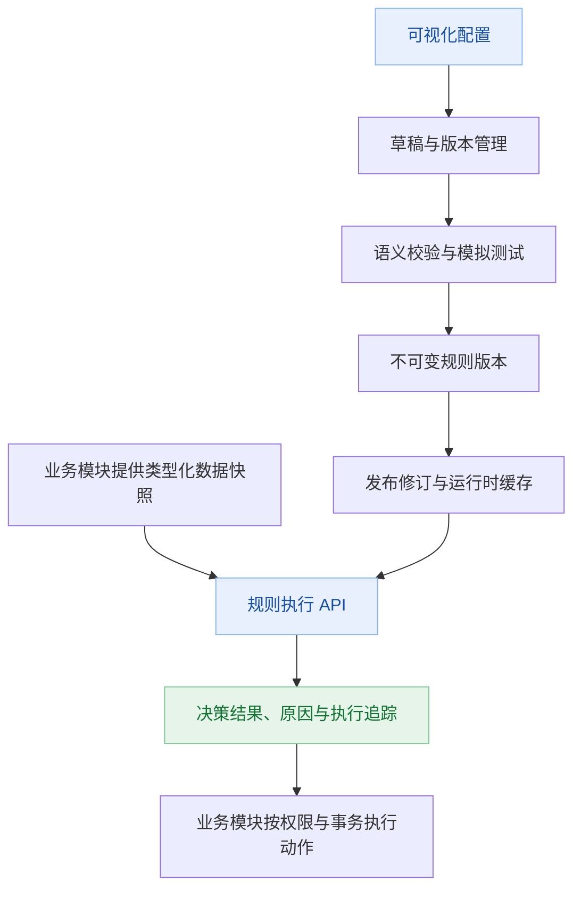

# P06 通用规则引擎与规则管理平台：调研与方案草案

- 日期：2026-11-10。
- 状态：方案草案，尚未选定或安装第三方内核，尚未实施。
- 用户明确要求：通用规则引擎、规则管理、可视化配置；先调研市场，再明确其他需求。
- 本次范围：产品与架构设计、选型比较、需求澄清、验证计划；不新增应用功能。
- 证据边界：本轮官方网页访问不完整，见第 2 节。各产品的版本、许可证、商业功能边界、依赖兼容性尚未全部核验，因此本文不是最终采购或依赖引入结论。

## 1. 建议与待决策事项

建议建设一个独立的 `rule` 应用模块，提供统一规则管理与执行契约。业务人员使用条件构建器和决策表，研发人员提供字段、纯函数及业务接入。执行内核通过内部适配层接入，具体选型经过业务样例验证后确定。

首版重点是可配置的确定性业务决策：校验、分类、准入、分配建议、参数与公式计算。这里只说明能力类型，不代表用户已经要求建设相应业务。

建议优先级：

1. 条件组、决策表、类型化输入输出、模拟测试。
2. 版本、发布、停用、回滚、权限、执行解释与审计。
3. 根据实际需求增加评分卡、受控公式、规则集编排。
4. 仅在确有需求时增加多事实推理、连续事件处理、长期状态或跨服务动作。

“通用”通过稳定数据契约、可扩展字段与函数、可组合规则实现，不承诺第一版覆盖所有推理、流程和数据处理场景。

**待定：业务样例、配置者画像、决策表是否必须遵循 DMN、调用方式、规模目标、是否允许商业组件。**

## 2. 调研范围与证据状态

### 2.1 本轮访问情况

- `https://www.drools.org/` 跳转至 `https://kie.apache.org/`，首页可读取；可确认 Apache KIE 当前展示为 incubating，包含 Drools、Kogito、Tools 等组件。首页本身不能证明某个版本的运行能力或兼容性。
- `https://liteflow.cc/` 可打开；尚未完成具体功能页、设计器与许可证核验。
- Camunda DMN 文档 `https://docs.camunda.io/docs/components/modeler/dmn/` 返回 CloudFront 403，没有取得内容。
- 后续若干 GitHub 页面导航返回 `BROWSER_ACTION_OUTCOME_UNKNOWN`，要求本轮停止浏览器操作并取得新的用户指令。未换工具重试这些被停止的访问。
- 下表属于产品能力的初步技术梳理，结合既有技术知识；除上述首页事实外，不应解读为全部已经通过本轮官方文档或实际部署验证。

### 2.2 市场能力比较

| 产品 / 路线 | 主要能力与适用情形 | 可视化配置与管理的评估重点 | 对本项目的初步判断 |
| --- | --- | --- | --- |
| Drools / Apache KIE | 多事实匹配、规则推理；生态提供决策表与 DMN 相关能力 | 区分规则运行库、KIE 工具和完整管理平台；确认所选版本提供的设计器、维护状态和部署组合 | 若存在复杂事实关联、规则触发新事实再继续推理，重点验证；简单条件判断可能投入偏大 |
| Flowable DMN | Java 生态的 DMN 决策表执行，适合标准化表格决策 | 开源执行内核与商业设计器、管理产品的边界需要分别核验 | 若多数需求可以用决策表表达，是优先验证候选；不必为了决策表引入整套流程平台 |
| Camunda DMN | 标准决策建模、决策表及 FEEL；与流程生态结合 | 明确 Camunda 7、Camunda 8、独立 DMN 组件的版本、生命周期及授权，不能混为同一产品 | 重点参考标准和交互；本轮官方文档访问失败，暂不定为默认依赖 |
| LiteFlow | Java 组件编排、链路控制、分支及组合执行 | 可视化设计器的来源、许可、业务条件编辑能力与治理能力需分开评估 | 若核心是研发组件的多步骤编排，优先验证；不能仅因支持画流程就认定满足业务决策语义 |
| QLExpress / Aviator | Java 表达式与公式执行，适合条件和计算扩展 | 通常需要自行建设字段目录、可视化编辑、发布、测试和追踪；具体版本的访问控制与资源限制需要验证 | 可作为受控表达式候选；表达式库本身不能直接当成完整规则平台 |
| URule | 中文规则产品路线，覆盖业务规则建模和管理场景 | 明确当前产品版本、开源与商业功能、设计器集成方式、二次开发与授权条款 | 如允许商业采购，应列入演示与报价评估，避免预先认定可免费完整嵌入 |
| GoRules ZEN | JSON 决策图与可视化编辑路线 | 分别确认编辑器、运行时、BRMS 的授权，以及 Java 集成的部署与维护成本 | 可参考编辑器交互；是否采用取决于 Java 接入验证和部署约束 |
| Easy Rules | 轻量 Java 条件—动作抽象 | 版本维护状态、规则表达能力和完整治理缺口待核验 | 可作轻量 API 参考；不因上手简单就默认选为长期平台底座 |

未对性能、活跃度、费用做数字评分；缺少统一基准时，星级和综合分数会造成错误精度。IBM ODM、FICO 等商业 BRMS 可在明确采购预算、交付支持与部署要求后扩展调研。

### 2.3 选型方式

将候选分成三个问题独立比较：

1. **业务决策**：条件组合、决策表、命中策略、类型与解释。优先验证 DMN 路线及受控条件树路线。
2. **复杂推理**：事实关联、前向链式推理、事件时间。确需这些能力时验证 Drools，不用普通 DAG 替代推理语义。
3. **步骤编排**：多个已注册业务组件如何组合。确需此能力时验证 LiteFlow，不把业务条件建模全部交给编排表达式。

首版只引入通过验证且实际需要的一种主要执行方式。预留适配接口不代表各内核语义等价，也不代表未来可以无损替换；每个内核必须声明能力、表达式方言和命中策略。

如果实际需求仅为受限的比较运算与逻辑组合，可以实现小规模类型化条件树执行器；这是明确受限的能力，不能扩张成自研通用脚本语言、RETE 或完整 FEEL 引擎。是否采用仍需与 DMN 候选比较维护成本。

## 3. 当前项目的接入依据

以下来自本轮本地文件检查：

| 当前事实 | 方案约束 |
| --- | --- |
| Java 21、Spring Boot 4.1.2、Spring Modulith 2.1.2；MySQL 8；Jackson 3 | 第三方 starter、Jackson 2 依赖、Jakarta 与 Spring 兼容性必须实测；优先评估核心库直接嵌入 |
| 模块使用单个小写单词，API / 表 / 权限前缀一致 | 新模块建议 `rule`、`/api/rule`、`rule_`、`rule:` |
| 根包暴露 API，internal 隐藏实现；模块依赖必须无环 | 业务模块调用规则 API；规则执行只接收数据快照，避免反向依赖所有业务模块 |
| 已有租户、数据权限、IAM、审计、UTC 与双语言约束 | 规则配置、测试数据、制品、缓存和日志都纳入同样隔离；不能只隔离规则列表 |
| `frontend-next/` 已按 P04 独立建设，旧 `frontend/` 保留 | 建议后续规则界面接入新版 Vue 3 / TypeScript / shadcn-vue 体系，不另引完整管理后台壳；以届时前端实施状态为准 |
| P05 设计 Java / JAR 扩展发布，已有部分扩展工程 | 配置发布与代码发布分开；代码能力若接入插件，固定其版本及摘要，不能借规则配置旁路加载 Java |

依据：[项目总纲](../../README.md)、[P04](P04-frontend-visual-rebuild.md)、[新版前端进度](../frontend-next/progress.md)、[P05](P05-versioned-api-extension-security.md)。P05 文档标注未整体实施，不能假定其中所有发布安全能力已经存在。

## 4. 产品范围与角色分工

### 4.1 角色

- 配置人员：选择可用字段、条件和结果，创建草稿、测试及提交发布。
- 研发 / 实施：定义数据契约、字段与枚举、函数和业务接入，处理复杂规则。
- 发布人员：具有目标规则集及环境的发布权限，检查差异与测试结果后发布或回滚。
- 运维 / 审计：查看执行健康、变更记录和脱敏追踪。

同一人可以兼任角色。普通数据规则不默认增加双人审批；如涉及已被 P05 管理的代码扩展，则继续遵守该发布流程。是否需要业务复核由需求确定。

### 4.2 首版建议范围

| 能力 | 建议首版 | 后续条件 |
| --- | --- | --- |
| 规则空间 / 分组、规则集、搜索、复制与停用 | 是 | 租户内共享及跨租户模板另定 |
| 字段目录、类型、枚举、必填与敏感标记 | 是 | 首期由研发注册或受控录入，不自动暴露数据库全部字段 |
| 条件组、嵌套 AND / OR / NOT | 是 | 采用显式语义和类型约束 |
| 决策表 | 是 | 首期明确 UNIQUE / FIRST；其他命中策略按实际需求扩展 |
| 类型化返回值、默认结果 | 是 | 多行输出及聚合需明确合并策略 |
| 草稿、测试、不可变版本、发布与回滚 | 是 | 多环境 / 灰度可分期 |
| 命中解释、操作审计、租户与规则权限 | 是 | 输入日志按敏感级别控制 |
| 公式与派生字段 | 有需要再纳入 | 选择表达式引擎并验证沙箱和资源控制 |
| 评分卡、规则图编排、灰度、批量回放 | 后续 | 由业务样例与发布要求决定 |
| 直接执行 SQL / 任意 HTTP / 任意脚本 | 不建议作为普通配置能力 | 若未来需要，定义受控能力、超时、授权和动作契约 |
| 人工审批流、定时调度、跨日长事务、流式 CEP | 独立评估 | 规则可被这些系统调用，首版不同时建设整套系统 |

## 5. 可视化规则配置界面

### 5.1 信息架构

建议菜单为“规则中心”，包含：

- 规则集：业务空间 / 分组、名称、编码、类型、当前生效版本、草稿、状态、负责人、更新时间。
- 字段与函数：输入输出契约、数据类型、枚举、敏感标记、函数签名与可用版本。
- 测试中心：单次模拟、用例集、运行结果及版本差异。
- 发布记录：版本差异、校验与测试证据、发布状态、停用与回滚。
- 执行记录：按时间、规则集、版本、结果、请求追踪查询脱敏日志。

### 5.2 规则编辑页

采用独立页面。顶部保留规则名称、草稿 / 已保存 / 保存失败状态、当前编辑版本、当前生效版本，以及“保存草稿”“模拟测试”“发布”等操作。

编辑区按需要提供三种模式，不强迫用户先画流程：

**条件构建器**：字段选择 → 与字段类型匹配的运算符 → 值 / 字段 / 受控函数 → 逻辑分组 → 输出。支持中文描述、增删条件、嵌套分组、键盘操作及撤销 / 重做。

**决策表**：条件列、输出列、行说明、命中策略。类型错误直接定位单元格；FIRST 模式下行顺序有业务意义，拖动后必须显示差异。空单元格不能同时表示“任意值”和“空值”，使用明确标记。

**规则图（后续）**：限定开始、条件、决策表、计算、子规则、结果等节点；禁止环和无限循环。节点属性仍使用同一套类型化表单。若存在并行节点，必须定义输出写入隔离和合并规则。

界面侧区展示选中项属性或字段说明；模拟测试打开输入 / 输出与执行解释区域。窄屏改为分步或标签视图，主要编辑不依赖拖拽。

### 5.3 编辑体验要求

1. 保存草稿不发布，不触发业务执行。模拟只执行隔离计算，不发送通知或修改业务数据。
2. 离开页面提示未保存内容；保存失败保留草稿；并发编辑通过修订号检测冲突，不能最后写入者静默覆盖。
3. 草稿与已发布版本分开；发布后继续修改会形成新草稿。
4. 错误提示定位字段、行列或节点，并给出可操作原因，如“金额字段不能与文本比较”。
5. 显示本次输入、条件实际值、条件结果和最终输出；短路未执行的条件标记“未求值”，不能当作 false。
6. 前端预览不是权威判断；模拟与正式执行使用相同后端语义。
7. 界面文本支持 zh-CN / en-US；规则业务名称是否翻译另定；生效时间按用户时区输入并存 UTC。

### 5.4 纯示例：统一的准入判断

以下为说明交互的虚构样例，不是已确认业务：

```text
规则集：示例准入决策        编辑：草稿 r4        生效：v2

当全部满足：
  [申请金额] [小于等于] [5000.00]
  [客户等级] [属于]     [A、B]
  且任意满足：
    [资料完整] [等于] [是]
    [已人工核验] [等于] [是]

返回：decision = PASS，reasonCode = ELIGIBLE
未命中：decision = REVIEW，reasonCode = DEFAULT_REVIEW

[保存草稿]  [模拟测试]  [查看版本差异]  [发布]
```

“规则命中结果”“执行错误”和“没有命中”是三种不同状态，不能都用一个布尔值表示。

## 6. 规则数据模型与执行语义

### 6.1 核心对象

| 对象 | 主要内容 |
| --- | --- |
| 规则空间 / 分组 | 归属、权限、可用字段和函数范围 |
| 输入输出契约 | 字段编码、类型、嵌套路径、枚举、精度、必填、敏感级别、版本 |
| 规则集 | 稳定编码、说明、负责人、默认行为、运行限制 |
| 草稿修订 | 编辑内容、结构版本、修订号、作者、最近保存时间 |
| 规则版本 | 规范化内容、内容摘要、内核与方言、契约及函数依赖快照、测试报告 |
| 发布修订 | 目标环境、规则版本、生效时间、发布与停用状态、操作者、理由 |
| 用例及测试运行 | 输入、预期输出、断言、测试版本、结果与差异 |
| 执行记录 | 请求标识、发布修订、版本、输入摘要、输出、耗时、错误及脱敏解释 |

同一模型可支持多个编辑视图，但并非任意转换。复杂 DMN、脚本或推理规则不保证能转换为普通条件表单；不支持的结构只能只读或在对应编辑器打开，不能静默丢失语义。

### 6.2 必须提前规定的语义

- **类型**：字符串、布尔、整数、十进制、日期、时间戳、枚举、对象、集合；拒绝不明确的自动类型转换。
- **金额与数值**：十进制运算使用 BigDecimal 语义，明确精度和舍入；不使用浮点数计算金额。
- **空值**：缺字段、显式 null、空字符串、空集合分别定义。缺失必填输入是输入错误；可空字段用明确空值运算符；其他比较不隐式按零或空文本处理。
- **时间**：统一 Instant / UTC；自然日与营业时间必须显式绑定 IANA 时区。执行时钟作为上下文传入，便于回放。
- **集合**：包含、任一匹配、全部匹配、空集合的结果均有定义。
- **命中策略**：UNIQUE 在多行命中时返回冲突；FIRST 使用可见稳定顺序；多结果模式明确聚合、优先级、重复值与字段冲突处理。
- **默认行为**：无命中、输入无效、超时、引擎故障分别配置或返回明确错误；“失败允许”或“失败拒绝”由业务契约确定。
- **依赖**：子规则固定版本，拒绝循环引用；发布时冻结字段、函数和子规则依赖，不能只存一个会变化的编码。
- **解释**：保留稳定规则 / 条件 ID、命中行、比较值的脱敏表示和原因码；不声称能为任意第三方脚本提供完整逐表达式解释。

静态检查对受限区间、枚举可发现部分重叠、空洞和遮蔽。复杂函数、任意表达式和推理规则不能保证通过静态分析证明无冲突，需要运行检查与用例补充。

## 7. 执行架构



### 7.1 模块边界

建议对外提供 `RuleExecutionApi`、类型化请求 / 结果 DTO、必要的版本查询接口及发布事件，根包不暴露内核会话、实体或 Mapper。具体签名在选型验证后确定。

执行请求包含规则集编码、业务输入及可信上下文。租户与环境由宿主认证 / 系统上下文确定；不能允许调用者随意指定 tenantId 读取别人的规则。测试与版本执行权限单独授权，普通业务调用不能执行任意草稿。

业务模块先查询自己拥有的数据，再传入不可变快照；规则模块不跨模块查库。首版建议规则仅计算和返回结构化决策。发券、扣款、审批落库、消息发送等动作由业务模块承担，若将来确需动作节点，再增加单独的授权、幂等与补偿协议。

### 7.2 运行与发布

1. 编辑使用可变草稿，保存时检查修订号。
2. 校验并冻结候选版本；测试绑定同一内容摘要，测试后改内容会使发布证据失效。
3. 编译 / 加载候选规则、验证依赖并预热；失败不影响当前生效版本。
4. 服务端按租户、环境和规则集进行权限检查，写入单调递增的发布修订，原子切换引用。
5. 每次请求进入时固定发布修订与依赖快照，在途执行不混用新版本。
6. 回滚建立新的发布修订并指向旧的不可变版本；若依赖已不可用或不兼容，应阻止回滚并给出原因。
7. 停用阻止新调用，返回明确状态；已开始执行是否取消由协议规定，首版建议允许完成短时纯计算。

单实例可从数据库发布修订与本地编译缓存起步。缓存键至少包含租户、环境、版本及内容摘要。集群后必须增加节点就绪、修订同步和故障策略，不能依赖本机事件声称同时全量生效。

### 7.3 资源控制

普通规则限制节点数、嵌套深度、集合规模、输入大小和操作预算。禁止访问类加载、反射、文件、进程、网络、Spring Bean 与任意 SQL；函数从受控注册表调用。

对表达式库逐项验证其沙箱、白名单、循环及递归控制。线程超时或取消不等于可以强制终止任意 Java；无法证明有界的脚本不在宿主进程开放给普通配置者。插件函数继续遵守代码发布边界。

## 8. 存储与接口草案

以下是逻辑设计，尚未执行建表；字段和拆表在需求确认后细化。

建议表：`rule_space`、`rule_schema`、`rule_ruleset`、`rule_draft`、`rule_version`、`rule_release`、`rule_testcase`、`rule_testrun`、`rule_execution`。按需增加函数绑定与执行明细表，避免把完整输入无限写入关系库。

共同遵守 TenantEntity、MyBatis-Plus、Flyway 和项目审计规范。业务唯一编码按租户限定；版本摘要、发布修订和草稿修订均有数据库约束。执行记录高增长，需按保留期归档 / 清理，具体期限由数据敏感度与容量决定。

| 接口类别 | 主要操作 |
| --- | --- |
| `/api/rule/rulesets` | 列表、创建、查看、复制、管理元信息 |
| `/api/rule/rulesets/{id}/draft` | 读取 / 保存草稿，携带预期修订号 |
| `/api/rule/rulesets/{id}/validate` | 对指定草稿修订执行静态校验 |
| `/api/rule/simulations` | 运行指定草稿 / 版本及测试输入 |
| `/api/rule/versions` | 查看不可变内容、版本差异与验证证据 |
| `/api/rule/releases` | 发布、查询、停用及回滚命令；防重复提交 |
| `/api/rule/testcases` | 用例集及断言管理 |
| `/api/rule/executions` | 执行查询与受控脱敏明细 |

模块内调用优先 Java API。外部应用如确有需要，另按现有 `/open/**` 应用鉴权接入并限定规则集与环境；不把管理 API 直接匿名开放。权限 key 可按 `rule:ruleset:view/edit`、`rule:simulation:run`、`rule:release:publish/rollback`、`rule:execution:detail` 等分别声明。

## 9. 测试、发布门禁与验收

### 9.1 最小验证样例

1. 条件组合：嵌套条件、NOT、空值、金额边界、枚举、集合。
2. 决策表：零命中、单命中、多命中、FIRST 行顺序、默认输出。
3. 可解释性：输出可定位到规则 ID / 表格行；短路项与错误不混淆。
4. 发布：旧版本执行过程中发布新版本，两次请求分别固定各自版本；加载失败维持旧版本。
5. 并发：两个编辑者保存冲突可见，重复发布不重复生成生效动作。
6. 隔离：跨租户规则编码、缓存、测试用例与日志不可串读；无权用户不能模拟或发布。
7. 资源：超大输入、深嵌套、非法函数和不受限表达式被拒绝。
8. 回放：固定输入、时钟和依赖，结果可重现；动态外部数据必须使用当时快照。

### 9.2 内核概念验证的通过条件

- 在当前 JDK / Boot / Jackson 基线上真实编译、启动并运行样例，不仅查看支持版本声明。
- 确认可视化编辑器的技术栈、许可证、嵌入方式及导入导出边界。
- 同一套输入输出预期通过空值、精度、日期、集合和命中冲突测试。
- 证明版本隔离与加载失败恢复方式；需要会话的引擎不能跨租户共享可变会话。
- 测量编译耗时、内存、吞吐、P95 / P99；分别报告纯规则计算与含业务取数的端到端延迟。需求未定前不承诺 QPS 数字。
- 表达式资源与访问限制得到验证，不能只以“开启沙箱”作为证据。
- 输出决策记录，列明选定版本、许可证文件、核心依赖、使用限制和弃用路径。

测试门禁采用项目现有 Modulith / 架构 / 租户 / i18n 检查，补充规则语义、真实后端联调与浏览器编辑交互验收。自动测试通过不等于业务可用性或人工视觉验收完成。

## 10. 实施阶段

| 阶段 | 交付物 | 退出条件 |
| --- | --- | --- |
| A 需求与选型 | 业务样例、官方来源核验、候选验证和选型记录 | 语义、授权、兼容性与首版范围明确 |
| B 设计验证 | 字段契约、编辑页原型、条件 / 表格样例、版本状态设计 | 实际配置者可以独立完成样例并理解输出 |
| C 最小闭环 | 规则模块、可视化编辑、模拟、版本发布、执行 API | 一个真实业务通过公开 API 接入并可追踪结果 |
| D 治理与验收 | 权限隔离、测试用例、审计、回滚、限制与监控 | 关键异常和发布场景验收通过 |
| E 按需扩展 | 评分卡、规则图、灰度、批量回放、外部应用接入 | 每项有具体场景和独立验收标准 |

不在业务样例、规模和内核验证之前给出精确工期或采购承诺。

## 11. 需求澄清清单

优先请用户提供前两项，其余可先按建议默认值设计：

| 问题 | 为什么影响方案 | 当前建议 / 状态 |
| --- | --- | --- |
| 最先落地的 2～3 个规则例子是什么？输入、判断和输出分别是什么？ | 区分条件判断、计算、推理与编排 | 待用户补充，不把虚构样例当成需求 |
| 谁配置规则，业务人员、实施还是研发？ | 决定编辑器难度、公式权限与字段治理 | 待用户补充 |
| 只返回决策，还是需要自动改变业务状态？ | 决定事务、幂等、授权和补偿 | 建议首版返回决策，业务模块执行动作 |
| 是否必须 DMN 导入导出或与其他规则平台交换？ | 决定标准内核和可视化建模格式 | 待确认；不声称自定义 JSON 等于 DMN |
| 内部调用、外部 API、定时批处理还是消息触发？ | 决定入口、部署和错误恢复 | 建议先内部同步调用；其他按需 |
| 单规则复杂度、规则数量、并发、延迟和可用性目标？ | 决定容量与资源上限 | 先验证代表性样例，再确定指标 |
| 一套系统内部共用，还是客户 / 租户各自维护？ | 决定模板、覆盖与授权模型 | 租户隔离沿用底座；首版不默认跨租户继承 |
| 是否需要测试 / 生产环境、定时生效与灰度？ | 决定发布路由与环境管理 | 首版保留环境维度，至少版本发布和回滚 |
| 是否要求双人业务审批？ | 决定发布流程 | 不默认增加双人；权限与测试门禁必要 |
| 可否采购商业产品，部署是否必须离线？ | 决定候选、授权和运行拓扑 | 待确认 |
| 执行输入有哪些敏感字段，追踪保存多久？ | 决定日志脱敏、访问和存储 | 默认仅必要字段及摘要，期限待定 |

## 12. 官方资料入口与待核验清单

以下为官方或项目资料入口；链接列表不表示本轮全部已成功读取：

- Apache KIE：<https://kie.apache.org/>，本轮首页可读取。
- Drools：<https://www.drools.org/>，本轮跳转至 KIE。
- LiteFlow：<https://liteflow.cc/>，本轮首页可打开，待深读。
- Flowable：<https://www.flowable.com/open-source/docs/dmn/ch02-GettingStarted/>，待核验。
- Camunda DMN：<https://docs.camunda.io/docs/components/modeler/dmn/>，本轮 403。
- QLExpress：<https://github.com/alibaba/QLExpress>，待核验。
- Aviator：<https://github.com/killme2008/aviatorscript>，待核验。
- URule：<https://www.bstek.com/>，待核验当前产品入口及授权。
- GoRules ZEN：<https://github.com/gorules/zen>，本轮访问结果未知，未取得可用正文。
- Easy Rules：<https://github.com/j-easy/easy-rules>，本轮访问结果未知，未取得可用正文。
- OMG DMN：<https://www.omg.org/spec/DMN/>，待核验版本及规范。

恢复调研后优先补齐：候选核心能力的官方引用、当前许可证文本、设计器授权、Java 21 / Boot 4 兼容证据、实际样例验证。补齐前保持本方案为草案，不冻结技术选型。
