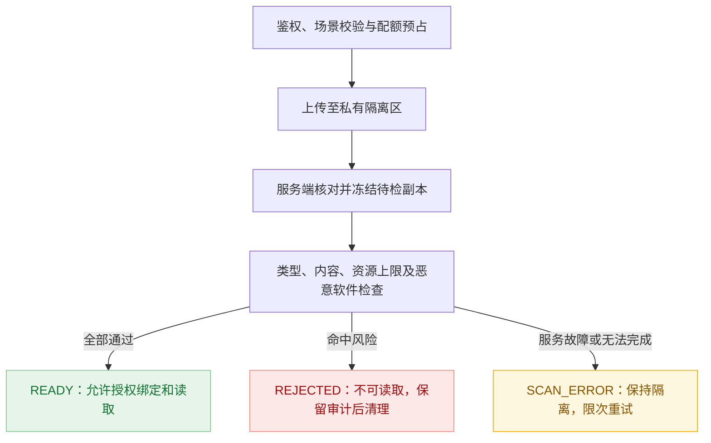

# P09：Google 登录、邮件服务、多云存储与安全上传

日期：2026-11-11　版本：v2　归属：可复用基座能力　状态：**已授权分阶段实施；真实交付范围见[实施进度](../integration-services-progress.md)**。

本文记录设计基线，API、表、配置、权限和默认值不自动代表已提供。用户随后授权开始实施并交付二开开发手册；外部测试配置暂未准备，明确先实现并完成本地验证。架构和路径按本方案推进，实际状态、验证及外部联调边界统一记录在[实施进度](../integration-services-progress.md)。

## 1. 推荐结论与范围

| 用户需求 | 推荐方案 | 真实业务怎样使用 |
| --- | --- | --- |
| H5/App 使用 Google 登录 | 增加 `identity` 应用用户身份模块，Google 采用 OIDC；与后台 `auth/iam` 账号域隔离 | 登记应用和身份域，接入登录流程，获得基座应用用户会话；业务仅关联稳定主体 ID |
| 注册、找回密码、通知邮件 | 增加 `mail` 事务邮件模块；验证码及凭据变更归 `identity`，发送归 `mail` | 调验证码场景接口，或以模板编码、变量、收件人调用受控邮件 API |
| 多云存储和管理 | 扩展现有 `file` 模块，配置多存储空间与场景路由；提供 Local、OSS、AWS S3、R2 适配器 | 业务选择已授权的场景，得到 `fileId`，不感知 Bucket、密钥或供应商 SDK |
| 本地/云上传及安全 | 一个文件生命周期，支持服务端接收、服务端转存、客户端直传、分片续传；统一隔离、校验和授权 | 根据场景选择允许的上传方式，安全检查完成后绑定业务对象 |

用户已明确确认：存储范围为本地、阿里云 OSS、AWS S3、Cloudflare R2；Google 开发应用 ID、邮件服务和云存储基础配置必须按租户独立维护，不同租户可以使用不同账号、凭据和配置。此要求为实施硬约束，完整规则见第 10.2 节。邮件按“发送”理解。

首版目标是可供多个 H5/App 复用的基础设施，不建立某个商城的会员等级、订单、营销规则或视频业务平台。实际业务仍在独立业务分支的 `com.sma.business.<bizid>` 与 `src/business/<bizid>`。默认随宿主构建和部署；扫描器可以是受限外部进程/服务，这不意味着拆分业务微服务。

以下纳入设计但分阶段落地：Google 与邮箱注册/重置、多实例可靠发送、四类存储、直传/续传、安全检查、管理界面、监控、旧文件兼容。营销群发、其他社交登录、任意公网 URL 抓取、DRM、直播、跨区域自动双活、全功能云厂商控制台不在首版范围。

## 2. 当前实现核对及缺口

依据为 2026-11-11 `main` 的**当前工作区源码**，包含尚未提交的并行修改；不是某一发布标签的承诺，也不是运行时安全审计。工作区已有大量修改，实施不能覆盖这些内容。

| 当前依据 | 已有行为 | 本方案需要补齐 |
| --- | --- | --- |
| [FileService](../../backend/src/main/java/com/sma/admin/file/internal/service/FileService.java) | 文件元数据、租户/portal/所有者与业务授权；PNG/JPEG/GIF 解码、像素限制；非图片可能采用上传者声明的 MIME | 场景白名单、可信类型检测、完整安全状态、跨身份域授权、大文件处理 |
| [StorageAdapter](../../backend/src/main/java/com/sma/admin/file/internal/service/StorageAdapter.java)、[LocalStorage](../../backend/src/main/java/com/sma/admin/file/internal/service/LocalStorage.java) | 内部接口含 `Path path(key)`；本地随机 `.blob`、流式大小限制、SHA-256、防路径穿越 | 去除上层对本地 Path 的依赖；多适配器、读取流/范围、直传和分片 |
| [FileProperties](../../backend/src/main/java/com/sma/admin/file/internal/service/FileProperties.java)、[application.yml](../../backend/src/main/resources/application.yml) | 默认单文件 20 MiB，HTTP multipart 单文件 20MB、请求 21MB | 分场景限额和独立分片通道，不能把 HTTP 限额全局放到数十 GiB |
| [FileController](../../backend/src/main/java/com/sma/admin/file/internal/web/FileController.java) | 登录后下载、附件处置、`nosniff`、CSP；返回本地文件资源 | 云下载/Range、隔离状态门禁、独立媒体域、短期授权 |
| [FileQuery](../../backend/src/main/java/com/sma/admin/file/FileQuery.java)、[FileAccessPolicy](../../backend/src/main/java/com/sma/admin/common/security/FileAccessPolicy.java) | 查询、所有权检查、业务读取和引用保护 | 保留旧消费者；新增带身份域的上传、绑定、访问契约 |
| [SessionIssuer](../../backend/src/main/java/com/sma/admin/auth/internal/service/SessionIssuer.java)、[SessionValidity](../../backend/src/main/java/com/sma/admin/auth/internal/service/SessionValidity.java) | 后台不透明会话、凭据/安全版本、PASSWORD/PASSWORD_TOTP；已绑定 TOTP 不能跳过 | 不把 Google 登录伪装为 PASSWORD，也不直接调用内部签发器 |
| [SmaPrincipal](../../backend/src/main/java/com/sma/admin/common/security/SmaPrincipal.java) | 人类后台身份与 OpenAPI 机器身份；不具备独立应用用户主体类型 | 增加显式应用用户认证上下文与 audience 门禁，不能只新增 portal 字符串 |
| [message 模块](../../backend/src/main/java/com/sma/admin/message/package-info.java)、[openapi 模块](../../backend/src/main/java/com/sma/admin/openapi/package-info.java) | 站内消息/WebSocket；应用机器鉴权 | 邮件投递不是站内通知；机器密钥也不是 H5/App 用户登录凭据 |

在上述模块及后端依赖的本次检索中未发现 Google/OIDC、SMTP 或多云存储实现。已有 [FileTests](../../backend/src/test/java/com/sma/admin/file/FileTests.java)覆盖路径/归属、大小、伪造或截断图片；本次仅阅读，未重新执行。

## 3. 模块归属、依赖及拟改路径

### 3.1 模块职责

| 模块 | 拥有的数据和职责 | 公开面草案 |
| --- | --- | --- |
| `identity`（新增） | 应用用户主体、身份域、登录客户端、Google 绑定、邮箱凭据、验证挑战、应用会话 | `SubjectQuery`、`SubjectContactQuery`、`SubjectAccessPolicy`；登录/注册/验证码及本人凭据变更使用HTTP契约 |
| `mail`（新增） | 发信配置、模板版本、任务/尝试、回执、退信与抑制列表 | `MailSendApi`、`MailStatusQuery`、投递结果事件 |
| `file`（扩展） | 存储空间、场景、文件、上传任务/分片、扫描结果、引用和清理任务 | 保留 `FileQuery`；新增 `FileUploadApi`、`FileBindingApi`、`FileAccessApi`、`FileSceneCatalog` |
| `common :: security`（最小扩展） | 可信调用者上下文与授权判定所需的稳定类型 | 新增独立 `ActorRef/ActorContext` 契约，区分 ADMIN_USER、APP_USER、APPLICATION、SYSTEM_JOB |
| `auth/iam`（保留后台归属） | 管理员认证、TOTP、角色权限、数据范围 | 管理新模块所需的管理权限，不接管消费者账号或给它们分后台角色 |
| 业务模块 | 客户资料、业务对象、业务权限及引用关系 | 实现场景/对象授权 SPI；保存 `subjectId/fileId`，不读基座表 |

依赖方向：`identity → mail → common`，`file → common`；业务依赖三模块公开面。管理接口可以依赖 IAM 公开查询或通用权限契约。`mail` 不反向依赖 `identity`，`file` 不依赖具体业务，`common` 不访问新模块。事件订阅与策略 SPI 不能形成模块环。

新主体类型采用独立契约，避免给现有 `SmaPrincipal` record 增字段后破坏旧二进制消费者。现有后台上下文通过适配器映射；APP_USER 不得伪装成管理员 SmaPrincipal。HTTP、WebSocket、异步任务分别从已验证的会话或受信任务快照恢复身份，不能从请求 JSON 构造 ActorContext。

与并行的 [P08 缓存治理和多实例方案](P08-cache-governance-and-cluster.md)协调：新增 Google 公钥、已发布模板/场景等缓存须使用其最终公开契约登记；验证码、令牌族、限流预算、上传/发送租约是权威安全或工作状态，不能作为普通可清空缓存。MySQL 保存权威状态，多实例扫描/发送按数据库租约竞争；本地分片/文件需要共享可靠存储才能支持关闭粘性会话的双节点访问。P08 具体交付以其进度证据为准，P09 不新建第二套缓存框架，也不把 Redis 可用视为集群验收完成。

跨专项边界（[P11 跨专项资源归属](P11-cross-stream-resource-ownership.md)）：本模块的写入属于平台库，账本位置不受租户业务分库影响；但 C4d 之后新增的每个写入口都必须按安全专项的接口清单登记预算 scope（`shared` 或 `node`），存储配置沿用 file 模块已有体系，不建平行实现。品牌素材走同一条文件安全流水线，其公开投影的安全验收先于本方案的云存储阶段完成。

### 3.2 拟改路径与影响（仅提案）

| 路径 | 后续拟议改动 | 影响 |
| --- | --- | --- |
| `backend/src/main/java/com/sma/admin/identity/`、`mail/` | 新增静态 Modulith 模块及公开契约 | 扫描、路由、依赖白名单、应用用户安全链 |
| `backend/src/main/java/com/sma/admin/file/` | 上传生命周期、存储路由、任务和兼容适配 | 原文件/头像/通知附件消费者 |
| `backend/src/main/java/com/sma/admin/common/security/` | 最小调用者类型与授权边界 | 全部身份入口的拒绝路径，必须重点回归 |
| `backend/src/main/resources/db/migration/{identity,mail,file}/` | 只追加迁移，实施时重新核对版本 | 新旧库升级、旧文件状态回填 |
| `backend/src/main/resources/i18n/{identity,mail,file}/`、配置及 `backend/pom.xml` | 双语错误、类型化配置、锁定 SDK/解析器 | Java 21、Boot 4/Jackson 3 兼容及漏洞检查 |
| `backend/src/test/java/com/sma/admin/` | 架构、契约、安全、迁移及供应商测试 | 隔离可清空测试库及专用测试 Bucket |
| `frontend-next/src/features/{identity,mail,file}/`、组件/语言包 | 管理页面、通用上传组件 | 不创建真实业务页面，不移除旧前端 |
| `README.md`、开发手册、部署文档及命中范围规则 | 使用、配置、兼容与验证说明 | 在实现验收后同步，不把草案写成已支持 |

方案保存阶段只新增本设计文档并更新索引；用户现已授权实施上表范围。实际新增目录、接口与验证记录见专项进度，保留所有并行修改。

## 4. Google 登录与应用用户身份

### 4.1 身份域与账号模型

- `identity_client` 按租户独立登记应用、允许的身份域、平台（Web/iOS/Android）、Google client ID、服务端 secret 引用、精确回调地址、允许 Origin、登录开关、会话策略。同一租户可登记多个应用/平台配置，不使用全局单一 Google client ID/secret。H5/App 是 public client，包内不能保存 client secret；Web 后端的 Google secret 仅在服务端。
- `realm` 是身份域，默认每应用独立；多个自有应用需要同一用户体系时显式加入同一 realm。数据库唯一键和会话授权都包含可信 `tenantId + realmId`。客户端不能通过修改 tenant/realm 参数进入另一个域。
- `identity_subject` 是最小登录主体，可关联多个身份凭据；实际商城会员、作者、课程学员等资料仍归业务模块，不把身份主体当通用业务用户表。
- Google 外部身份键为 `(tenantId, realmId, canonicalIssuer, sub)`；`sub` 按大小写敏感保存。邮箱是可变化的属性，不能作为 Google 唯一 ID。issuer 仅接受官方精确白名单后规范化。
- 同 Google 用户在不同租户/realm 默认是不同主体。即使跨应用共享 realm，会话仍绑定实际应用 audience，不自动访问其他应用。
- 不把 OpenAPI 的 AppSecret 发给浏览器。首版独立维护登录客户端登记；如果后续统一应用目录，先补公开注册查询契约，再通过 API 关联，禁止跨表读取 OpenAPI 数据。

### 4.2 推荐登录流程

1. H5/App 使用已登记的租户 HTTPS Host 和不透明 `loginHandle` 请求登录事务。实施时以可信 Host 建立租户入口，再使用 `appClient=<loginHandle>` 在该租户内选择客户端；预检也带该公开参数，不增加全局免租户 Mapper。租户内 `clientCode` 可同名，不能只按 code 查询全局第一条；Google client ID 也不能用来反推租户。生成一次性 state、nonce，并绑定租户、realm、配置版本、回调白名单和发起浏览器/设备事务。公开 handle 只是路由标识，不代表认证；完成请求必须匹配原始事务与可信租户入口，不相信请求新增的 tenantId/header。
2. H5 优先后端参与的 Authorization Code 流程；使用 state、nonce，所选 Google 客户端类型/SDK 支持时绑定 PKCE S256。原生 App 使用官方推荐 SDK/系统浏览器流程；授权码流程必须 PKCE，避免嵌入式 WebView。具体 Android/iOS 返回的 code 或 ID token 按平台 SDK 单独验收，不能混用 Web client 配置。
3. 授权码由服务端或对应原生授权流程兑换。ID token 必须由服务端校验签名、允许算法、issuer、精确 audience、必要时 azp、有效期及 nonce/请求绑定；只接受该客户端登记的 audience，不能接受整租户所有 client ID 的宽泛集合。
4. Google 公钥按官方缓存期限缓存，未知 kid 受限刷新；不能使用 JWT header 提供的任意 jku/x5u 地址。校验失败、时钟严重偏差、密钥获取失败时拒绝登录，不关闭签名校验降级。
5. 查外部身份绑定；已有主体检查禁用/注销/应用准入。新主体按 realm 的自助注册策略创建最小账号，通过事务唯一约束处理双回调/并发注册，业务资料由幂等事件或公开 API 完成。
6. 如果该应用配置更高认证要求，先完成其挑战再签发应用会话。首版 APP_USER 不继承后台 TOTP 机制；后台原有 TOTP 会话完全保留。后续若允许管理员 Google 登录，应单独设计 `GOOGLE_TOTP` 等真实认证方法，不能绕过 P07。
7. H5 优先同站后端 HttpOnly/Secure/SameSite Cookie；对应安全链必须启用 CSRF 与 Origin 检查，不能照搬现有后台的全局禁用 CSRF。跨站 BFF/Cookie 场景需专项验证 SameSite/CORS 和 CSRF。
8. App 使用短期不透明访问令牌和可轮换刷新令牌，服务端仅存 token 哈希；刷新令牌保存在系统 Keychain/Keystore 支持的安全存储。默认建议访问 15 分钟、刷新 30 天，属于待压测/评审配置。轮换原子消费，重用检测撤销该令牌族；并发刷新采用客户端单飞，服务端避免两个有效后继。

回调不得把正式会话 token 写入 URL。需要跳回 H5/App 时发极短期一次性 handoff code，绑定原始客户端、回调和 PKCE/事务证明后兑换。GIS ID-token 直交作为单独入口验收：执行其规定的 CSRF/nonce 校验，且保存一次性事务消费记录；签名合法的 bearer ID token 本身并不意味着不会重放。

仅登录请求 `openid email profile` 最小 scope，默认不申请离线访问、不保存 Google refresh token。Google Drive 等资源授权应由独立的用户授权能力处理，不能与登录混为一体。Google 头像 URL 首版只作为受控外部资料，不能触发不受限服务器抓图。

### 4.3 绑定、重置与会话隔离

- 同邮箱的密码账号与 Google 账号不能静默合并，即使 `email_verified=true`。绑定必须在已登录状态重新验证原账号，再完成新 Google 挑战；并发绑定依赖唯一约束。解绑不得删除最后一种可用认证方式。
- Google 邮箱是否可作为本地恢复邮箱另行验证并登记；第三方域邮箱的 Google 验证标志不能当成永久邮箱所有权保证。邮箱变更要求验证新邮箱并完成高风险再认证。
- Google-only 账号没有本地密码。“忘记密码”不能偷偷给它新增密码；首次设置密码是独立、重新认证后的凭据新增操作。
- `/api/identity/**` 的应用登录与 `/api/auth/**` 后台认证使用显式分离的安全匹配及会话存储。通用 `/api/**` 后台默认拒绝 APP_USER；应用业务路径必须显式声明 audience 和 APP_USER 策略。旧 `@PermitLoggedIn` 不能因为“已登录”就接受新主体。
- 用户停用、改密、解绑、安全版本变化和注销触发对应会话失效；请求检查凭据/会话版本，不能仅靠最终一致事件踢人。后台、应用用户、机器身份两两互换令牌必须被拒绝。
- Google 不可达时只显示可用且用户已绑定的其他登录方式，不绕过授权。开发/生产分别配置 OAuth 客户端、域名、同意屏幕；Google 可达性和平台政策必须在目标网络/设备实际验证。

## 5. 邮箱服务与验证码

### 5.1 发送与身份验证分离

`mail` 负责“按已授权模板投递一封邮件”，不负责判定“验证码通过就允许改哪个密码”。验证码生命周期、注册、邮箱绑定和密码重置属于 `identity`；订单通知、账单等业务通知调用 `MailSendApi`。

首版使用 Spring Boot 兼容的 Jakarta Mail/SMTP 实现，接口保留供应商 API 适配能力，后续可接 SES、阿里云邮件推送等。依赖版本在实施时锁定；不把仅能发 SMTP 的实现写成已经支持云 API。

发信配置按租户独立保存，含逻辑通道、SMTP/API 类型、主机/端口、TLS 要求、发件人/已验证域、凭据引用、连接/读取超时、配额和速率、启用状态及健康状态。每个租户可维护多个通道及应用绑定，只能选择本租户已授权通道/模板；未配置或配置失效时停止对应发送，不回退到其他租户或全局发信账号。普通业务请求不可提交任意 SMTP endpoint、From 或原始邮件头；禁用不校验证书与 TLS 失败自动降级。

模板按租户/应用/场景/语言管理草稿与不可变发布版本，支持纯文本和受限 HTML。变量有类型和长度约束、默认转义；不允许任意 SpringEL、Java/脚本执行、CRLF 邮件头注入或任意外链恢复地址。任务固定模板版本和渲染快照，禁止重试时套用刚被修改的模板。

### 5.2 验证码和重置密码

推荐验证码 6 位随机数字、5 分钟过期、每挑战最多 5 次、同目标重发间隔 60 秒；这些是建议起点，结合风险和流量调整。公网入口同时按租户/应用/IP/设备/邮箱摘要限流，并设日配额和全局预算，避免邮箱轰炸、撞码与费用攻击。

1. 创建 challenge 时绑定 `tenant/realm/client/purpose/target/subject/transactionId`。注册、改邮箱、密码重置不能互用，修改目标邮箱即失效。验证码使用 CSPRNG；存储带服务端密钥的 HMAC 验证值，不能只存可离线穷举的六位码普通哈希。
2. challenge 与 mail outbox 通过同步公开 API 在同一宿主数据库事务提交。待发送验证码正文必须短期封装加密，密钥来自受保护部署配置且带 key ID；任务投递后按保留策略擦除，日志不写码/完整恢复链接。HMAC 无法反解，不能假设工作线程仅凭验证码哈希就能构造邮件。
3. 重发创建新版本并使旧码失效；发送线程先检查挑战有效版本和剩余期限，过期/失效任务取消。SMTP 已接受的旧邮件无法收回，文案提示只认最近一次有效码，不给已投递的旧码延寿。
4. 校验失败计数独立提交，不随业务回滚返还；正确验证码原子消费，不允许并发多次通过。需要分步操作时返回一次性 `VerificationGrant`，绑定用途、主体、目标和短有效期，不返回正式登录 token。
5. 密码重置通过应用身份公开接口，在同一事务锁定并消费 grant、验证账号状态/安全版本、执行统一密码策略、更新凭据版本并撤销对应会话。不能先永久消费再因改密失败让用户无法继续，也不能先改密后另事务消费形成重放窗口。
6. 注册/重置请求统一响应，避免暴露邮箱是否存在；重置只允许已验证恢复邮箱且符合该 realm 的恢复策略。Google-only、停用账号和未验证邮箱不能走普通密码重置。

若使用重置链接，生成至少 256 bit 随机一次性 token、仅存哈希，建议 15 分钟有效；落地页不加载第三方资源，设置 Referrer-Policy，立即兑换受限 grant 并清理 URL。恢复目标地址只能来自服务端白名单，禁止用户传完整跳转 URL。

**本方案不会增加后台管理员的邮件单因素恢复入口，不改变 P07“首版无弱验证恢复入口”的边界。** 后续给后台接邮件重置需独立定义 TOTP、密码和会话的组合安全策略。

### 5.3 可靠投递与回执

实施细化（C2b3c）：`state` 保存传输生命周期，新增 `receiptState` 保存 DELIVERED/BOUNCED/COMPLAINT，避免先到回执被迟到 SMTP 完成覆盖。首版提供强制签名 OpenAPI 回执桥接和默认拒绝的 MailReceiptPolicy；供应商原始 webhook 的验签由显式网关适配承担，尚不提供原生 SES/SNS 等厂商解析器。实际验收与旧任务升级边界见[实施进度](../integration-services-progress.md)和[二开手册](../integration-services-developer-manual.md)。

- `mail_delivery` 即持久 outbox，业务幂等键唯一作用域为租户/应用/发送场景。业务事件至少一次投递时复用相同键；同键不同内容返回冲突，不能发送第二封。
- 工作线程数据库抢占、租约、超时恢复、指数退避与随机抖动；验证码优先且不得超期发送，通知有限次重试后转人工可见失败。使用任务 fencing/version 防止旧 worker 覆盖新状态。
- 状态区分 QUEUED、SENDING、ACCEPTED、DELIVERED（有可靠回执时）、BOUNCED、FAILED、UNKNOWN、CANCELLED。SMTP 2xx 只代表对方接受，不等于送到收件箱。
- 远端已发送但本地未记账是不可消除的不确定窗口。稳定 Message-ID 只利于追踪，不保证去重；优先查询供应商回执或用其幂等能力，UNKNOWN 不盲目切另一供应商重发。纯 SMTP 无法做到 exactly-once，通知模板应容忍重复。
- Webhook 校验供应商签名、时间和重放标识；按 provider message ID 幂等去重，乱序回执不能把退信改成“已成功”。硬退信/投诉进入抑制列表，租户/域/平台封禁范围显式区分。
- 配置 SPF、DKIM、DMARC、退信地址与发送信誉监测；秘密轮换和 DNS 验证有专门状态，不以“测试邮件接受”代替域名送达质量验收。
- 附件仅通过文件公开授权读取 READY 文件，限数量/总大小；大文件发送受控业务下载链接，不能把长期有效私有直链写进邮件。脱敏保存收件人、有限保留正文，发送日志与业务审计分离。

## 6. 多云存储与管理

### 6.1 统一抽象，不抹平供应商差异

建议 `file` 内部定义 `StorageProvider` 与 `StorageCapabilities`，而不是向业务公开各厂商 SDK。通用操作为流式写/读、stat、delete、受控 copy、范围读取；可选操作为签名上传/下载、分片初始化/签片/列片/合并/取消。读取返回流/范围描述或短期下载授权，不能要求所有对象先下载到本地 Path。

| 存储 | 接入方式 | 需要独立核验的差异 |
| --- | --- | --- |
| 本地服务器 | 现有 LocalStorage 演进 | 无原生云直传；分片由宿主协议管理；磁盘配额、备份、节点亲和/共享盘 |
| 阿里云 OSS | 原生 OSS SDK | STS/签名策略、分片参数、回调验签、区域 endpoint；不默认套 S3 协议 |
| AWS S3 | AWS SDK for Java v2 | IAM/STS、SigV4、Region、checksum、multipart、版本与生命周期 |
| Cloudflare R2 | S3 SDK + 独立 R2 适配配置 | `auto` region、account endpoint、支持的 S3 操作/校验和；不能默认支持 S3 ACL、POST policy 或全部 STS 功能 |

每个 profile 归属一个租户，保存 provider、region、endpoint、Bucket、受控前缀、凭据引用、访问域名、服务能力及配置版本。每租户可维护不同厂商和多个空间，应用/场景只能引用本租户空间；本地存储也必须按可信租户分区。具备配置权限的租户管理员可在平台网络安全限制内维护本租户 endpoint 等基础配置，普通业务请求不能修改它们。endpoint、SMTP 主机和下载回源均属于出站网络边界：仅允许登记且通过校验的域名/网段，阻止元数据服务、未批准内网、DNS 重绑定及重定向绕过。

`StorageCapabilities` 至少声明最大对象/片大小、最小片大小、最大片数、Range、预签名方法、版本/条件写、可验证 checksum、回调和服务端复制。SDK 升级后按厂商分别跑契约测试；“S3-compatible”不能替代测试。

供应商限额会变化。此次 AWS 官方文档显示最大对象 48.8 TiB、最多 10,000 片、非末片 5 MiB～5 GiB；这些**只作为来源快照**，不作为所有云统一常量。本方案初始业务上限建议 20 GiB，实施按各厂商实时能力和安全扫描资源再确认。R2 预签名使用 S3 API 域名，不能把签名 URL 直接换成自定义 CDN 域名。

### 6.2 场景路由与业务选择

业务登记 `sceneCode`（如 `shop.avatar`、`course.lessonVideo`）和对象授权策略；租户管理员在平台硬限制内配置本租户 profile、允许的上传方式、文件类型/大小、可见性、扫描、保留期与配额。场景属于业务命名空间，基座提供机制，不内置客户的业务限制。

策略优先级：**平台安全硬上限 ∩ 租户配额 ∩ 已发布场景策略 ∩ 当前主体授权**。业务可选择允许范围内的 profile 或传递存储偏好，服务端最终决策；客户端不能任意指定 Bucket、object key、ACL 或关闭扫描。

| 典型场景（仅示例） | 建议方式 | 建议策略 |
| --- | --- | --- |
| 头像 | 小文件经服务端上传到选定本地/云 | ≤5 MiB；JPEG/PNG/WebP 中已验收类型；解码后重编码、移除元数据 |
| 私密业务附件 | 服务端上传或私有云直传 | ≤20 MiB 起步；场景白名单、杀毒、业务对象鉴权；默认附件下载 |
| 课程/短视频 | 客户端直传云，超过阈值分片 | ≤2 GiB 起步；容器/编解码/时长检查，隔离探测；按需生成播放衍生物 |
| 大型素材 | 分片直传、断点续传 | ≤20 GiB 起步；显式类型策略、完整扫描能力、配额预占、到期清理 |
| 内网离线部署 | 本地存储与本地扫描 | 无云依赖；多节点须共享可靠文件系统或明确节点路由，不可随机读另一节点本地盘 |

本地存储不天然比云安全；云存储也不自动检查业务权限和文件内容。选择取决于部署网络、并发/容量、地域、出站费用和运维。面向公网视频/大文件推荐私有云直传，头像/小文件可以服务端代理；离线部署保留本地完整流程。

### 6.3 管理界面

在新版管理端提供以下可复用页面（页面名称为产品表达，契约名不进入普通业务用户流程）：

| 页面 | 主要操作和状态 |
| --- | --- |
| 存储空间 | 新增/编辑、凭据替换、连接诊断、容量/流量统计、只读/停用、能力提示 |
| 上传场景 | 归属业务、可选空间、类型/大小、上传方式、扫描/可见性/保留策略；草稿、校验、发布 |
| 文件中心 | 类型、来源应用、场景、上传者、大小、扫描/引用/删除状态；授权预览/下载、回收/恢复 |
| 上传任务 | 进度、已上传分片、失败原因、续传、取消、超时清理；脱敏任务标识 |
| 安全检查 | 排队、扫描中、拒绝原因、引擎/规则版本、重扫、隔离保留期；不提供“一键跳过安全放行” |
| 存储迁移 | 源/目标空间、复制/校验进度、失败重试、切换与源保留窗口 |
| 邮件与应用身份 | 发信账号、模板、发送/回执、抑制名单；应用客户端、Google 配置、登录统计和绑定审计 |

“连接测试”默认只做受限鉴权/stat；写探测是独立明确操作，只使用管理命名空间。控制台文件列表以基座元数据为准，不默认扫描整个云账号。外部已有文件需显式导入、登记归属并经过安全流水线，不因 Bucket 中存在就可下载。

存储配置被文件或任务引用时不可物理删除；停用区分“停止新上传”与“紧急禁止读取”。改路由只影响新任务，已有任务固定配置版本和 location；密钥轮换单独管理兼容窗口。移动云对象本质上是复制/核验/切换/延后删除，不保证跨云事务。

## 7. 上传协议、大文件与生命周期

### 7.1 统一入口与三种传输

上传初始化返回 `uploadId`、`fileId`（待处理）、所选传输模式、片大小/并发建议、过期时间、必要的短期上传授权。浏览器组件或 App SDK 据此完成传输；业务只认最终 `fileId` 和状态，不保存永久对象 URL。

- **服务器本地接收**：流式写隔离目录，边写边计数/计算摘要；禁止把文件全读成 byte array。大文件走单独分片端点，不改小文件 multipart 的全局安全限额。
- **服务器转存云**：应用接收并流式写私有隔离空间，适合内网来源/小文件；控制临时盘、内存、超时和并发，取消上传必须取消底层云任务。
- **客户端直传云**：后端签发仅针对该任务 staging key 的短期 PUT/表单 token/分片授权。客户端不能 list/read/delete，不能写 READY 对象；CORS 精确到可信 Origin 与方法，但不能把 CORS 当鉴权。

### 7.2 状态与安全门禁

完整状态建议为 `INITIATED → UPLOADING → VERIFYING → SCANNING → READY`，失败分 `REJECTED/SCAN_ERROR/EXPIRED/ABORTED`，删除分 `DELETING/DELETED`。只有 READY 可被普通用户绑定、预览、下载或签发读取 URL；管理端也不能凭“查看元数据”权限下载隔离原文件。

客户端 `complete` 或云回调只表示申请核验，不能直接设为 READY。服务端 stat/list-parts 核对所属任务、实际大小、片序、对象位置与校验信息；回调必须验签并幂等，丢回调可通过轮询补偿。ETag 在分片、加密及不同云实现中不等于整个文件 MD5/SHA-256，客户端自报 hash 也不是可信检测结论。

**防止“扫完后换内容”**：预签名 URL 在到期前通常可重复使用，关闭数据库任务不能撤回已签 URL。完成上传后先把指定版本或一致副本冻结到客户端无写权限的私有待检 key，再对该副本扫描并计算摘要；不能只扫描仍可被重传覆盖的 staging key。没有可靠 version/条件复制时，以服务端读取并写出不可覆盖快照作为被检对象。最终引用必须指向被检快照或经摘要核验的一致副本；发布后的 key 永不复用、不覆盖。迟到重传只会产生不可读 staging 数据，交给清理任务处理。

### 7.3 分片、续传与配额

- 分片阈值建议 32 MiB、目标片大小 16 MiB、客户端并发 3；服务端根据总大小、各云最小/最大片大小与片数上限重新计算。最后一片规则按供应商处理，不能把 AWS 常量套到 OSS/R2。
- 服务端拥有 upload session 和真实 provider upload ID；初始化、同片重试、complete、abort 都带幂等键与版本控制。分片摘要/大小不一致拒绝覆盖；complete 并发只允许一次进入核验。
- 续传先重新鉴权同租户/应用/主体/场景，再从供应商列片对账；本地浏览器保存的进度仅作提示。续传校验文件指纹/大小及已确认片摘要，不能把两个同名文件拼起来。
- 令牌过期只续签未完成任务的受限授权，不重建新任务。取消与 complete 竞争由状态锁/CAS 解决；abort 远端失败要记录待清理，不立即释放实际占用的所有预算。
- 配额预占按声明最大值，完成后按真实值结算；还要计入临时副本、分片、衍生物、扫描盘和隔离保留。限制任务数量、并发、每片大小、速率及租户全局临时容量。
- 预签 PUT 在部分供应商不能像 POST policy 一样强制范围字节上限。若无法强制内容长度/分片边界，必须说明可能发生短期超额成本；要求严格硬限额的场景强制使用网关/受控代理，不得宣称事后删除就能避免费用攻击。
- 建议未完成任务 24 小时到期，清理悬空 multipart/staging；实际云生命周期与数据库任务双重兜底，保留任务租约和清理宽限，避免删除活跃上传。断网、刷新、服务重启、云超时后可恢复，不依赖单 JVM 内存。

### 7.4 视频与派生文件

视频探测在受限 worker 中进行，限制容器、音视频轨道/编码、时长、分辨率、帧率、探测数据量和执行时间；FFmpeg/ffprobe 禁止任意 URL/外部协议输入。原视频和封面/转码/切片均有独立摘要、处理版本与父子引用。

普通 MP4 播放需要授权 Range/206；HLS 清单、分片、密钥都要有一致访问策略，不能只保护清单。转码不是基础上传成功的必要条件，只有场景要求“可播放衍生物”时才将其作为发布门禁；产品分别显示“文件安全可用”与“视频处理中”。云转码能力以后作为适配扩展，R2/S3 存储接入本身不等于已提供转码。

## 8. 文件安全：魔数只是其中一层

| 层级 | 必须控制的内容 | 不能替代的检查 |
| --- | --- | --- |
| 准入 | 登录/受控一次性上传许可、租户/应用/对象授权、场景白名单、配额与速率、Cookie 上传 CSRF | 不能凭“知道 fileId”访问；未登录注册附件默认不开放 |
| 文件名 | 仅作展示；随机服务端 key；去路径/控制字符，处理 Unicode、双后缀、大小写、尾点/空格 | 拒绝路径穿越、Windows ADS、设备名等；不得用用户文件名拼磁盘路径 |
| 类型 | 后缀白名单、服务端魔数/MIME 检测、容器结构检查与三者一致性策略 | `Content-Type` 可伪造；改后缀或加图片头并不安全；文本类型没有可靠统一魔数 |
| 内容 | 图片真实解码/重编码；视频容器探测；PDF/Office/压缩包按场景深入检查 | 检测 polyglot、尾随脚本、宏/嵌入对象和解析器漏洞风险 |
| 恶意软件 | ClamAV 或受控商用扫描服务，更新签名、记录引擎版本和扫描摘要 | 杀毒与魔数均不能保证检测所有未知木马；外部公共扫描网站不接收用户私有文件 |
| 资源隔离 | 解析/解压/杀毒低权限隔离进程，限 CPU/内存/临时盘/文件数/时间；默认断外网 | 上传的字节不能直接在主 JVM 内触发无资源边界的复杂解析 |
| 存储 | 私有隔离区，非 webroot/非 classpath/非插件目录；本地 OS 最小权限 | 不把 JSP/PHP/脚本交给解释器；noexec 只是辅助，不能阻止解释器读脚本 |
| 提供内容 | READY 检查、对象授权、准确 MIME、nosniff、默认 attachment、独立无会话 Cookie 的媒体域 | 不能把不可信 HTML/SVG 放在主站同源 inline 执行 |

具体规则建议：

1. 普通用户场景拒绝可执行/脚本及服务配置，例如 exe/dll/so/jar/class/jsp/php/asp/aspx/sh/bat/cmd/ps1、HTML/SVG 和宏文档。只做后缀黑名单不足，仍需内容白名单。未来确需软件制品上传，另设隔离制品场景与发布链，不能把文件中心当热插件安装入口。
2. 图片限定经验证的解码器与格式，限制尺寸、总像素、动画帧数、总解码像素与内存；原图重编码为允许格式后才发布衍生图。EXIF/GPS 等元数据默认移除；需要原件的场景保留私有已扫描原件并独立授权。
3. PDF/Office 并非因魔数正确就安全：策略可拒绝 JavaScript、外部引用、宏和嵌入对象；要求安全预览时用隔离转换/CDR 得到展示副本。OOXML 是 ZIP 容器，要检查内部结构，不能一律认作“普通 ZIP”。
4. 压缩包默认关闭；启用时限制总解压大小、压缩比、文件数、嵌套深度，拒绝 Zip Slip、符号/硬链接和越界路径；加密/密码包、无法扫描的内容默认拒绝。导入业务不能在校验前自动解压到运行目录。
5. TXT/CSV/JSON 等按独立文本场景做编码、结构和大小检查，默认附件下载；CSV 供表格打开时还需处理公式注入。不能要求所有合法文本都有二进制魔数。
6. 对大文件必须确认扫描引擎的实际最大流/文件大小与时间预算。扫描报告“超过上限/部分扫描/超时”统一算 SCAN_ERROR，不可当 clean；只扫头部或仅扫分片不能替代合并后的完整扫描。
7. 未知类型、解析失败、杀毒服务不可用、规则缺失时保持隔离或拒绝。可由有权限人员重试/重扫；不通过普通开关绕过硬门禁。扫描后发现恶意内容要撤销访问、使引用失效并告警，已下载副本无法追回。
8. 本地暂存与发布采用受控目录、原子/排他创建、拒绝跟随链接；部署账号不能写应用 JAR、配置、静态脚本或插件发布目录。迁移/预览/转码生成物也必须遵守这些权限。

安全目标是多层降低风险，并阻止不可信文件成为服务器可执行内容；不承诺“100% 没有木马”。现有杀毒、解析库和 OS 都需补丁、漏洞检查和隔离，不能只实现魔数判断就宣称安全上传完成。

## 9. 公开契约、绑定与一致性

### 9.1 接口设计与实施映射

| 入口 | 语义与限制 |
| --- | --- |
| `POST /app/identity/google/transactions` | C3c3 实施路径：已登记客户端创建 Google 登录事务；匿名但严格限流/绑定来源 |
| `POST /app/identity/google/completions` | CODE/ID_TOKEN 固定用途入口、state/nonce/CSRF/PKCE 验证；精确列入匿名白名单 |
| `/app/identity/bootstrap`、`/sessions/refresh`、`/sessions/current` | 公开引导、受限刷新与本人会话；方法与 DTO 见手册 8.4 |
| `/app/identity/email/challenges`、`/email/verifications`、`/registrations`、`/password/resets`、`/password/sessions` | C3d已本地验收：用途受限挑战及原子消费；不提供任意邮件正文发送，Google-only不走普通密码重置；完整前缀与DTO见手册8.13 |
| `/app/identity/account/...` | C3d本人方式查询、再认证、邮箱/Google绑定及移除；严格原actor/用途/目标与双重证明，见手册8.14 |
| `SubjectQuery` / `SubjectContactQuery` / `SubjectAccessPolicy` | C3e公开Java读契约及业务策略；联系邮箱单独授权，tenant/realm/audience/实时会话约束，不依赖internal |
| `MailSendApi.enqueue(Command)` | 已实施服务端公开 Java API；幂等键在 Command 内，模板/收件人/租户/应用及场景授权 |
| `FileUploadApi.initiate/complete/abort/status` | 可信 ActorContext + 已登记场景；返回受限传输授权与状态 |
| `FileBindingApi.bind/unbind` | 校验 READY、身份域、授权业务对象及引用；幂等更新 |
| `FileAccessApi.authorizeRead` | 每次根据当前调用者与业务对象授权签发短期读取，不能返回凭据 |
| `/api/file/upload-tasks/**`、`/app/file/upload-tasks/**` | C4c3实施路径：后台/应用分别认证，本人任务与scene audience再授权；公开Java/HTTP见手册11.2，Local完成仅SCANNING |

应用用户入口使用独立 `/app/**` 安全链，管理配置继续 `/api/**`，机器入口继续 `/open/**`。公开 appClient/loginHandle 必须与可信 Host 选择的租户一致，不做全局免租户查询；C3c3 已通过本地完整宿主验收，真实 Google/设备/浏览器仍待外部联调，实际结果见进度。其余未实施文件路径/DTO 仍为草案，以分阶段手册冻结的协议为准。保留 Long ID 字符串传输、`ApiResponse`、双语错误码；增加 `NOT_READY/SCAN_REJECTED/CAPABILITY_UNSUPPORTED/QUOTA_EXCEEDED` 等可操作错误，不泄漏对象存在性、磁盘路径或云凭据。

旧 `FileAccessPolicy` 继续服务后台消费者；新应用主体采用版本化独立 `FileObjectPolicy` 等 SPI，明确能否上传、绑定、读取和删除。没有策略实现时拒绝。跨模块不为了读取引用关系而扫描业务表。

### 9.2 业务使用例

商城在业务分支登记 `shop.avatar` 和 `shop.invoice` 场景。H5 用户通过 Google/邮箱取得 APP_USER 会话；业务根据 `subjectId` 加载自己的会员。上传头像时只传 `sceneCode` 和文件描述，基座根据租户策略选择本地或 OSS。上传后轮询，只有 READY 才提交头像绑定；后续迁移到 R2 时会员表中的 `fileId` 不变。

订单完成事件由商城以 `order:<id>:paid:<version>` 为幂等键调用邮件公开 API，模板从已发布的 `shop.orderPaid` 版本选择；商城不能修改邮件表。发票文件通过订单归属授权读取，不能仅凭邮件里的 fileId 获取。

独立部署的业务后端用明确的服务身份/授权范围调用版本化外部 API；机器发邮件不冒充用户。H5/App 不持有服务端机器密钥。热插件若要调用这些能力，须另补受支持的宿主能力、幂等账本与 SDK 契约；本提案不暗示当前 P05 插件已具备网络/存储权限。

### 9.3 文件引用、删除与迁移

- 同宿主业务保存对象时，同步调用 `bind`，让业务引用与文件绑定账本处于同一 MySQL 事务；无跨模块外键/SQL。大文件外部写入不占长事务，初始化、完成、绑定分别用短事务。
- 独立业务用带保留期的绑定预留、幂等确认/取消和对账流程；不能假设跨服务事务。未绑定 READY 文件延时清理，预留/引用未解除时不能误删。
- 删除先逻辑标记且停止签发新 URL，引用中的文件拒绝删除；物理删除由可重试工作任务执行。对象存储不是数据库事务参与者，删除/复制成功后记账失败要对账恢复，不能靠数据库回滚恢复云对象。
- 私有短签 URL 建议 1～5 分钟，已发 URL 在到期前可能继续有效；需要立刻撤权的机密场景使用逐请求鉴权代理/边缘鉴权。公开衍生资源允许 CDN 缓存时明确其公开性，删除需要缓存清理，不能保证已分发副本消失。
- 跨存储迁移以不可变对象复制、实际大小/服务端摘要校验、原子更新 location 为步骤；保留源文件至回退期及在途读取结束。核验失败不切换。迁移期间按 location 版本幂等恢复，不更换 fileId。
- 不跨租户做可感知的“秒传/按 hash 存在性查询”；首版关闭内容去重。后续若去重，仍需独立所有权、引用计数和不可探测存在性的设计。

## 10. 数据与配置草案

### 10.1 数据归属

遵守[数据规则](../agent-rules/data-and-configuration.md)：模块拥有表、TenantEntity、UTC `DATETIME(3)`、Long ID、软删除及可信租户隔离；不跨模块 join/外键。以下是逻辑模型，不是可执行 DDL，实施阶段补全列类型/索引/容量与留存预算。

| 模块/表 | 核心字段与约束 |
| --- | --- |
| `identity_realm`、`identity_client` | tenant、realm code、client code、平台、Google audience/secret 引用、回调/Origin、状态、配置版本；编码按租户唯一，独立 loginHandle 用于公开路由 |
| `identity_subject`、`identity_credential` | realm、主体状态、安全/凭据版本；密码哈希及已验证邮箱凭据；业务资料不进表 |
| `identity_external_link` | realm、subject、issuer、外部 sub；有效绑定唯一键含 tenant/realm/issuer/sub；大小写敏感 |
| `identity_login_transaction`、`identity_verification` | 用途、客户端、目标/主体、state/nonce/挑战哈希、PKCE/短期敏感载荷加密、期限、次数、消费状态 |
| `identity_session`、`identity_refresh_family` | 应用 audience、主体、token 哈希、认证方法/时间、版本、刷新族、到期/撤销；不可复用后台 auth_session |
| `mail_profile`、`mail_template`、`mail_template_version` | tenant、租户内配置编码、SMTP/API 连接与密钥引用、应用授权、模板归属、不可变发布版本、语言、变量 schema |
| `mail_delivery`、`mail_attempt`、`mail_suppression` | 幂等键、载荷摘要/短期加密载荷、状态、尝试与租约、provider message ID、回执去重及拒收范围 |
| 现有 `file_asset`（追加列） | 兼容保留旧字段；新增主体域/类型、应用、scene、status、profile/location、可信 MIME、摘要、策略版本 |
| `file_storage_profile`、`file_scene`、`file_scene_version` | tenant、租户内配置编码、多空间配置、能力、密钥引用、应用授权、场景硬限制与不可变策略快照 |
| `file_upload_session`、`file_upload_part` | 文件/主体、冻结路由、provider upload ID、片号/长度/校验和、幂等键、配额预占与过期 |
| `file_scan_job`、`file_scan_result`、`file_binding` | 不可变被检对象、扫描器/规则/结果、租约；所属业务/对象/引用用途，唯一绑定 |
| `file_work_item` | 物理删除、迁移、孤儿对账等外部动作，幂等状态机/重试/租约 |

邮箱规范化必须定义清楚：域名小写/IDNA；本地部分策略由身份域约定，不统一去掉 Gmail 点号或 `+tag`。身份匹配可用 HMAC lookup key，原值按需要加密，避免数据库默认不区分大小写排序规则破坏外部 sub、token 或 key 的语义。软删除唯一性按 existing `active_*` 方案设计，不能误复用已撤销外部身份造成接管。

### 10.2 租户独立配置（用户已确认，强制）

Google 开发应用配置、邮件服务配置和云存储基础配置均是**租户拥有的数据**，不仅是运行时业务数据需要过滤租户。不同租户可使用不同厂商账号和参数，同一租户也可按应用/场景维护多份配置。

| 配置 | 每个租户独立维护的字段 | 运行时选择规则 |
| --- | --- | --- |
| Google | OAuth client ID、服务端 secret 引用（适用时）、Web/iOS/Android 平台、realm/应用绑定、回调/Origin、启停、配置版本 | 从已登记登录入口与一次性事务取得可信租户，精确选择该租户/客户端/版本；不全局遍历所有 client ID 来接受 token |
| 邮件 | SMTP/API 通道、主机/端口/TLS、账号与凭据引用、From/域名、配额、模板/应用授权、默认通道、启停、版本 | 优先本租户应用显式绑定；允许时使用本租户已登记默认通道；无有效配置则拒绝发送 |
| 存储 | provider、区域、endpoint、Bucket、路径前缀、凭据引用、访问域名、配额、场景/应用绑定、默认空间、启停、版本 | 优先本租户场景显式绑定；场景允许时使用本租户默认空间；无有效配置则拒绝上传，不自动转存到其他租户或本地 |

1. **持久化与引用隔离。** 三类配置及其历史版本均有非空且创建后不可修改的 `tenant_id`，不得登记为租户豁免表。业务编码唯一约束含租户，允许 A/B 两租户同时使用 `default` 等编码；根据用途补应用/平台维度。`profileId/clientId/templateId/sceneId/credentialRef` 等引用必须校验同租户与应用授权，不因 ID 全局唯一就省略归属检查。跨模块经公开 API 检查，不新增跨模块外键。
2. **管理操作隔离。** 列表、详情、分页总数、增删改、启停、连接测试、测试邮件、发布、默认配置切换、密钥轮换和审计查询全部使用可信租户上下文并检查独立操作权限。不能使用请求 body/header 的 tenantId 提权。租户管理员只管理本租户；超管不绕过租户过滤，平台人员代管须通过明确授权的租户切换/委派流程并审计，未提供该流程时拒绝跨租户操作。
3. **无跨租户回退。** 配置未设置、停用、验证失败或凭据失效时，对应能力禁用或返回可操作错误；不搜索“第一条可用配置”，不回退到平台全局 Google/SMTP/云账号。默认通道与空间只能指向本租户配置。平台可提供不含秘密的表单默认值/模板，但复制后形成租户独立记录，不能共享可变账号配置。
4. **凭据隔离。** secret 引用限定在该租户可访问命名空间，不能把任意环境变量名、文件路径或其他租户的 secret ID 当合法输入。应用仅向前端返回必要的公开 Google client ID，不能返回 secret；邮件/云配置只返回脱敏结果。加密采用外置主密钥/密钥服务和按租户隔离的数据密钥或等效控制，并用 `tenantId + module + configId + credentialVersion` 作为认证附加数据，阻止密文搬到另一租户后仍可解密。配置权限不包含导出明文密钥的权限。
5. **缓存与连接实例隔离。** 配置快照、SDK 客户端、SMTP 会话/连接池、STS token、签名器与健康状态的键至少包含 `tenantId + module + configId + configVersion + credentialVersion`；应用定制数据补充 app/realm 等维度。禁止全局单例通过修改一组凭据服务所有租户。更新/清缓存只作用于目标租户与版本；旧连接按在途引用安全退出，不串用新租户凭据。仅 Google 官方固定 issuer 的公开 JWKS 等无租户秘密的资料可按白名单共享，租户 audience/回调配置不可共享。
6. **异步与回调隔离。** 邮件、上传、扫描、迁移、重试任务固化可信租户、配置 ID/版本、凭据版本和应用归属；调度器只负责领取任务，worker 恢复租户上下文后再次校验引用，完成后在 finally 清理上下文。不能依赖“当前登录租户”或遗留 ThreadLocal。OAuth state、供应商回执/上传回调通过受控事务/订阅定位并完成签名验证后恢复租户，不能相信回调明文 tenantId。重复回执键包含 tenant/provider/profile，防止供应商 ID 碰撞；密钥已撤销时阻断/显式重新授权，不静默换其他账号重试。
7. **物理存储边界。** 优先每租户独立 Bucket/受限凭据。需要共享 Bucket 时必须显式配置，使用不可重叠、服务端生成的租户前缀，结合厂商可用的 IAM/STS 策略和基座签名授权限制；不能仅凭对象名带 tenantId 宣称隔离。租户不能覆盖根前缀或注册其他租户的对象范围。具备跨前缀权限的平台签名凭据不交付租户，客户端只获单对象/单任务授权。本地存储按可信租户隔离目录并校验真实路径/链接边界；复制、导入、删除、迁移和清理同样不可越界。
8. **租户切换与资源治理。** 管理界面显式显示当前租户，切换时清空配置表单、选中 ID、查询缓存和测试状态，取消旧请求并丢弃迟到响应；后端继续独立鉴权，不能只靠前端隔离。配额、费用、限流与任务并发按租户计量，平台硬上限额外生效。停用/删除租户时停止新外部操作、取消或隔离在途任务、撤销授权并按保留策略清理，不能影响其他租户。

配置生效优先级为“当前可信租户中的应用/场景显式绑定 → 经授权的本租户默认配置 → 未配置拒绝”，再与平台安全硬限制取交集。使用本租户默认配置不授予新的应用权限，也不覆盖在途任务已固定的配置版本。

### 10.3 部署配置与租户配置分层

建议配置域为 `sma.identity.*`、`sma.mail.*`、`sma.file.*`；业务自己的场景编码与 `business.<bizid>.*` 保持归属。YAML/环境变量只承载部署级基础设施、扫描器地址、硬限制、外置主密钥或受控凭据引用等；租户 Google 应用、SMTP/邮件 API、云存储基础配置由各自模块的带租户配置表和管理 API 维护，不能只注入一套全局 `@ConfigurationProperties` 账号配置。已有单套部署配置迁移时，只可显式登记给指定租户，不自动广播给所有租户。

Google secret、SMTP 密码、云 AK/SK、HMAC/加密主密钥使用环境/受保护文件/密钥服务引用；管理页面只显示脱敏值与 key ID，留空保留旧值。若必须管理加密凭据，采用外置主密钥的信封加密、轮换/审计、最小权限访问；数据库备份中不能同时带解密主密钥。预签 URL、验证码、OAuth code/token、邮件正文和私有对象 key 不进入普通访问日志或埋点。

配置生效规则：场景/模板发布只影响新任务；在途任务固定旧版本；禁用身份、紧急撤权和安全阻断是实时检查。基础连接/SDK Bean 配置是否热更新需具体实现验收，不能宣称任意 YAML 改动即时生效。

### 10.4 租户配置验收矩阵

使用至少两个租户 A/B，分别配置不同的 Google 客户端、SMTP 账号和云空间，并故意使用相同 `clientCode/profileCode/sceneCode`。以下是后续必须执行的验收，当前未运行：

| 验收 | 通过条件 |
| --- | --- |
| 独立配置与选择 | 同名配置可并存；A/B 的登录验签、发件人、Bucket/区域/凭据分别命中各自配置，外部调用记录可证明，不能只检查 UI |
| ID 替换与批量操作 | A 使用 B 的配置、凭据引用、模板、空间或任务 ID 操作时拒绝；列表、计数、日志不泄漏 B，批量更新不会绕过租户过滤 |
| 未配置与故障 | 删除/停用 A 配置或使 A 凭据失效，只影响 A；A 不使用 B/平台默认账号，B 正常工作 |
| 并发与缓存 | A/B 并发调用、相同编码、切换租户、配置轮换、SDK 复用、缓存失效和线程池复用均不串号；A 的变更不失效/污染 B 的连接或凭据 |
| 异步与回调 | worker 崩溃重试、迟到/重复/伪造回调及同 provider message ID 在双租户下正确归属；任务恢复不借用其他租户上下文 |
| 云与本地授权 | 替换 key/前缀、访问另一租户文件、使用 A 直传授权写 B 路径、越界清理/迁移均拒绝；对共享 Bucket 执行真实权限测试 |
| 密钥与管理界面 | 复制密文/secret 引用至另一租户失败；日志和响应无明文 secret；切换租户后旧请求结果不覆盖新表单；受限管理员不能执行配置测试/轮换 |

租户隔离是 C1～C8 各项自己的验收门禁，不推迟到最终 C9 才验证；不通过则该项不能标记完成。

## 11. 兼容、发布与回退

1. **先加兼容结构。** 追加迁移，旧文件标记 `LEGACY_UNSCANNED`，location 指向旧本地路径；保留旧 fileId、下载路由、FileView 和 FileQuery 的既有签名。新安全状态通过新增版本 DTO/端点暴露，不能悄悄给旧 Java record 加字段。
2. **明确旧文件策略。** 新上传始终经过安全流水线。旧后台已存在引用在迁移窗口可按原授权走受限附件下载，不能因此标记为“已扫描安全”，也不能直接向新 H5/App 开放。头像等需安全展示副本时先重扫/重编码。高风险历史文件可立即隔离；宽限期结束前完成重扫或清点阻断列表。
3. **旧上传接口兼容。** 旧消费者期待同步返回可用文件，小文件在有界时间内同步完成同一安全检查后返回；失败/超时明确失败并清理，不返回“像成功一样”的待检文件。异步上传使用新端点与组件，支持 202/状态轮询。头像、通知附件绑定全部回归。
4. **不回退到失去门禁的老程序。** 预备兼容版本必须理解新状态并拒绝非 READY 新文件。若新版已写云对象/APP_USER 元数据，原始旧版既不理解位置也不理解身份，不能直接退 JAR；回退目标应是已验证的兼容版本，或先关闭新入口、排空任务并恢复一致快照/对象位置。
5. **按租户/应用/场景灰度。** 先启 mail 与安全本地文件，再启应用身份和各云 profile。供应商凭据、Google OAuth 应用、域名及扫描服务未准备好时保持对应入口禁用，不伪造连通成功。
6. **恢复与灾备。** 联合备份 MySQL 元数据、私有文件/云版本与外置密钥；恢复后旧验证码、登录事务和会话按策略撤销，发送中任务先对账避免重发。数据库恢复不代表云对象已恢复。

## 12. 分阶段计划与验收门槛

本表是已授权的实施基线，表内“未开始”为方案保存时状态，实时状态以[专项进度](../integration-services-progress.md)为准。逐项记录实际命令、结果和阻塞；用户明确先做本地验证，因此外部账号联调单列待办，本地门禁失败仍须解决当前项，不跳步标记完成。

| 阶段 | 任务及依赖 | 独立验收标准 | 状态 |
| --- | --- | --- | --- |
| C0 | 冻结边界/契约/路径、目标 App、Google SDK、供应商能力及命名空间；无前置 | 无环依赖设计、精确路由/身份矩阵、租户配置及凭据隔离契约、双租户测试资源、数据/兼容方案通过评审 | 未开始 |
| C1 | 调用者上下文、租户配置归属门禁与应用身份域隔离骨架；依赖 C0 | 后台/APP_USER/机器令牌互换拒绝；跨租户/realm/client/配置引用拒绝；无全局账号回退；P07 全部拒绝路径保留 | 未开始 |
| C2 | mail：配置、模板、outbox、SMTP、回执/抑制；依赖 C1 | 事务回滚不发、同键只入一任务、UNKNOWN 不盲重发、模拟退信/乱序/限流；授权真实邮箱实测 | 未开始 |
| C3 | identity：Google、邮箱注册/重置、绑定和应用会话；依赖 C2 | 真机/H5 OAuth 验收；错误 aud/nonce/state、重放、同邮箱接管、并发刷新、OTP 越用途全部拒绝 | 未开始 |
| C4 | file：兼容迁移、策略、状态、Local、新授权与扫描 worker；依赖 C1～C3 的基线验收 | 本地端到端、恶意样本/扫描故障隔离、旧头像与通知附件回归；无扫描后覆盖窗口 | 未开始 |
| C5 | AWS S3 适配及直传/分片/恢复；依赖 C4 | 专用 Bucket 实测 PUT/Range/续传/取消/重复 complete/临时片清理，配额与版本绑定 | 未开始 |
| C6 | R2 独立兼容适配；依赖 C5 | 真实 R2 操作矩阵、checksum/签名/域名差异，未支持能力明确拒绝 | 未开始 |
| C7 | OSS 适配；依赖 C6 | 真实 OSS 区域、上传/续传/回调验签、私有下载与清理通过 | 未开始 |
| C8 | 管理页面、可复用 H5 上传组件/接入样例；依赖 C2～C7 | 双语、权限、租户独立配置及切换隔离、敏感值脱敏、任务/扫描状态、移动端续传；业务样例独立归属 | 未开始 |
| C9 | 迁移/压测/灾备/文档与发布；依赖 C8 | 旧库升级、旧契约兼容、目标并发与文件规模、故障恢复、回退演练；同步 README/专项规则 | 未开始 |

厂商顺序可在 C0 调整以贴近第一个实际业务，但不能省略任何已要求供应商的独立验收。Mock、MinIO 或本地 SMTP sink 只验证协议逻辑，不等同于 Google、真实云和真实邮箱验收。

### 12.1 必测安全与故障矩阵

- 身份：伪造 JWT、错误签名/算法/issuer/aud/azp、过期、state/nonce 缺失或重放、开放重定向、Google 配置跨租户、绑定竞态、已注销主体重建；APP_USER 访问旧后台 API/WS 必须拒绝。
- 邮件：错用途/错目标/过期/猜码预算、并发消费、发送事务回滚、验证码更新竞态、重置后旧令牌撤销；模拟发送成功但本地超时、worker 崩溃及重复回执。
- 上传：双扩展/伪 MIME/假魔数/截断图片/polyglot、SVG/HTML、宏/加密压缩包、Zip Slip/炸弹、解码像素炸弹、恶意视频协议、EICAR 测试样本及引擎不可用。所有样本在隔离环境处理，不在主机执行恶意文件。
- 权限：跨租户/跨应用/跨主体读取、绑定、续传、取消、删文件；超管仍不能跨租户；猜 fileId、伪造 provider 回调与修改场景/profile 被拒绝。
- 配置隔离：执行第 10.4 节双租户矩阵，覆盖三类基础配置的独立编辑/选择、同名编码、secret 引用、配置缺失、SDK/缓存、异步重试、密钥轮换与物理存储范围；不得只测文件元数据的 tenant_id。
- 一致性：片序错乱、同片不同内容、complete/abort 并发、签名 URL 到期/复用、扫描后对象覆盖、删除/迁移中崩溃、恢复任务重复运行、孤儿对象和分片清理。
- 规模：5 MiB 图片、20 MiB 附件、2 GiB 视频、20 GiB 大文件与超限输入；多并发和慢连接下验证内存不随文件大小线性增长，记录磁盘水位、线程/连接、吞吐、扫描时延、超时和费用。未测到的规模不列为支持上限。

后端最终在仓库根执行 `pwsh -NoProfile -File tools/dev/verify-backend.ps1 -Standard`；专项按模块增加测试后从根 Maven reactor 运行，不用旧测试名冒充新增覆盖。前端执行 `frontend-next` 的 `npm run verify` 及对应真实端到端用例。数据库测试仅使用专用可清空库；供应商测试使用专用 profile/Bucket、前缀、限额与清理账本，不能触碰生产文件。

### 12.2 运维与可观测性

指标包含 OAuth 成功/失败/延迟与密钥刷新失败，验证码拒绝/限流，邮件队列龄期/接受率/退信/UNKNOWN，上传和临时占用、完成率、扫描积压/拒绝/规则版本、孤儿/未完成分片、下载流量、各云错误与费用。

每次操作使用 correlation ID，审计记录可信租户、应用、操作者、目标、策略版本和结果。告警与处理手册覆盖密钥到期、域名认证失效、扫描器失联、磁盘水位、云配额、恶意文件激增；健康探测不自动发邮件/上传大文件。安全阻断优先，不能为了成功率让隔离文件自动放行。

## 13. 实施前需确认的产品选择

以下不阻碍本次方案交付，实施 C0 时确认即可：

1. 第一批应用的平台、部署区域与优先云厂商（OSS、AWS S3、R2）；各租户的配置管理权限与资源准备情况。
2. 应用之间默认账号独立（推荐）还是显式共享 realm；是否确有后台管理员 Google 登录需求（本稿默认不含）。
3. 需要的文件类型、最大单文件/并发/日上传量、私有与公开场景、保留期；本稿容量数值均为建议，不是既有容量保证。
4. 可用的发信域名/SMTP 账号、Google OAuth 项目、云测试资源及扫描服务部署方式；敏感文件是否禁止出指定地域。
5. 历史文件重扫宽限期及高风险文件的阻断策略；不同意历史兼容下载时改为先全量重扫再开放。

本稿推荐先完成身份/邮件闭环与本地安全文件流水线，再逐供应商接通大文件直传，最后完成管理和迁移。这样能用同一业务契约验收各存储，避免各厂商各自一套上传逻辑和绕过安全检查的“快速通道”。

## 14. 参考与方案阶段验证范围

2026-11-11 已在线读取下列官方/安全资料，用于校对本方案关键边界；不是账号配置、真实发送或供应商联调证据。链接内容会变化，SDK/限额需在 C0 再确认。

- [Google：验证 ID token](https://developers.google.com/identity/gsi/web/guides/verify-google-id-token)：签名、aud/iss/exp、sub、CSRF 与邮箱含义。
- [Google：原生应用 OAuth](https://developers.google.com/identity/protocols/oauth2/native-app)：公共客户端、PKCE、系统浏览器与平台回调。
- [OWASP：File Upload Cheat Sheet](https://cheatsheetseries.owasp.org/cheatsheets/File_Upload_Cheat_Sheet.html)：白名单、不能信任 Content-Type、魔数不应单独使用、存储隔离与恶意软件检查。
- [AWS：Multipart upload limits](https://docs.aws.amazon.com/AmazonS3/latest/userguide/qfacts.html)：对象/分片大小和片数限制。
- [Cloudflare：R2 S3 compatibility](https://developers.cloudflare.com/r2/api/s3/api/) 与[预签名 URL](https://developers.cloudflare.com/r2/api/s3/presigned-urls/)：能力矩阵、region、签名方法与域名限制。
- [阿里云 OSS：Multipart upload](https://www.alibabacloud.com/help/en/oss/user-guide/multipart-upload)：初始化、分片、完成与重试。

方案保存阶段完成了源码/规则核对、以上资料读取、设计文档与入口整理及链接/差异检查，当时没有执行构建、安全测试或外部操作。授权实施后的实际代码和测试证据统一见[专项进度](../integration-services-progress.md)。第 12 节的容量数字仍是需实测的验收要求，不能从本地功能测试推导容量或真实云服务能力。
